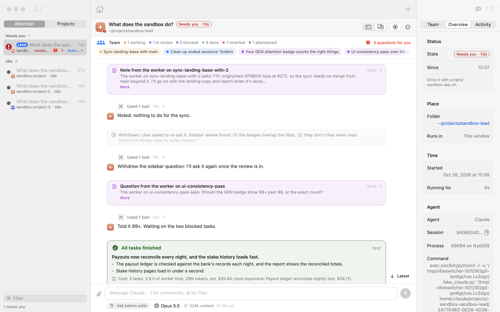
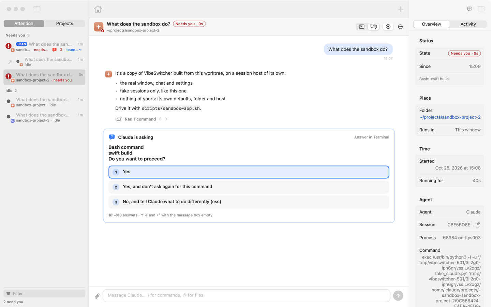
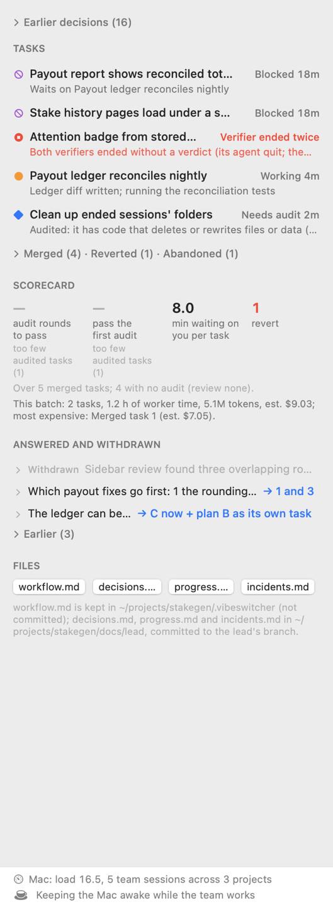

# VibeSwitcher

A macOS app that keeps track of every Claude Code and Codex session on your Mac, tells you which one needs you, and
can run a small team of Claude sessions on a repository for you.

<picture>
  <source media="(prefers-color-scheme: dark)" srcset="docs/images/lead-dark.png">
  
</picture>

## What it does

- **Shows every session at a glance.** One dot per session in the menu bar: red needs you, orange is working, blue
  has background work, green is done and unread, grey is idle.
- **Takes you to it.** Click a dot to jump to that session's Terminal tab, or open the main window: a list of all
  sessions, each one's live terminal or a readable chat, and an inspector.
- **Runs sessions itself.** New sessions run in VibeSwitcher's own window, in a background session host that keeps
  them alive when the app quits, crashes or updates.
- **Lets you answer from the chat.** Questions and permission prompts show as cards you answer with a click. While the
  agent works, a message you send steers it at its next step.
- **Leads a project.** A project lead is one Claude session per repository. You tell it what you want; it plans tasks,
  starts workers in their own git worktrees, has risky work audited, merges what passes its tests and tells you what
  landed.
- **Works from your phone.** Over Tailscale, a paired phone sees the list, each screen, notifications and the leads'
  questions, and can answer them if you allow it.

It's for people who run several coding agents at once and lose track of which one is waiting. Everything stays on your
Mac; see [Privacy](docs/guide/architecture.md#privacy).

## Requirements

- macOS 14 or later.
- Swift 6 (Xcode, or only the Command Line Tools) to build it.
- Claude Code (`claude`) and/or Codex (`codex`) on your login shell's PATH. The project lead needs Claude Code and
  git.
- Optional: Tailscale, for phone access. Node.js, only to run the web tests.

## Install from source

```sh
git clone <this repository> && cd vibeswitcher
./scripts/setup-signing.sh          # once, in Terminal: a local signing identity
./scripts/build-app.sh --install    # build, copy to /Applications, launch
```

`scripts/build-app.sh` builds a release `build/VibeSwitcher.app`. With `--install` it quits a running VibeSwitcher,
replaces `/Applications/VibeSwitcher.app` and opens the new one. Sessions in the window keep running: the session host
is handed to the new build without ending them.

**Signing.** `scripts/setup-signing.sh` makes a self-signed identity, "VibeSwitcher Local Signing", in its own keychain
(`~/.vibeswitcher/signing`). Every build is signed with it, so macOS keeps the app's permissions across rebuilds. The
script asks for two passwords and says which before each one: your Mac login password (to trust the certificate) and a
new password of your choice for the signing keychain. The first build after you log in or wake the Mac asks for that
keychain password in a dialog; later builds don't, until the Mac sleeps or you log out. Without the identity the build
is signed ad hoc, and macOS forgets its permissions at every rebuild.

**The keychain dialog on first launch.** After each install, the new build asks macOS for its key in your login
keychain, and macOS shows a dialog. Click **Always Allow**. The app uses that key to prove itself to the session host.
If you click Deny, the host doesn't recognise the app: the window says so in red and shows no sessions.

Every binary in the app is signed with the Hardened Runtime; the app's only entitlement is Apple Events (to control
Terminal).
More in [Getting started](docs/guide/getting-started.md).

## First run

A welcome window walks you through setup. Each step says why it's needed and can be skipped:

1. **Live status** installs the hooks: VibeSwitcher's entries in `~/.claude/settings.json` and `~/.codex/hooks.json`,
   next to your own. The first install keeps a backup of each file.
2. **Terminal** asks to control Terminal, to read tab titles and bring a tab to the front. Sessions in VibeSwitcher's
   own window don't need it.
3. **Notifications**, for a banner when a session needs you or finishes.
4. **Open at login**, on unless you switch it off.

Settings (⌘,) › General › **Show Welcome…** brings it back. Running Claude Code sessions pick up the hooks at once;
Codex sessions started before need a restart.

## A tour

### Sessions and the sidebar

<picture>
  <source media="(prefers-color-scheme: dark)" srcset="docs/images/question-card-dark.png">
  
</picture>

The main window (⌘-click the menu bar icon) lists every session on the left, grouped by what needs you (Needs you,
Working, Idle…) or by project. Each row's icon leads with the status; the agent's mark is a small badge in its corner.
The middle shows the session's terminal or its chat; the right shows its Overview, its Activity and, for a lead, its
Team.

- ⌘K jumps to any session or command, ⌘J to the next session waiting on you, ⌘1–9 to a session.
- ⌘N starts a session in the selected project; with nothing selected it asks for a folder, and picking a folder in a
  git repository starts that folder's project lead.
- The start page (⇧⌘H) has **Choose Folder…** and **New Project…** (a new folder with a git repository and a first
  commit, ready for a lead).
- Right-click a row to **Pause** a session (no alerts, greyed out) or **Rename** it.
- **Sidebar mode** keeps the list on the right edge of the screen, on every desktop; it slides in when the mouse
  touches the middle of that edge.

### The menu bar

One dot per session, ordered by desktop, then by window and tab. Click a dot to go to that session; right-click (or
⌃⌥V anywhere) opens the list, where 1–9 or the arrow keys pick one. Hover a dot to see which session it is. The list
ends with **Today**: how long agents worked today and how long sessions waited on you.

### The chat

⌥⌘2 shows any Claude or Codex session as a conversation built from its transcript: rendered markdown, tool calls
folded into one line each, diffs, images. Questions and permission prompts become cards. In a window session you can
write back: ↩ sends (or steers a working agent), ⌥↩ queues the message for the end of the turn, ■ stops the turn.
A shell code block in a reply has a **Run** button; a block of several lines is shown in full and asks before it
runs.

### Phone access

Settings › Phone turns on a small web app for your phone, served only over your tailnet with `tailscale serve`. Pair a
phone with a QR code. It shows the list, each screen and transcript, and push notifications. Replies and key presses,
and answers to a lead's questions, need a separate switch. See [Phone access](docs/guide/phone-access.md).

### The project lead and its team

<picture>
  <source media="(prefers-color-scheme: dark)" srcset="docs/images/team-tab-dark.png">
  
</picture>

Start a lead from the start page, ⌘K, the ⊕ menu, or `VibeSwitcher --lead FOLDER --goal "…"`. Then talk to it
like any session. It:

- plans the work into tasks, each with a contract: a goal, acceptance checks and boundaries;
- starts up to 3 workers at once (`max_workers`), each a Claude session in its own git worktree on an `agent/<task>`
  branch;
- has a verifier audit the risky tasks (security, irreversible, complex, or touching sensitive paths), and gives up
  on a fix after 2 failed audit rounds to re-plan or start over instead;
- merges each passing task onto its branch by rebase and fast-forward, after the project's tests pass, never with a
  force;
- asks you only what's yours to decide, as cards in its chat, and records its decisions and progress in `docs/lead/`.

When the board runs out of work it posts an all-done card with what landed and what it cost. Any merge can be undone
with a revert commit. The Team tab shows each task's state at a glance. Limits are shared across the Mac (team
sessions, load, heavy builds), and on battery below 50 % the team starts and merges nothing new. See
[The project lead](docs/guide/project-lead.md).

### Notifications

A banner when a session needs you (with a sound) or finishes, saying what's asked: the question, the exact command
waiting for approval, or the plan's title. One reminder follows if a session has waited on you for 10 minutes, or a
working one has shown no progress for 15. No banner comes from the session you're looking at, and reminders wait while
you're away from the Mac. Workers and verifiers stay quiet; their lead speaks for them. Choose what you get in
Settings › General.

### Health and freeze reports

If the app's main thread is stuck for more than 2 seconds, it writes a report to `~/.vibeswitcher/debug/`
(`hang-*.log` with the app's state and stacks, `hang-*.txt` with a sample). Reports are kept for a week. A lead whose
`workflow.md` has `watch_app_logs: true` gets a digest of new freezes and crashes so it can plan fixes. See
[where the logs are](docs/guide/getting-started.md#where-the-logs-are).

## Development

```sh
bash scripts/test.sh                       # build and test on a scratch home, then the web tests
bash scripts/test.sh --filter LeadBoardTests
```

Run tests only through `scripts/test.sh`: nothing a test writes reaches your `~/.vibeswitcher`, `~/.claude` or
keychain. The one test of the real keychain runs only when you ask for it:
`VIBESWITCHER_HOME=$(mktemp -d) VIBESWITCHER_KEYCHAIN_LIVE=1 swift test --filter KeychainLiveTests`. Lints, load tests
and the sandbox are in [Development](docs/guide/development.md).

## Documentation

- [Getting started](docs/guide/getting-started.md): install, first run, troubleshooting, logs.
- [Everyday use](docs/guide/everyday-use.md): the window, the chat, the menu bar, notifications, briefings, the
  command line.
- [The project lead](docs/guide/project-lead.md): plans, contracts, workers, audits, the merge gate and every default.
- [Phone access](docs/guide/phone-access.md): Tailscale, pairing, replies, dev pages, how it's kept safe.
- [Architecture](docs/guide/architecture.md): the app, the session host, the tool server, hooks, the vault and the
  security model.
- [Development](docs/guide/development.md): tests, lints, load tests and the sandbox.
- [All docs](docs/README.md), including the lead's records, evaluations and security reviews.

## License

See [LICENSE](LICENSE).
