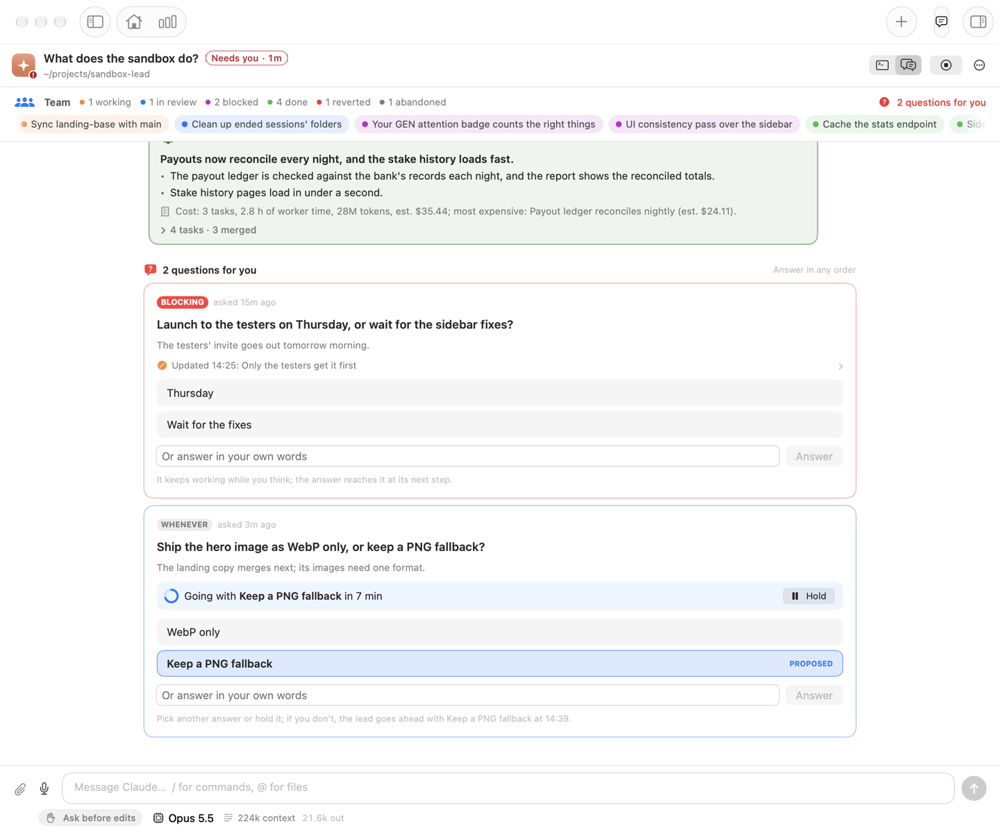
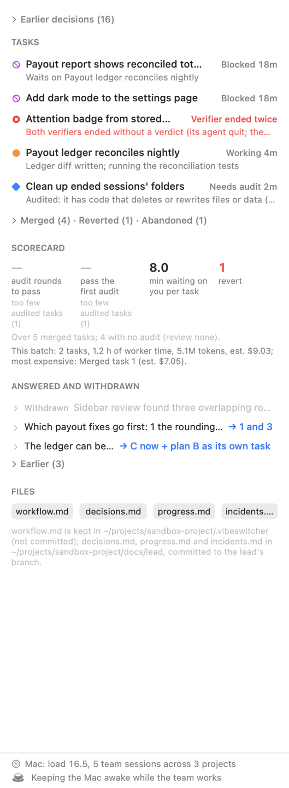
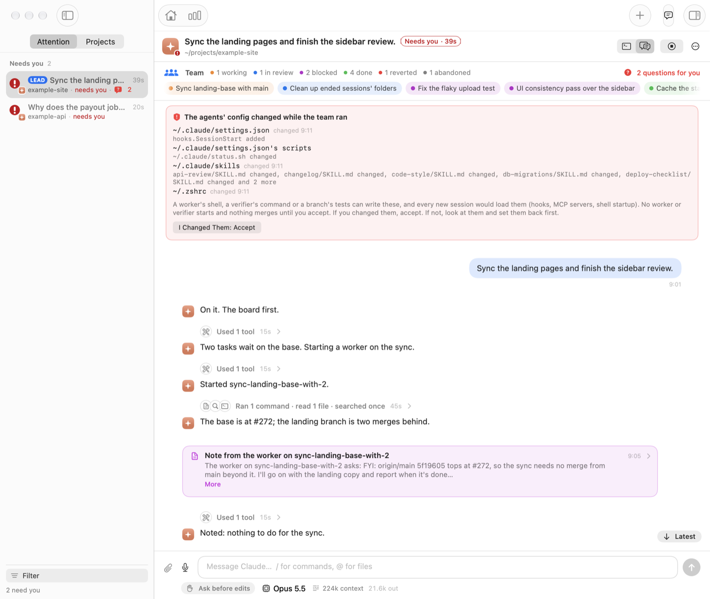
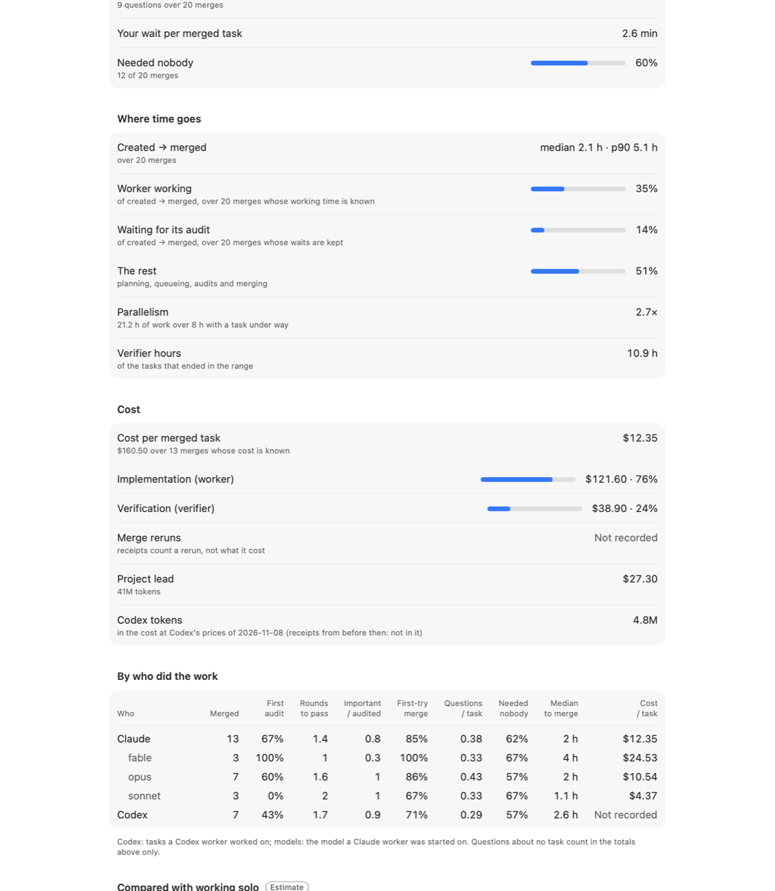
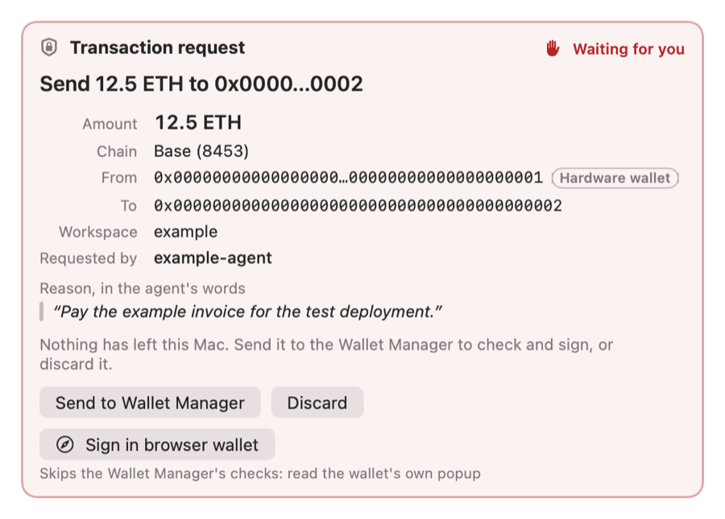
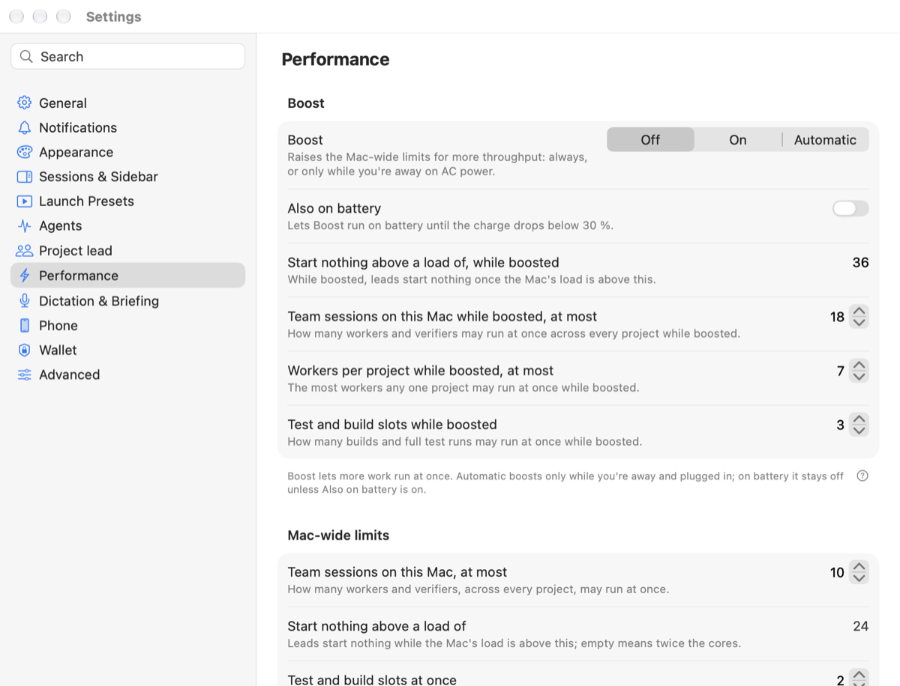
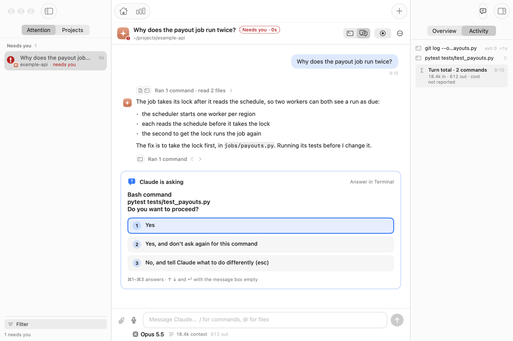

# VibeSwitcher

A macOS app with a project lead that runs a team of coding agents on your repository, on top of tracking every Claude
Code and Codex session on your Mac.

<picture>
  <source media="(prefers-color-scheme: dark)" srcset="docs/images/lead-dark.png">
  
</picture>

## What it does

You tell a project lead what you want. It plans the work, starts workers in their own git worktrees, gets the risky
work reviewed, merges what passes and reports back, and asks you only what's yours to decide. Underneath is the session
switcher it started as: every Claude Code and Codex session on the Mac, with a live status and one click to reach it.

- **Leads a project.** A project lead is one Claude session per repository. It keeps a board of tasks with contracts,
  runs up to 3 workers at once (Claude or Codex), and records its decisions and progress in the repository.
- **Checks work before it lands.** A read-only verifier audits risky changes, a risk check reads each branch's diff,
  and nothing reaches your branch unless the project's tests pass on it.
- **Stops when something looks wrong.** If the agents' own config changes while a team runs, or your branch moves under
  a lead, work waits for your click.
- **Shows every session at a glance.** One dot per session in the menu bar: red needs you, orange is working, blue
  has background work, green is done and unread, grey is idle.
- **Runs sessions itself.** New sessions run in VibeSwitcher's own window, in a background session host that keeps
  them alive when the app quits, crashes or updates.
- **Lets you answer from the chat.** Questions and permission prompts show as cards you answer with a click. While the
  agent works, a message you send steers it at its next step.
- **Works from your phone.** Over Tailscale, a paired phone sees the list, each screen, notifications and the leads'
  questions, and can answer them if you allow it.

It's for people who run several coding agents at once. Sessions and their transcripts stay on your Mac; see
[Privacy](docs/guide/architecture.md#privacy) for what goes where.

## Requirements

- macOS 14 or later.
- Swift 6 (Xcode, or only the Command Line Tools) to build it.
- Claude Code (`claude`) and/or Codex (`codex`) on your login shell's PATH. The project lead needs Claude Code and
  git.
- Optional: Tailscale, for phone access. Node.js, only to run the web tests.

## Install from source

```sh
git clone <this repository> && cd vibeswitcher
./scripts/setup-signing.sh          # once, in Terminal: a local signing identity
./scripts/build-app.sh --install    # build, copy to /Applications, launch
```

`scripts/build-app.sh` builds a release `build/VibeSwitcher.app`. With `--install` it quits a running VibeSwitcher,
replaces `/Applications/VibeSwitcher.app` and opens the new one. Sessions in the window keep running: the session host
is handed to the new build without ending them.

**Signing.** `scripts/setup-signing.sh` makes a self-signed identity, "VibeSwitcher Local Signing", in its own keychain
(`~/.vibeswitcher/signing`). Every build is signed with it, so macOS keeps the app's permissions across rebuilds. The
script asks for two passwords and says which before each one: your Mac login password (to trust the certificate) and a
new password of your choice for the signing keychain. The first build after you log in or wake the Mac asks for that
keychain password in a dialog; later builds don't, until the Mac sleeps or you log out. Without the identity the build
is signed ad hoc, and macOS forgets its permissions at every rebuild.

**The keychain dialog on first launch.** After each install, the new build asks macOS for its key in your login
keychain, and macOS shows a dialog. Click **Always Allow**. The app uses that key to prove itself to the session host.
If you click Deny, the host doesn't recognise the app: the window says so in red and shows no sessions.

**Updating.** In your clone, get the latest and install it:

```sh
git pull
./scripts/build-app.sh --install
```

A clone made before 2026-10-29 is on `project-lead`, the old default branch. That branch is gone (main is now the
only branch), so `git pull` there fails or brings nothing. Move the clone to main once, then update as above:

```sh
git fetch origin --prune && git switch main && git pull
```

Every binary in the app is signed with the Hardened Runtime. The app's entitlements are Apple Events (to control
Terminal) and the microphone (for dictation).
More in [Getting started](docs/guide/getting-started.md).

## First run

A welcome window walks you through setup. Each step says why it's needed and can be skipped:

1. **Live status** installs the hooks: VibeSwitcher's entries in `~/.claude/settings.json` and `~/.codex/hooks.json`,
   next to your own. The first install keeps a backup of each file.
2. **Terminal** asks to control Terminal, to read tab titles and bring a tab to the front. Sessions in VibeSwitcher's
   own window don't need it.
3. **Notifications**, for a banner when a session needs you or finishes.
4. **Open at login**, on unless you switch it off.

Settings (⌘,) › General › **Show Welcome…** brings it back. Running Claude Code sessions pick up the hooks at once;
Codex sessions started before need a restart.

## The project lead

<picture>
  <source media="(prefers-color-scheme: dark)" srcset="docs/images/team-tab-dark.png">
  
</picture>

Start a lead from the start page, ⌘K, the ⊕ menu, or `VibeSwitcher --lead FOLDER --goal "…"`. Then talk to it
like any session. It:

- plans the work into tasks, each with a contract: a goal, acceptance checks and boundaries;
- starts up to 3 workers at once (`max_workers`), each in its own git worktree on an `agent/<task>` branch. A worker is
  a Claude session, or a Codex one for a bounded task (the lead, verifiers and the risk check stay on Claude);
- moves finished work along by itself (`auto_advance`): starts audits, sends findings back, merges what passes;
- asks you only what's yours to decide, as cards in its chat, and records its decisions and progress in `docs/lead/`.

When the board runs out of work it posts an all-done card with what landed and what it cost. The inspector's Team tab
shows each task's state at a glance, and the Team strip above the chat shows it without opening the tab. Leads of
different projects can message each other if you turn that on in Settings › Project lead; every message shows in the
Team tab. See [The project lead](docs/guide/project-lead.md).

### Merge gates and reviews

A task is reviewed at one of two levels, and the lead picks audit for security, irreversible or complex work. Others
get raised to it anyway:

- **The risk check** reads a review-none task's diff before it merges. Over 400 changed lines (`risk_lines`), code that
  deletes or rewrites files, changes permissions, spawns processes or adds locks or threads, a change to the test or
  build setup, or tests taken out: all go to audit. A small Claude model can raise it too. Nothing here can lower it.
- **Sensitive paths** (`.claude/`, `.github/`, `.env`, entitlements and the like) are always audited.
- **A random sample** (10 % by default) of the rest is audited anyway.

An audit is a read-only verifier, on a different model from the workers unless you say otherwise, working from the
contract with real commands. It can run as 1 to 3 finders with different focuses. An Important finding blocks the merge
until it's fixed or dismissed with a reason. After 2 failed rounds the lead re-plans or starts the task over instead of
sending it back again.

A merge takes exactly the commit that was checked, rebases it onto the lead's branch in a worktree no agent works in,
runs the project's tests there and fast-forwards. There's never a force, and any merge can be undone with a revert
commit. `merge_policy` decides what waits for you: `auto`, `ask_sensitive` (how merges go until you choose) or `ask_all`.

The lead can make its project's review rules stricter, not looser: Settings › Project lead › **Review rules floor** sets
the least each project may have. It doesn't push on its own either: it asks, and only your click on the card's
**Push** sends that exact commit, as a fast-forward.

### The config seal and Accept cards

<picture>
  <source media="(prefers-color-scheme: dark)" srcset="docs/images/config-held-dark.png">
  
</picture>

Workers, verifiers and a branch's tests run as you, so they could write what your next session loads: `~/.claude`
settings, hooks, skills and MCP servers, shell startup files, git config, the main checkout's `.git`. The session host
keeps a hash of each. If one changed while the team ran, no new worker or verifier starts and nothing merges until you
click **I Changed Them: Accept** on the card, which names what changed and when. A hook, MCP server or shell startup
file waits for that click whoever changed it. This detects a change; it doesn't prevent one.

If the lead's branch moves by something other than its own merges, its merges are refused until you pick **Accept
These Commits** or **Keep Refused** on a similar card.

### Boost and the Mac-wide limits

Every project on the Mac shares one set of limits, in Settings › Performance: team sessions (10), the load above which
leads start nothing (twice the cores), and test and build slots (the cores ÷ 6). A lead that's refused is told when
there's room again. On battery below 50 %, leads start and merge nothing new; at 80 % of a Claude usage limit they stop
starting work unless you turn on **Ignore usage limits**.

**Boost** raises those limits (load 36, 18 team sessions, 7 workers per project, 3 slots by default, each editable).
It's Off, On or Automatic, which boosts only while you're away and on AC power. An orange bolt shows in the toolbar
while it's on.

### The scorecard and Statistics

<picture>
  <source media="(prefers-color-scheme: dark)" srcset="docs/images/statistics-dark.png">
  
</picture>

The Team tab's scorecard shows four numbers for the lead: audit rounds to pass, the share passing the first audit,
minutes waiting on you per task, and reverts. Every merged task keeps a receipt with its time, tokens and estimated
cost.

The **Statistics** window (the chart button in the toolbar, or Statistics… in the menu bar list's gear menu) covers all
your projects over today, 7 or 30 days: a two-week scorecard, quality, autonomy, where the time goes, cost by who did
the work, an 8-week trend and a per-project table. Figures are shown with how many tasks they're from; a comparison
with working solo is labelled as an estimate.

### Git provenance

The top commit of each merge ends with trailers saying where it came from: `VS-Task`, `VS-Review`, `VS-Worker-Model`,
`VS-Verifier-Model`, `VS-Build` and `VS-Contract` (a hash of the task's contract). They go wherever the commit goes.

```sh
scripts/merge-provenance.sh -n 20          # the last merges: task, review, models, build, contract
```

## Around the lead

### Wallet requests

<picture>
  <source media="(prefers-color-scheme: dark)" srcset="docs/images/wallet-card-dark.png">
  
</picture>

An agent can ask for a blockchain transaction with `vs-wallet request`. It shows as a card saying what the transaction
does, and nothing leaves the Mac until you press **Send to Wallet Manager**, which hands it to a separate Wallet Manager
app (over Passage to another Mac, or on this one) to check and sign. The card can also offer your browser's wallet.
VibeSwitcher never signs or holds a key. Choose where requests go in Settings › Wallet. The format is in
[wallet-request.md](docs/protocol/wallet-request.md).

An agent can also ask to open a shell with `vs-shell run`: its card shows the folder and the exact command, and it runs
when you press **Run**, unless you've let agents open shells without asking in Settings › Agents.

### The phone

Settings › Phone turns on a small web app for your phone, served only over your tailnet with `tailscale serve`. Pair a
phone with a QR code. It shows the list, each screen and transcript, your leads' questions and boards, a spoken
briefing, and push notifications. Replies, key presses, dictation and answers to a lead's questions need a separate
switch. See [Phone access](docs/guide/phone-access.md).

### Dictation and the spoken briefing

Hold the mic button in the composer, or ⌥Space, and let go: the text lands at the cursor and is never sent by itself.
Holding Space in the composer does the same, unless you turn that off. A Claude Code session in the window dictates through
Claude's own `/voice`, with your claude.ai sign-in; anything else records on the Mac and uses OpenAI with your API key.

**Brief me** (⇧⌘B, or ⌥⇧⌘B for one project) tells you in about 30 seconds what happened across your leads: what
landed, what's stuck, what waits on you. ElevenLabs reads it if you've saved a key, else the Mac's own voice does. Both
are set in Settings › Dictation & Briefing.

### Settings

<picture>
  <source media="(prefers-color-scheme: dark)" srcset="docs/images/settings-dark.png">
  
</picture>

Settings (⌘,) has a sidebar of 12 categories: General, Notifications, Appearance, Sessions & Sidebar, Launch Presets,
Agents, Project lead, Performance, Dictation & Briefing, Phone, Wallet and Advanced. Search (⌘F) finds any option. Each
one says what it does in a line, and a **?** next to a section's note has the detail.

## Sessions

### The window and the sidebar

<picture>
  <source media="(prefers-color-scheme: dark)" srcset="docs/images/question-card-dark.png">
  
</picture>

The main window (⌘-click the menu bar icon) lists every session on the left, grouped by what needs you (Needs you,
Working, Idle…) or by project. Each row's icon leads with the status; the agent's mark is a small badge in its corner.
The middle shows the session's terminal or its chat; the right shows its Overview, its Activity and, for a lead, its
Team.

- ⌘K jumps to any session or command, ⌘J to the next session waiting on you, ⌘1–9 to a session.
- ⌘N starts a session in the selected project; with nothing selected it asks for a folder, and picking a folder in a
  git repository starts that folder's project lead.
- The start page (⇧⌘H) has **Choose Folder…** and **New Project…** (a new folder with a git repository and a first
  commit, ready for a lead).
- Right-click a row to **Pause** a session (no alerts, greyed out) or **Rename** it.
- **Sidebar mode** keeps the list on the right edge of the screen, on every desktop; it slides in when the mouse
  touches the middle of that edge.

### The menu bar

One dot per session, ordered by desktop, then by window and tab. Click a dot to go to that session; right-click (or
⌃⌥V anywhere) opens the list, where 1–9 or the arrow keys pick one. Hover a dot to see which session it is. The list
ends with **Today**: how long agents worked today and how long sessions waited on you.

### The chat

⌥⌘2 shows any Claude or Codex session as a conversation built from its transcript: rendered markdown, tool calls
folded into one line each, diffs, images. Questions and permission prompts become cards. In a window session you can
write back: ↩ sends (or steers a working agent), ⌥↩ queues the message for the end of the turn, ■ stops the turn.
A shell code block in a reply has a **Run** button; a block of several lines is shown in full and asks before it
runs.

### Notifications

A banner when a session needs you (with a sound) or finishes, saying what's asked: the question, the exact command
waiting for approval, or the plan's title. One reminder follows if a session has waited on you for 10 minutes, or a
working one has shown no progress for 15. No banner comes from the session you're looking at, and reminders wait while
you're away from the Mac. Workers and verifiers stay quiet; their lead speaks for them. Choose what you get in
Settings › Notifications.

### Health and freeze reports

If the app's main thread is stuck for more than 2 seconds, it writes a report to `~/.vibeswitcher/debug/`
(`hang-*.log` with the app's state and stacks, `hang-*.txt` with a sample). Reports are kept for a week. A lead whose
`workflow.md` has `watch_app_logs: true` gets a digest of new freezes and crashes so it can plan fixes. See
[where the logs are](docs/guide/getting-started.md#where-the-logs-are).

## Development

```sh
bash scripts/test.sh                       # build and test on a scratch home, then the web tests
bash scripts/test.sh --filter LeadBoardTests
```

Run tests only through `scripts/test.sh`: nothing a test writes reaches your `~/.vibeswitcher`, `~/.claude` or
keychain. The one test of the real keychain runs only when you ask for it:
`VIBESWITCHER_HOME=$(mktemp -d) VIBESWITCHER_KEYCHAIN_LIVE=1 swift test --filter KeychainLiveTests`. Lints, load tests
and the sandbox are in [Development](docs/guide/development.md).

## Documentation

- [Getting started](docs/guide/getting-started.md): install, first run, Settings, troubleshooting, logs.
- [Everyday use](docs/guide/everyday-use.md): the window, the chat, the menu bar, notifications, dictation, briefings,
  Statistics, the command line.
- [The project lead](docs/guide/project-lead.md): plans, contracts, workers, audits, the merge gate, the config seal,
  provenance and every default.
- [Phone access](docs/guide/phone-access.md): Tailscale, pairing, replies, dictation, dev pages, how it's kept safe.
- [Architecture](docs/guide/architecture.md): the app, the session host, the tool server, hooks, the vault and the
  security model.
- [Development](docs/guide/development.md): tests, lints, load tests and the sandbox.
- [All docs](docs/README.md), including the lead's records, evaluations and security reviews.

## License

See [LICENSE](LICENSE).
