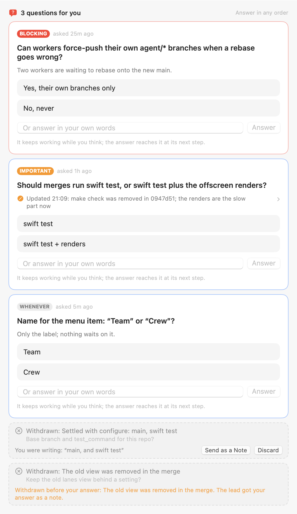
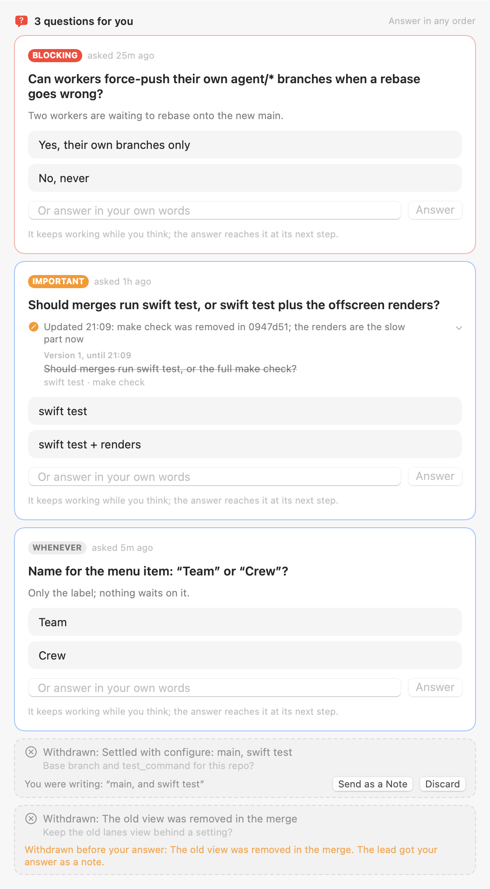
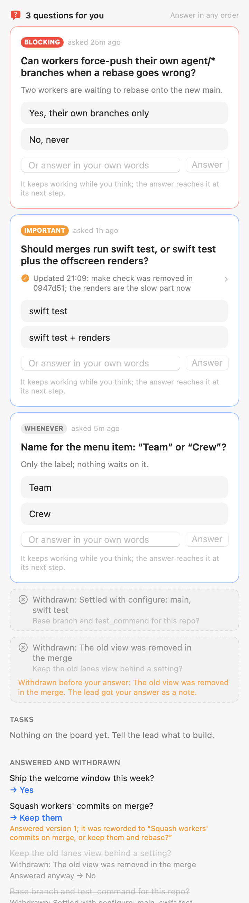

# The lead's questions as a queue

Stack | Earlier wording open | Team tab
--- | --- | ---
 |  | 

Dark: `questions-*-dark.png`. The strip over the lead's chat: `questions-team-strip-*.png`.

**How they were made.** Offscreen, from `LeadQuestionStack`, `LeadTeamView` and `TeamStrip`, each hosted in a
borderless window far off every display and drawn with `cacheDisplay` (text fields and buttons are AppKit views,
which `ImageRenderer` leaves out). The board: a blocking question with a why-now line, one the lead revised
(its "Updated 21:09: …" line, the earlier wording folded and open), one that can wait, one withdrawn while you were
writing an answer (send it as a note, or discard it), and one withdrawn before your answer landed (the card says so;
the lead got it as a note). The Team tab's history shows an answer to an earlier wording and the withdrawn ones.

Regenerate: `QUESTION_SNAPSHOT_DIR=$PWD/docs/eval/questions swift test --filter LeadQuestionSnapshots`.

What the lead has:

- `ask_user(question, options?, priority?, why_now?)`: priority is blocking, important (the default) or whenever.
  Only blocking ones add to the Dock badge.
- `revise_question(id, text?, options?, note)`: same id, the earlier wording kept; an answer to an earlier version
  tells the lead which wording was answered.
- `withdraw_question(id, reason)`: the card collapses to "Withdrawn: <reason>" for half an hour, out of every count.
- `questions`: open (most important, then oldest, first), answered and withdrawn, each with its history.
- `status` lists open questions with priority and age, and asks "still relevant?" of any untouched for over an hour.
