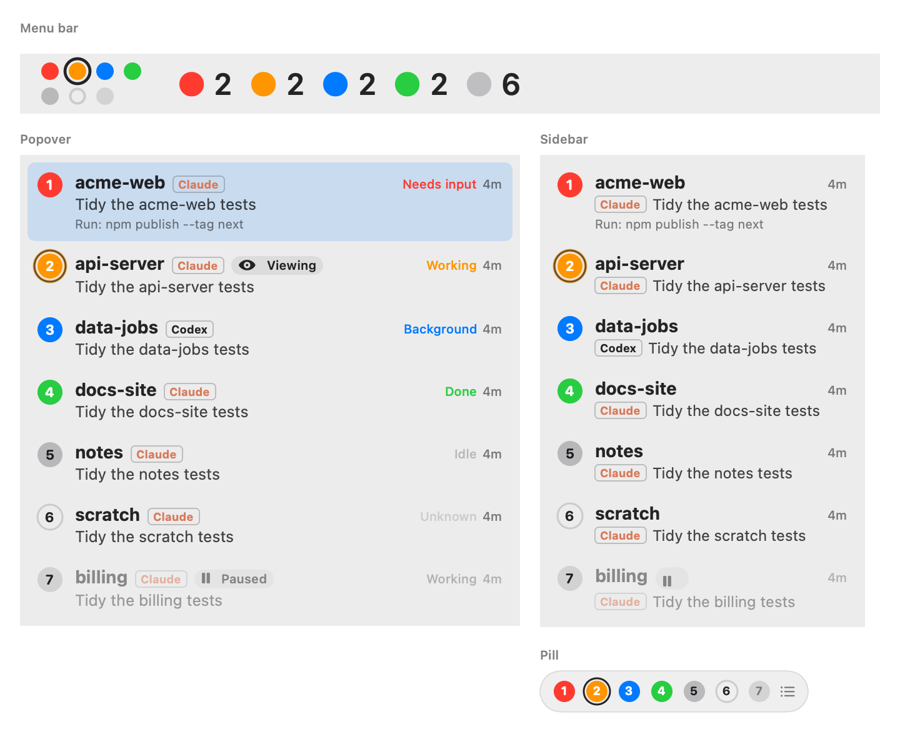
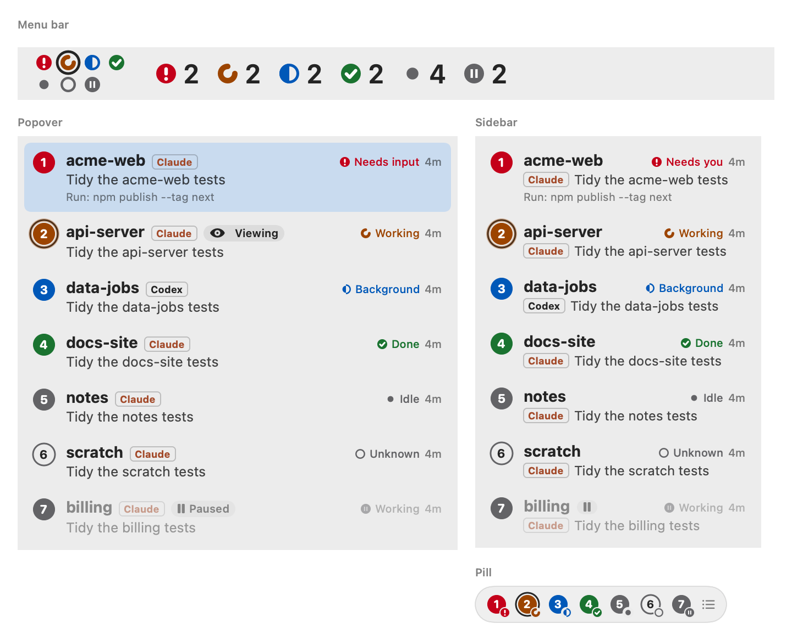
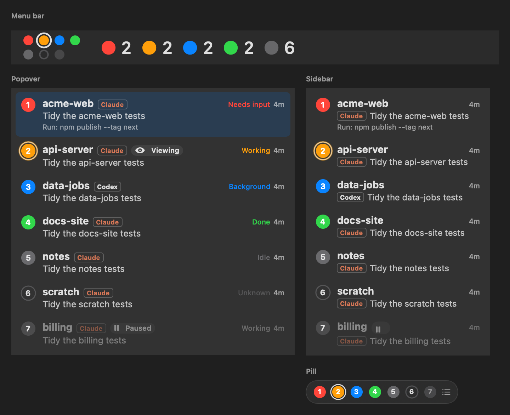
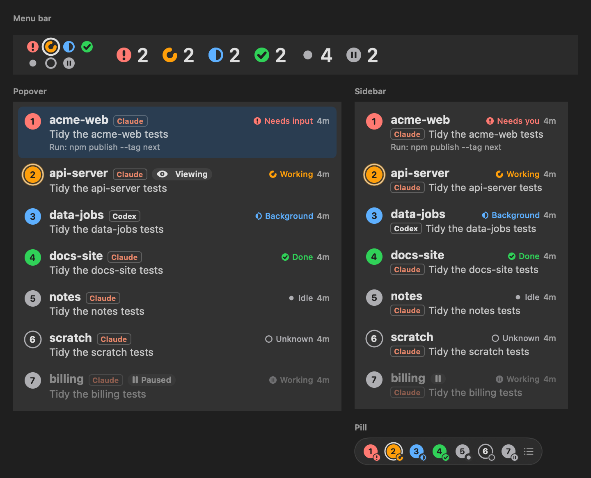
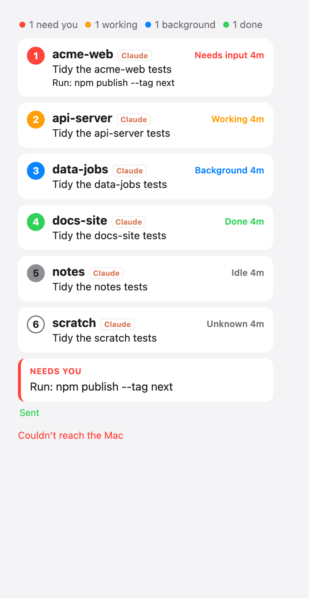
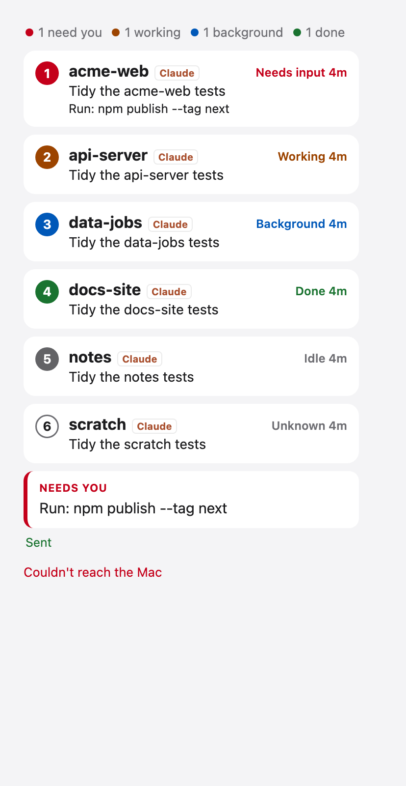
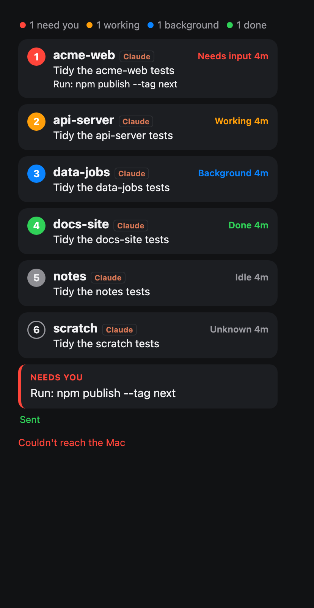
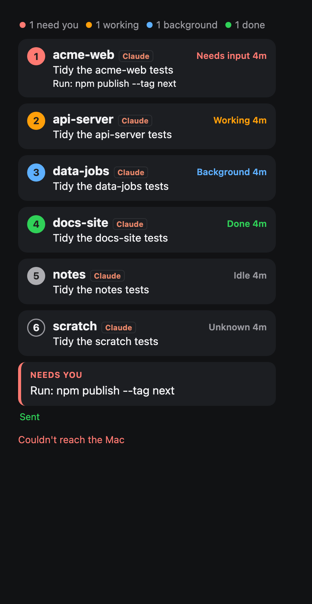

# Accessibility: labels, status beyond colour, contrast, motion

Fixes `MB-1`, `MB-2`, `SB-1`, `PI-1`, `PH-2` and `AX-1`, `AX-2`, `AX-5`, `AX-6` from [the UX report](../ux.md#accessibility).

## Pictures

| | Before | After |
| --- | --- | --- |
| Mac, light: menu bar (dots, and counts past 12), popover, sidebar, pill |  |  |
| Mac, dark |  |  |
| Phone, light |  |  |
| Phone, dark |  |  |

Mac pictures: `STATUS_SNAPSHOT_DIR=… STATUS_SNAPSHOT_NAME=status-after swift test --filter StatusSnapshots` (the real
`StatusIcon`, `SessionRow` and pill views, drawn offscreen). Phone pictures: a static page with the list's markup
(badges, status words, the ask card) on `Web/style.css` as of before and after, screenshotted in headless Chrome.

## What changed

- **Shapes** (`StatusMark`, `MenuBarDots.swift`): needs you is a disc with "!", working a ¾ spinner arc, background a
  half-filled ring, done a disc with a check, idle a smaller dot, unknown an empty ring, paused a disc with two bars.
  Drawn in the menu bar dots and counts, next to the status word in popover and sidebar rows, on the corner of each
  pill dot and in the window's agent marks.
- **Words**: the sidebar keeps the status on its first line ("Needs you", "Working"). VoiceOver hears the menu bar item
  as "VibeSwitcher: 2 need you, 3 working", each popover/sidebar row and pill dot as "1, acme-web, needs input", and
  the agent mark as "Claude, needs input".
- **Labels**: every icon-only control in the AX-1 table has an accessibility label and a tooltip; decorative symbols
  are hidden from VoiceOver. `AccessibilityLintTests` fails on any new SF Symbol in `Sources/VibeSwitcher` that's
  neither labelled nor hidden, and on any animation that doesn't check Reduce Motion.
- **Contrast** (`StatusPalette`, shared by the Mac and the phone): darker inks in light mode, the bright system colours
  in dark mode, white numbers in light-mode badges and near-black in dark ones.
- **Reduce Motion**: the sidebar appears and goes without sliding and no longer flashes on desktop switches; the
  inspector collapses at once; chat scrolls (Latest, search matches, scroll-to-bottom) jump; tool groups open without
  animating. The phone turns off animations, transitions and smooth scrolling under `prefers-reduced-motion`.

## Measured ratios (WCAG 2)

Status text, marks and badge fills, against the app's backgrounds, and the number inside a badge on its fill:

| Status | Light ink | on #ECECEC / #FFFFFF / #F4F4F6 | white in badge | Dark ink | on #323232 / #1E1E1E / #1C1E22 / #111214 | #1F1F1F in badge |
| --- | --- | ---: | ---: | --- | ---: | ---: |
| Needs input | `#C4001A` | 5.29 / 6.25 / 5.69 | 6.25 | `#FF7A72` | 5.05 / 6.57 / 6.58 / 7.39 | 6.50 |
| Working | `#9C4400` | 5.49 / 6.48 / 5.90 | 6.48 | `#FF9F0A` | 6.24 / 8.11 / 8.12 / 9.12 | 8.02 |
| Background | `#0058B8` | 5.76 / 6.80 / 6.19 | 6.80 | `#5EB0FF` | 5.57 / 7.25 / 7.26 / 8.15 | 7.17 |
| Done | `#1A7330` | 5.02 / 5.93 / 5.40 | 5.93 | `#30D158` | 6.34 / 8.25 / 8.26 / 9.27 | 8.15 |
| Idle / Unknown | `#636366` | 5.07 / 5.99 / 5.45 | 5.99 | `#AEAEB2` | 5.80 / 7.54 / 7.55 / 8.48 | 7.45 |

Before: systemOrange / systemGreen text 1.86 / 1.88 on the light popover, white on them 2.0–2.2, web `#30d158` /
`#ff9f0a` on white 2.02 / 2.06. The "Claude" tag: `#A34A2A` 4.98 on #ECECEC (Mac light), `#A9502F` 5.42 / 4.93 on the
phone's white card / page, `#E8876A` 4.95 on #323232 and 6.44 on the phone's dark card. `StatusAccessibilityTests`
checks every pair above for the Mac palette and parses `Web/style.css` to check the phone's, in light and dark.

## Left

- `AX-3` (tap gestures to buttons), `AX-4` (text styles, 11 pt floor) and Increase Contrast aren't part of this change.
- Text drawn in `.tertiary` (footer hints, durations) and the accent blue used as text on the phone (`#0a84ff`, 3.65 on
  white) aren't status colours and are unchanged.
