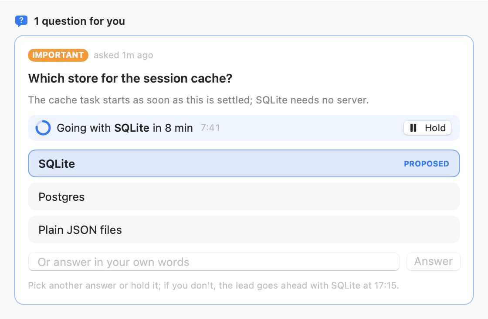
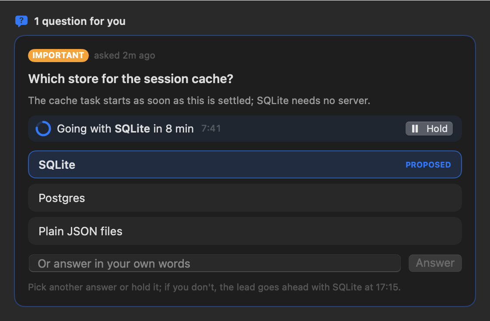
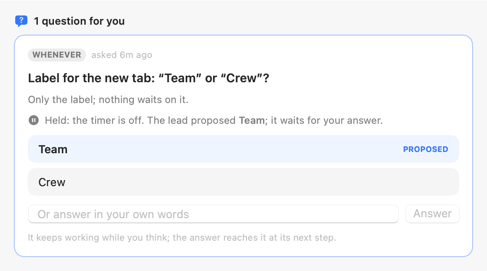
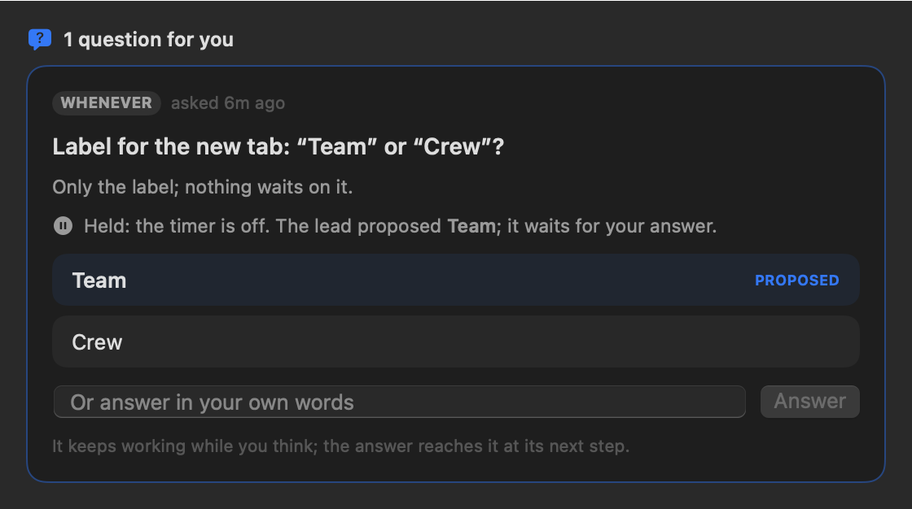
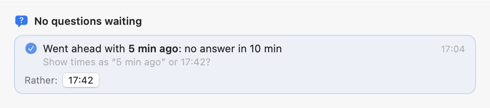
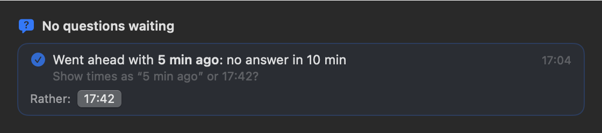

# Decisions with a timer

Light | Dark
--- | ---
 | 
 | 
 | 

Also: `late-answer-*` (answered after the lead went ahead: the answer reached it as a note), `stack-*` (all of them in
one "Questions for you" stack, as the chat shows it), `counting-narrow-*` (the inspector's column, where the seconds
are left out so the line doesn't wrap).

**How they were made.** Offscreen, in a borderless window far off every display, from the app's own
`LeadQuestionStack`, not from a screen capture; the board is built by `DecideTimerSnapshots.scene` with the
question asked 2 min 18 s before drawing, so its 10-minute timer reads "in 8 min". The chat column is drawn 560 pt
wide, the inspector 360 pt.

Regenerate: `DECIDE_TIMER_SNAPSHOT_DIR=$PWD/docs/eval/ux-fixes/decide-timer swift test --filter DecideTimerSnapshots`.

What it shows:

- **Counting down.** The proposal is the highlighted option, marked PROPOSED; above the options, "Going with
  **SQLite** in 8 min", a ring that empties as the time runs out, the minutes and seconds left, and Hold. The note at
  the bottom says when the lead goes ahead. Picking any option (the proposal too) answers now.
- **Held.** The timer is off: one line says so and names the proposal, which stays marked but no longer stands out;
  the question waits for your answer like any other, and the lead was told not to go ahead.
- **Auto-decided.** No answer in time: the card folds into one line, "Went ahead with **5 min ago**: no answer in
  10 min", with the question under it and the other options ("Rather: 17:42") to tell the lead you'd have chosen
  otherwise. It stays in the stack for 30 minutes, like a withdrawn question, and shows under "Answered and
  withdrawn" after that. The lead got exactly one message, "No answer in 10 min: going with your proposal
  ‘5 min ago’", and the decision is in `decisions.md`, so it shows (and fades) in the Team tab's decisions.
