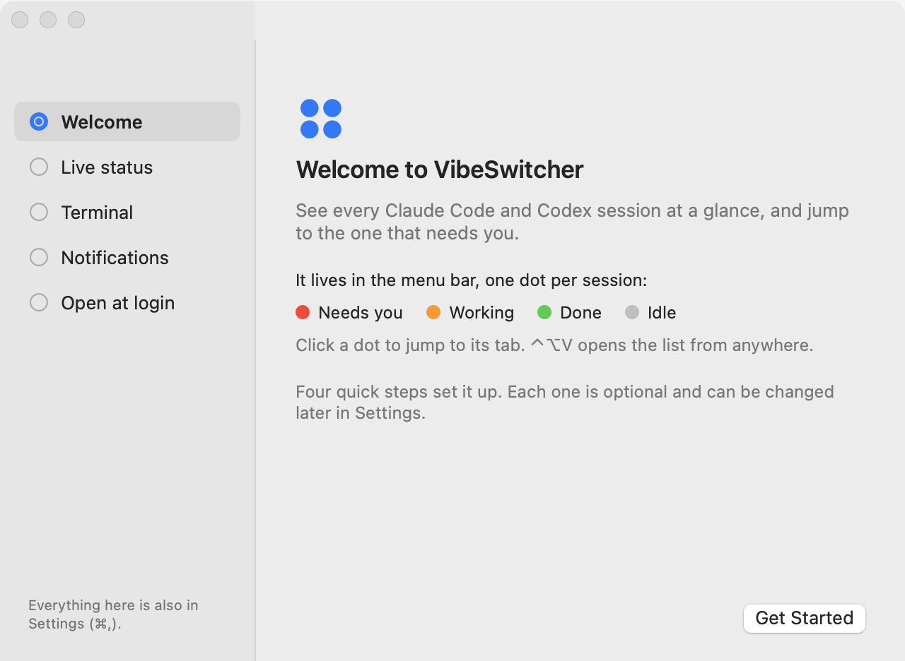
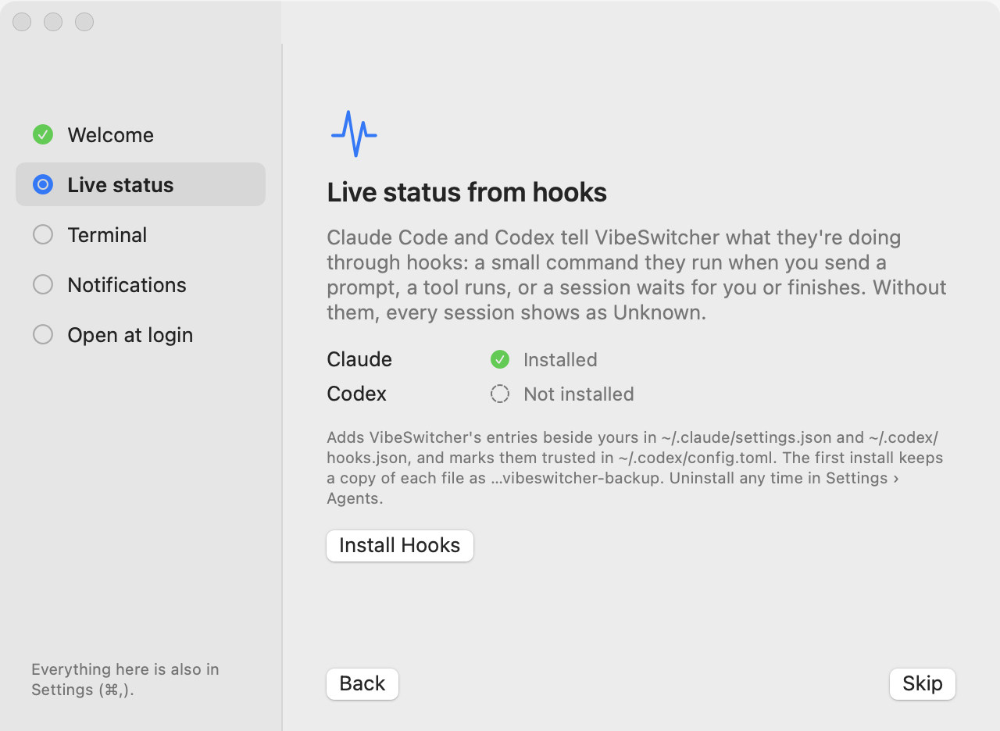
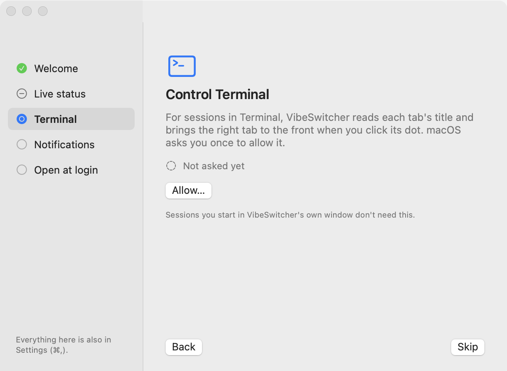
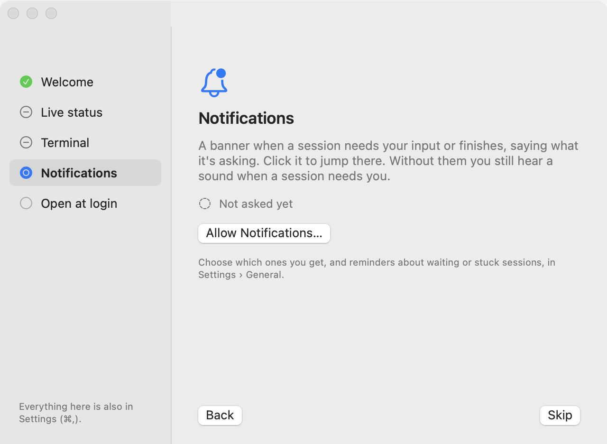
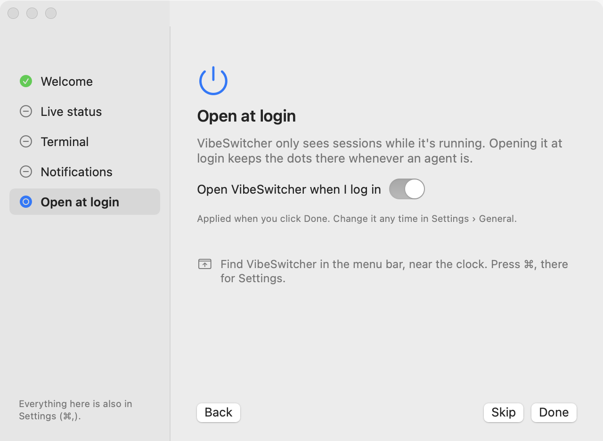
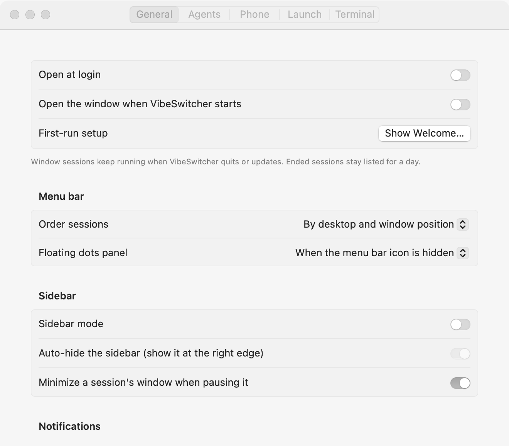
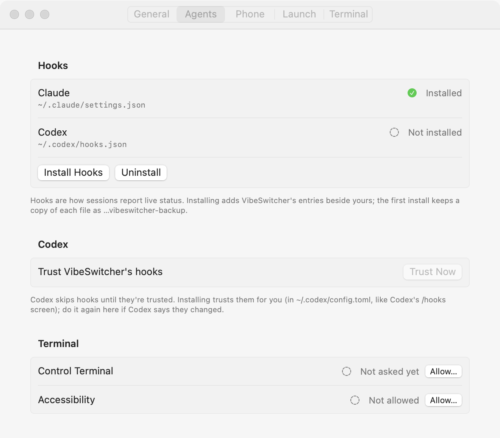
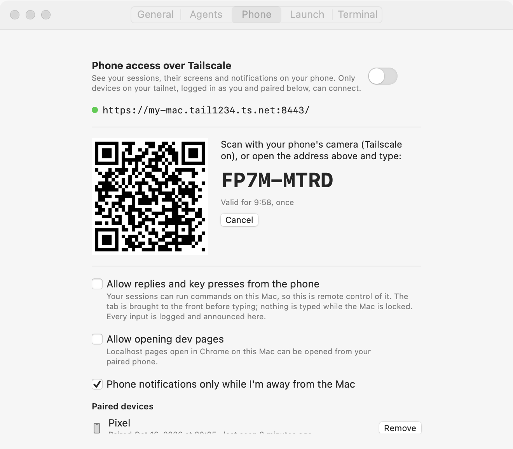
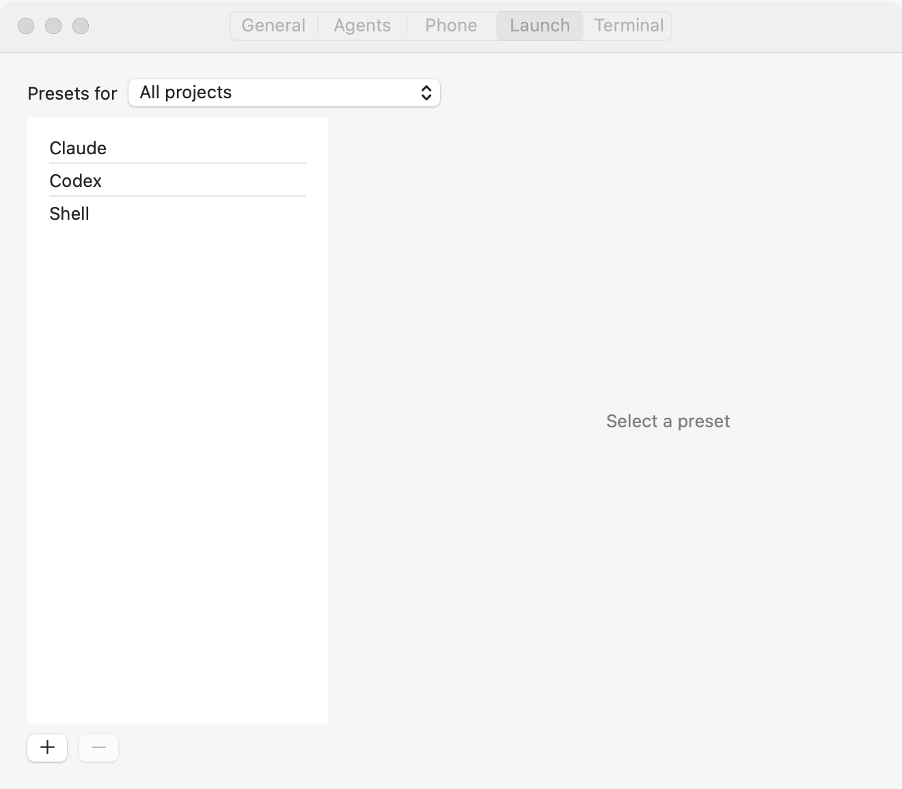
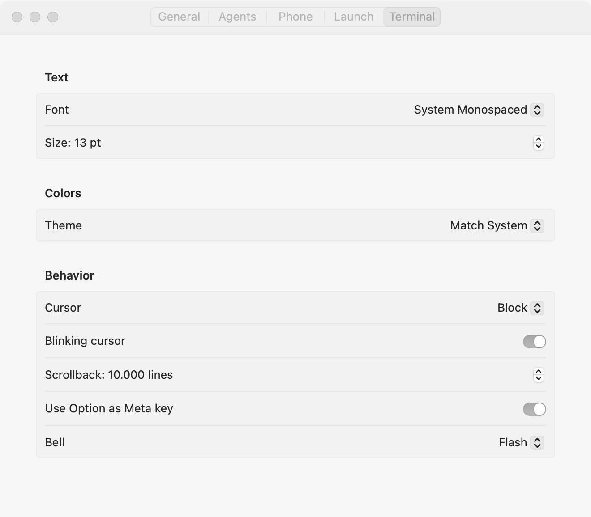

# First run and one Settings window (ON-1, ST-1)

Welcome | Live status | Terminal | Notifications | Open at login
--- | --- | --- | --- | ---
 |  |  |  | 

General | Agents | Phone | Launch | Terminal
--- | --- | --- | --- | ---
 |  |  |  | 

Dark: `welcome-*-dark.png`, `settings-*-dark.png`. Tabs that scroll are also drawn scrolled to their end
(`settings-general-end-*`, `settings-agents-end-*`, `settings-phone-end-*`).

**How they were made.** Offscreen, from the real views (`OnboardingView`, `SettingsView`) in real `NSWindow`s
placed 30,000 pt off every display, drawn with `cacheDisplay` so the switches, pickers and grouped forms are
AppKit's own. Like the audit's renders, the window is inactive, so prominent and default buttons are drawn grey or
white rather than in the accent colour. The state is fixed: Claude Code's hooks installed and Codex's not, Terminal
control not asked yet, notifications not asked yet (welcome) or turned off (Settings), Phone Access in its
`--snapshot` sample state. The test refuses to draw unless `HOME` and `CFFIXED_USER_HOME` point at a scratch folder,
and it uses its own defaults suite, so nothing touches the real preferences, presets or hook configs:

```sh
swift build --build-tests
H=$(mktemp -d)
HOME=$H CFFIXED_USER_HOME=$H SETUP_SNAPSHOT_DIR=$PWD/docs/eval/ux-fixes swift test --skip-build --filter SetupSnapshots
```

## What changed

- **A welcome window on first launch** (`Onboarding.swift`). Shown only when VibeSwitcher has never run on this
  Mac: no `~/.vibeswitcher/state` (checked before launch creates it), no VibeSwitcher hooks in either agent's
  config, and neither `welcomeShown` nor the old `didSetUpLoginItem` key set. Five pages with a rail that shows each
  step's live state (done, skipped, current, to do), re-read every second while the window is open, since
  permissions change in System Settings:
  1. **Welcome**: what VibeSwitcher does, the dot legend, where it lives.
  2. **Live status**: why hooks, per-agent state, exactly which files change (`~/.claude/settings.json`,
     `~/.codex/hooks.json`, trust in `~/.codex/config.toml`), the one-time backup, where to uninstall. Install Hooks
     calls the same `HookSetup.installAll()` as the popover banner and `--install-hooks`.
  3. **Terminal**: why Terminal control; Allow… asks macOS (`AEDeterminePermissionToAutomateTarget`, opening
     Terminal first if it isn't running, since macOS can only ask about a running app); once denied, the button
     opens Privacy & Security › Automation.
  4. **Notifications**: why; Allow Notifications… shows macOS's prompt, or System Settings once it was answered.
  5. **Open at login**: a switch, on by default, applied only when the user clicks Done. Skip leaves the login
     item alone.

  Every step has Skip (and Back); the window can be closed at any point; Settings › General › Show Welcome… opens it
  again.
- **No more silent first-launch side effects.** `Preferences.setUpLoginItemOnFirstLaunch` is gone (the login item
  is the welcome's last step and a Settings switch), and launch reads the notification permission instead of
  prompting for it. Because macOS may now not have asked yet, the popover's "Notifications are off · Turn on…"
  button asks first when it hasn't (System Settings doesn't list an app that never asked).
- **One Settings window** (`SettingsWindow.swift`, 660×540, so Terminal's last row is no longer clipped):
  - **General**: open at login, open the window at launch, Show Welcome…; menu bar order and the floating dots
    panel (the pill); sidebar mode, auto-hide, minimize on pause; notifications (permission state and button,
    needs input, finished, sound, reminders).
  - **Agents**: hooks per agent with config path and live state, Install/Reinstall and Uninstall; Codex trust
    (Trust Now); Control Terminal and Accessibility with state and Allow….
  - **Phone**: the Phone Access view (the separate Phone Access window is gone; `--settings phone` opens it).
  - **Launch**, **Terminal**: unchanged.
- **The ⚙︎ menu** keeps three quick toggles that are also in Settings (notify on needs input, notify on finish,
  sidebar mode), Settings… and Quit. Reinstall hooks, Phone Access…, order, pill, login and the rest moved to
  Settings.
- **Stored values are untouched**: every preference keeps its `UserDefaults` key. `SetupTests` writes each old key
  with a non-default value into a fresh suite and reads it back through `Preferences`, checks Settings writes under
  the same keys, that `--settings general|launch|terminal` still parse, and the first-run decision.
