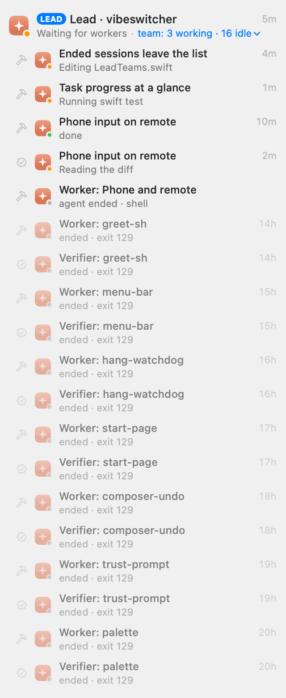
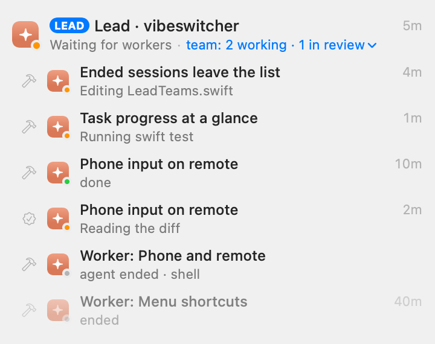

# A lead's group after WL-1 / WL-4 (ended sessions of finished tasks)

Before | After
--- | ---
 | 

Dark: `lead-group-*-dark.png`.

**How they were made.** Offscreen, with SwiftUI's `ImageRenderer`, from the window list's own `WindowRowView` and
`LeadTeams.arrange`: the lead row with its team open, not a screen capture (and so without the sidebar's selection
and list chrome). The scenario is the user's screenshot of 2026-10-17: fourteen workers and verifiers of merged
tasks, ended with exit 129 (the SIGHUP of a normal cleanup), two workers working, one task in review (its worker
done, its verifier reading), and a worker whose agent quit and left its shell ("agent ended · shell"). The after
picture adds one worker the lead stopped (its task blocked) to show how a normal end reads now. Drawn 320 pt wide
before and 360 pt after (the sidebar is 260–380): at 320 the activity and the team summary share one truncated line
(WL-2, not fixed here).

Regenerate: `LEAD_SNAPSHOT_DIR=$PWD/docs/eval/ux-fixes LEAD_SNAPSHOT_NAME=lead-group-after swift test --filter LeadGroupSnapshots`.

What changed:

- **Finished tasks' sessions leave.** When a task is merged or abandoned, its ended workers and verifiers are
  dropped by the session host, so they leave the window list, the popover, the sidebar and the phone alike. The
  lead's `cleanup` asks the host to forget every ended worker and verifier of the task's worktree (earlier ones
  too); `LeadController` does the same for any task the board shows as done, or failed with its worktree removed
  (`LeadTeams.finished`). Ended sessions of tasks still under way stay under the lead (why one died is worth a
  look), and ended sessions outside a lead's team keep the day's retention.
- **The summary counts live tasks.** "team: 3 working · 16 idle" counted every row, ended ones as idle. Now it
  counts the tasks with a live member, a worker and its verifier being one task, in the board's words where it has
  them: needs you, working, in review, done, idle ("team: 2 working · 1 in review"). A session whose agent quit
  isn't live. With nothing live: "team: none running" (`LeadTeams.summary`).
- **A normal end isn't a failure.** In the team, exit 129 and 143 (the hangup or terminate that ending a session
  sends) read "ended" and exit 0 "finished"; other codes still show ("ended · exit 1") (`LeadTeams.state`).
- **The witness sees "agent ended · shell".** A worker whose agent process quit while its shell lives on is told to
  the lead as ended without reporting, as when its session exits, and a verifier's as ended without a verdict
  (`LeadWitness.Seen.agentQuit`, from `HostSession.agentQuit`, the same test the row uses).
