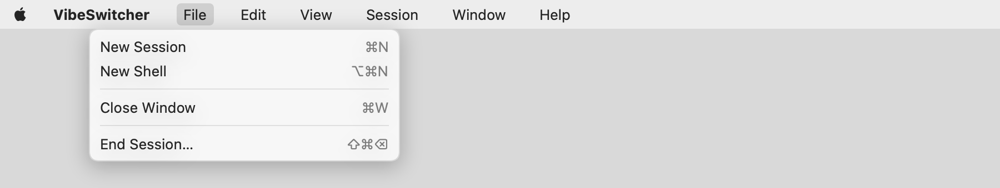
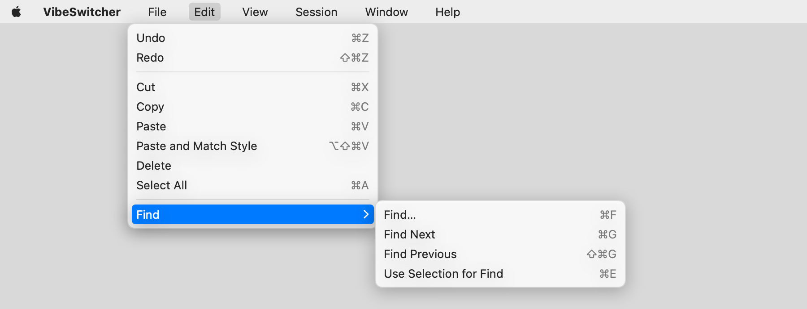

# Menus after WX-1 / WX-2

  
Dark: `menu-*-dark.png`. Also the app menu (`menu-vibeswitcher-*`), View and Session.

**How they were made.** Offscreen, from the menu bar the app installs (`MainMenu.build()`): titles, shortcuts,
separators and submenus are the built `NSMenuItem`s, drawn with SwiftUI's `ImageRenderer` in a menu-like frame,
light and dark. Not a screen capture (Screen Recording isn't granted to this shell, and popping real menus would
take the keyboard from whoever is at the Mac), so the styling is an approximation of AppKit's and every item is
drawn enabled (nothing validates them offscreen). At run time AppKit also adds to these menus: Writing Tools,
AutoFill, Start Dictation and Emoji & Symbols to Edit, the window list to Window, and the search field to Help.

Regenerate: `MENU_SNAPSHOT_DIR=$PWD/docs/eval/ux-fixes swift test --filter MenuSnapshots`.

What changed:

- **File**: ⌘W is Close Window (also closes the ⌘K palette). End Session… moved to ⇧⌘⌫ and always asks, idle or
  not, unless the session has ended (`AppDelegate.endSessionQuestion`).
- **Edit**: Undo, Redo, Cut, Copy, Paste, Paste and Match Style, Delete, Select All, and a Find submenu (⌘F, ⌘G,
  ⇧⌘G, ⌘E; enabled only when a conversation or terminal is shown). All go through the responder chain. The
  composer has its own undo history, emptied when its text is replaced from outside (sent, another session's
  draft, a history step): before that, ⌘Z after sending raised an `NSRangeException`.
- **App menu**: About, Settings… ⌘,, Services, Hide ⌘H, Hide Others ⌥⌘H, Show All, Quit ⌘Q.
- **Window**: Minimize ⌘M, Zoom, Bring All to Front, and AppKit's window list (`NSApp.windowsMenu`).
- **Help**: the menu search field (`NSApp.helpMenu`).
- `MainMenuTests.noTwoItemsShareAShortcut` collects every key equivalent and fails on duplicates.
