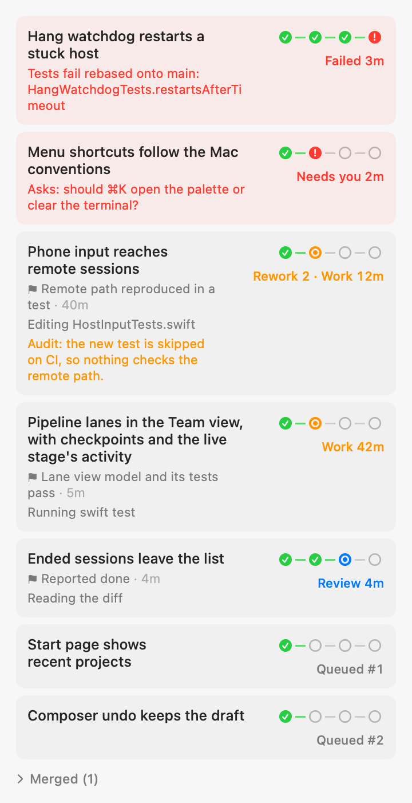
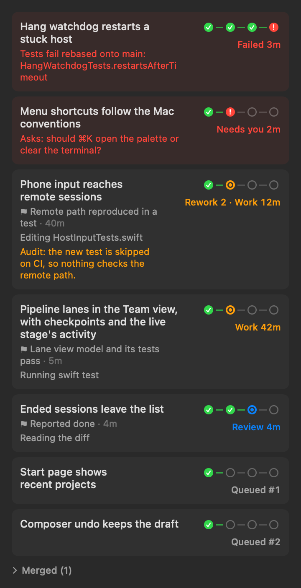

# The lead's Team view as pipeline lanes

Light | Dark
--- | ---
 | 

Opened (a reworked task and a merged one): `team-lanes-expanded-*.png`. Each state alone: `lane-running-*`,
`lane-rework-*`, `lane-review-*`, `lane-needs-you-*`, `lane-failed-*`, `lane-merged-*`, `lane-queued-*`. The live ring,
pulsing and with Reduce Motion: `lane-live-ring-*`. The lead row's team summary now comes from the board:
`lead-group-after-*`.

**How they were made.** Offscreen, with SwiftUI's `ImageRenderer`, from the Team tab's own `LaneList` and
`LeadLanes`, not from a screen capture. The pulsing ring is drawn at its first frame. Drawn 360 pt wide (the inspector
is about that wide).

Regenerate: `LANE_SNAPSHOT_DIR=$PWD/docs/eval/ux-fixes swift test --filter LeadLaneSnapshots`.

What it shows:

- **One row per task, the whole title.** It wraps and is never cut. Under it: the worker's latest checkpoint (from
  its `progress` tool) with its age, what the session at the live stage is doing now, and in red why it failed or
  what it waits on. While the task is reworked, the same line shows in orange why it last failed.
- **The lane: Plan → Work → Review → Merge.** A done stage is filled green, the live stage has a ring around a dot
  (pulsing; with Reduce Motion a still halo), a stage not reached yet is hollow, and a red node marks a failure or
  a session waiting on you. Click Work to open the worker, or Review to open the verifier.
- **The state in words, and how long it's been there.** For example `Work 42m`, `Rework 2 · Work 12m`, `Review 4m`,
  `Merge 3m` (audit passed), `Needs you 2m`, `Failed 3m`, `Blocked`, `Queued #1`, `Merged ✓`.
- **What's happening now, not the last verdict.** A failed task whose worker is working again is in Work, with its
  rework round and the last failure's reason under it. It turns red only with no worker at work. The board counts
  the rounds (`attempts`): messaging the live worker of a failed task, or starting a new one on it, starts a round.
- **Order.** Needs you, live, in review, queued (in the order they'll start), then a folded `Merged (n)`.
- **Opened**, a row shows the contract, the checkpoints with their times, the worker's report, the audit (or the
  last failed one), and the merge commit with whether the test command ran.
- **VoiceOver** reads a lane as one line: "Pipeline lanes in the Team view: Work, 42 minutes, Lane view model and its
  tests pass". Actions open the worker or the verifier.
- **The sidebar (WL-1, WL-4).** The lead row's "team: 1 needs you · 2 working · 1 in review · 3 queued" counts the
  board's tasks, so a worker that hasn't begun isn't idle. A window session that has started but whose agent hasn't
  shown up yet reads "Starting…". The team folding leaves out ended workers and verifiers of finished tasks at
  once, before the host has forgotten them.
