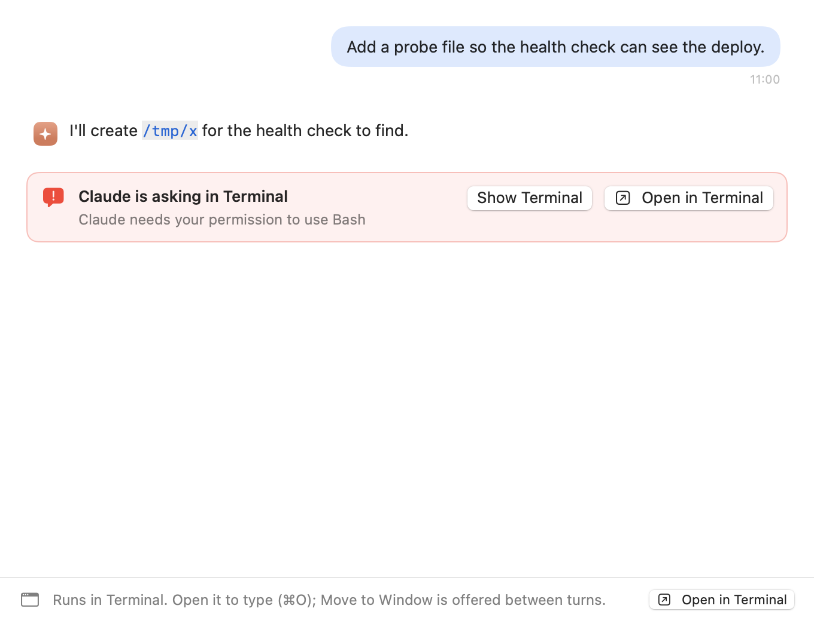
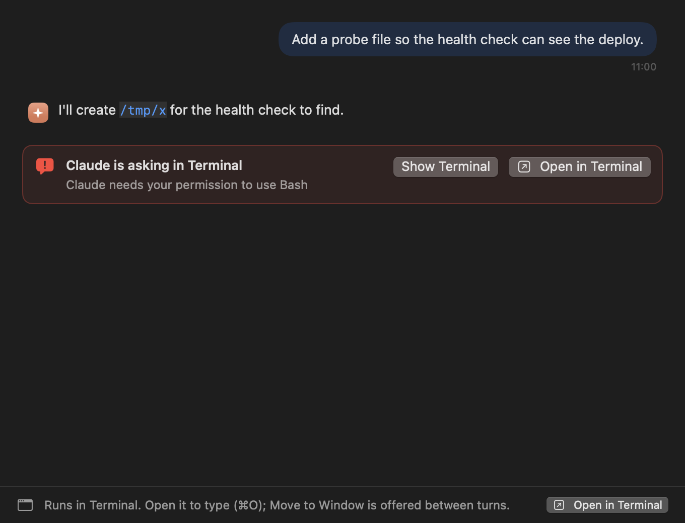
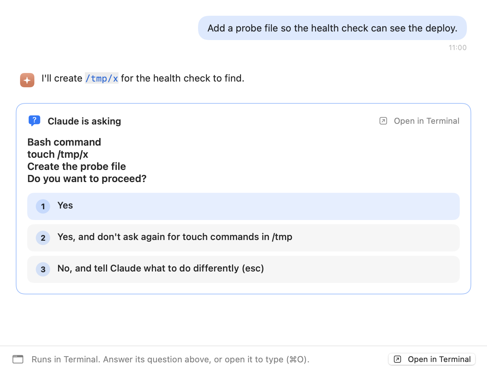
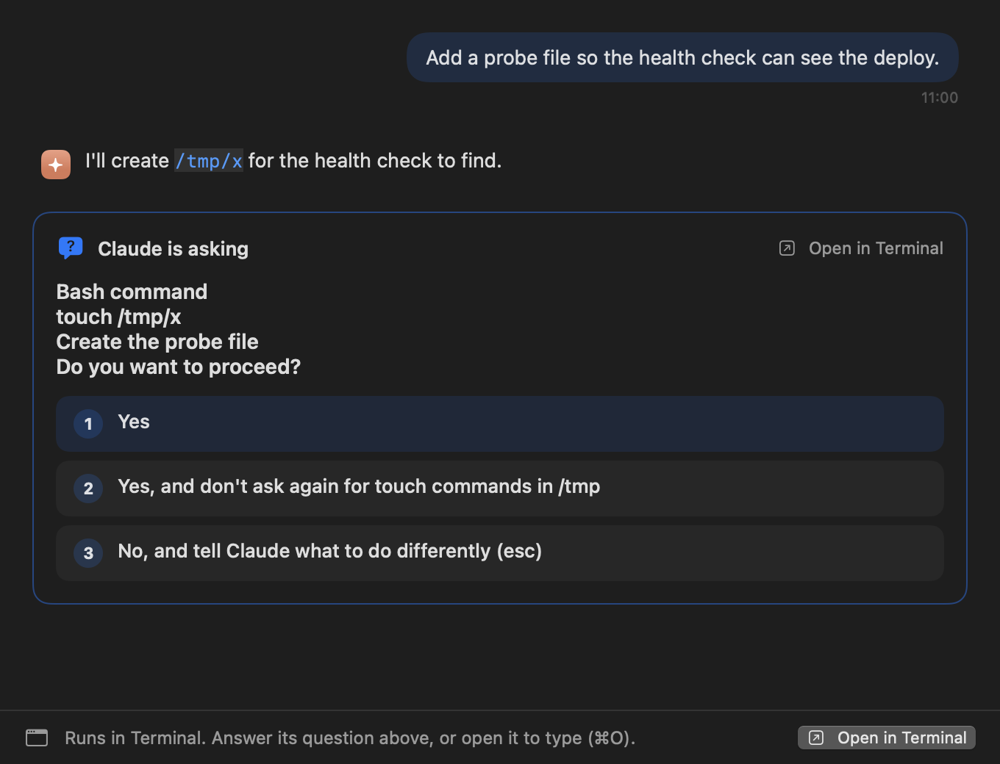
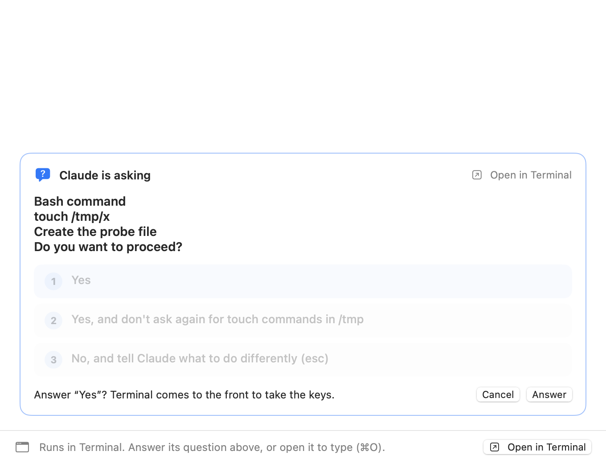
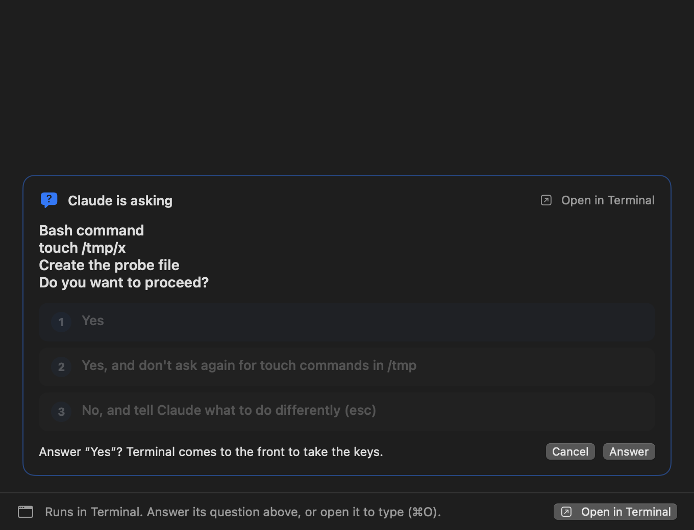
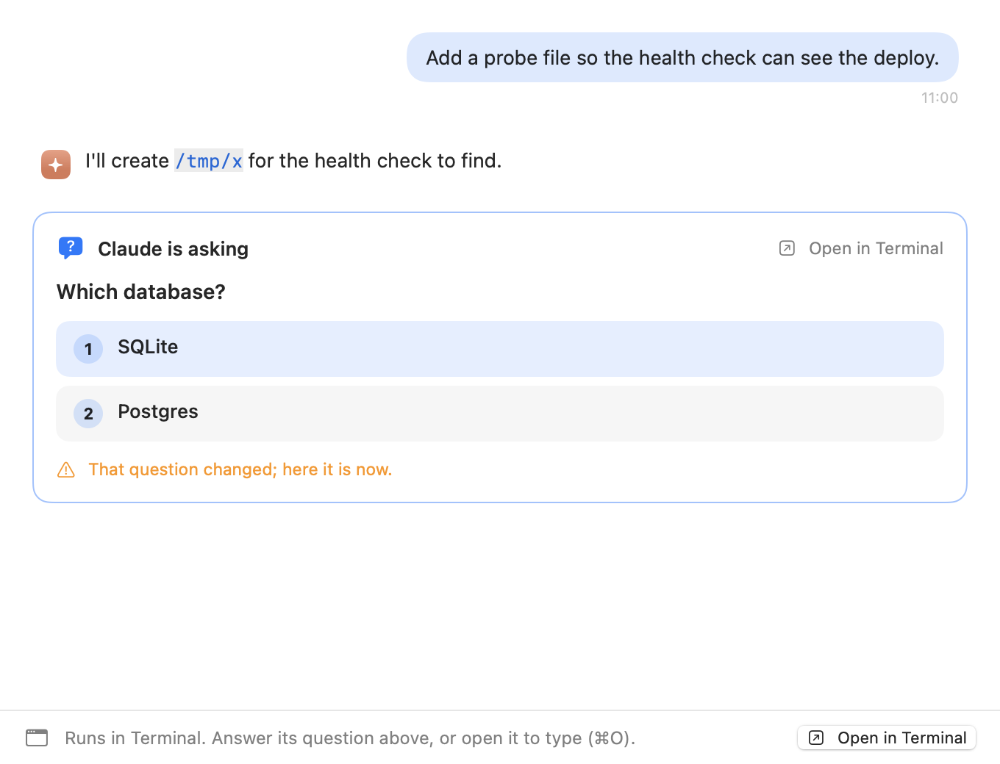
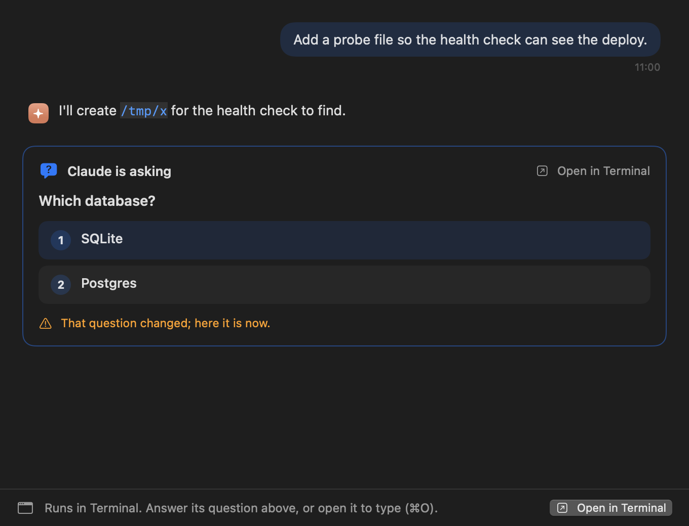

# A Terminal.app session that needs you (WT-1)

Light | Dark
--- | ---
 | 
 | 
 | 
 | 

**Before.** For a session running in Terminal.app, the chat's needs-you card offered only Show Terminal, which opens
the read-only mirror; the answer card was drawn only for live window sessions; the footer said "Runs in Terminal.
Reply there…". ⌘O (Open in Terminal) existed in the menu but the card didn't offer it.

**After.**

- **needs-you**: no question read off the tab (or none parsed). The card's buttons are Open in Terminal (the primary
  one, ⌘O) and Show Terminal (the mirror) beside it. The footer: "Runs in Terminal. Open it to type (⌘O); Move to
  Window is offered between turns.", with its own Open in Terminal button.
- **answer-card**: while the hooks say it needs you, the chat reads its Terminal tab every 2 s (off the main thread)
  and, when the text parses to a menu, draws the same answer card as for a window session (same `AnswerCardContent`;
  `TerminalAnswerTests` checks it on the same fixtures). Its header offers Open in Terminal in place of "Answer in
  Terminal". The footer: "Runs in Terminal. Answer its question above, or open it to type (⌘O)."
- **confirm**: a click asks first, in one line: "Answer “Yes”? Terminal comes to the front to take the keys."
  Answer reads the tab again and, when it still shows that question, types the keys through `RemoteInput.send`
  (the phone's guarded path: the agent still on that tty, the tab verified in front, keys to Terminal only), each
  key only while the tab still shows the question. Esc or Cancel drops it; a new question on the card drops it too.
- **refused**: the question on the tab changed before the answer went in: nothing is typed, the card shows the
  question there now, and says "That question changed; here it is now." (or "That question is gone.").

**How they were made.** Offscreen, in a borderless window far off every display, from the app's own `ChatView`,
`AnswerCard` and `TerminalReplyHint`, over a scratch transcript under a scratch home; the menus are the fixtures of
`TerminalAnswerTests` read by `ChatSync.terminalMenu`. Nothing reads or types into Terminal. As in the other
offscreen benches, the window isn't key, so a prominent button is drawn without its accent fill.

Regenerate: `TERMINAL_NEEDS_YOU_SNAPSHOT_DIR=$PWD/docs/eval/ux-fixes/terminal-needs-you HOME=/scratch
CFFIXED_USER_HOME=/scratch swift test --filter TerminalNeedsYouSnapshots`.
