# VibeSwitcher: UX and visual audit

Audited at commit `e992e0a` (17 Oct 2026). Every surface in the README, on macOS 15.6, judged against Apple's macOS
Human Interface Guidelines and the bar set by Things, Linear, Raycast and Arc. The standard is AAA, so this review is
strict on purpose. Most findings come from screenshots and code read together, and each gives a file:line and a
suggested change.

**Severity**

- **P1** broken or confusing: a user gets stuck, misreads state, loses work, or can't use the feature with assistive tech.
- **P2** clearly below AAA: works, but a best-in-class app wouldn't ship it this way.
- **P3** polish.

Finding IDs are prefixed by surface: `MB` menu bar, `PO` popover, `PI` floating pill, `SB` sidebar, `WL` window list,
`WT` terminal/mirror, `WC` chat, `WI` inspector, `WK` ⌘K palette, `WS` start page, `WX` window chrome, menus and
keys, `ST` Settings, `PA` Phone Access window, `ON` onboarding/first run, `PH` phone web UI, `AX` accessibility.

## How the pictures were made

Screen Recording isn't granted to this shell, so `screencapture` of the app's windows failed. I used three methods
and nothing touched the installed app's settings or any live session:

1. **Installed app, live data**: `VibeSwitcher --snapshot` (popover, sidebar, pill, menu bar icon, Phone Access) and
   `VibeSwitcher --capture-window` of the window that was already open (light appearance; the system is in light mode).
   Files: `live-*.png`, `phone-access-light.png`. These show the user's real session titles. `--capture-window` can't
   draw the terminal's text (it's drawn in a layer); the view tree it writes beside the PNG has the text.
2. **Offscreen renders from a scratch build**: a copy of this commit, built outside the repo, with a throwaway render
   harness. It ran with `HOME` pointed at a temp folder and its own defaults domain (deleted afterwards). It
   draws the real views (`MainWindowController`, `PopoverView`, `SettingsWindowController`…) from mock sessions, a
   synthetic transcript and a mock lead board, in **both** `aqua` and `darkAqua`. The window sat 30,000 pt off any
   display, so AppKit draws it as an **inactive** window: list titles and prominent buttons look greyer than they do
   in a key window. Terminal text is drawn straight from SwiftTerm into the bitmap. Two harness artifacts: the ended
   session's terminal is empty (the mock host has no replay), and its dark background was painted in by hand.
   File names: `window-*`, `palette-*`, `popover-*`, `sidebar-*`, `pill-*`, `menubar-*`, `settings-*`, `firstrun-*`,
   `phone-access-dark.png`.
3. **Phone UI**: `Web/` served read-only by a small mock API server (fake `/api/state`, `/api/screen`,
   `/api/conversation`, a token put in `localStorage` by the server), photographed at 390 pt wide by a `WKWebView` (the
   iOS Safari engine) in light and dark. Files: `web-*`.

`live-statusline-garbled.png` is a crop of the screenshot the user sent the lead (only the status-line rows).

## Verdict

VibeSwitcher has an unusually strong core idea and several surfaces that are already close to best-in-class: the
chat's answer card, the "Edited 1 file · updated the to-dos" tool folding, the lead's team strip, the start page and
the phone list are clear and handsome in both appearances. What holds it back from AAA is mostly **consistency and
fundamentals**, not missing features:

- **One concept, five vocabularies.** The same state is "Needs input", "Needs you", "waiting", "need you" and a red
  dot, depending on the surface (`WL-3`).
- **Settings live in two places**, and the important ones are in a menu full of toggles, not in Settings (`ST-1`).
- **No first-run experience.** The app silently becomes a login item, asks for notifications with no context, and
  hides hook installation in a caption-sized banner (`ON-1`).
- **Accessibility is close to absent.** One `accessibilityLabel` in the whole app, no VoiceOver description for the
  menu bar icon, status shown by colour alone in the menu bar, pill and sidebar, white-on-orange and white-on-green
  text at about 2:1, no Reduce Motion handling anywhere (`AX`).
- **Standard Mac behaviours missing**: ⌘W ends a session, and Cut, Undo and Redo aren't in the menu bar, so ⌘X/⌘Z/⇧⌘Z
  do nothing in the composer and the filter field (`WX-1`, `WX-2`).

| Surface | Today | Biggest gap |
| --- | --- | --- |
| Menu bar icon | Good idea, dense | Colour-only, no VoiceOver, left-click teleports |
| Popover | Solid | Truncates the row that matters most; settings dumped in ⚙︎ |
| Floating pill | Works | Unreadable numbers, no drag affordance |
| Sidebar mode | Works | Status is colour only; layout floats |
| Window: list | Good | Vocabulary, clutter from ended sessions, truncated team line |
| Window: terminal / mirror | Good | Dead end for Terminal sessions that need you |
| Window: chat | Very good | Tiny secondary text; answer card not keyboard-operable |
| Window: inspector | Fair | Activity duplicates the chat with raw markdown |
| ⌘K palette | Fair | No sections, shortcuts as subtitles, commands below the fold |
| Start page | Good | "Lead" placed before the default action |
| Settings | Weak | Nearly empty General tab; real settings elsewhere |
| Onboarding / first run | Missing | No guided setup at all |
| Phone web UI | Good | Permission menus not offered as buttons; contrast in light mode |

---

## Menu bar icon and dots

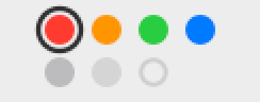 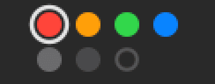
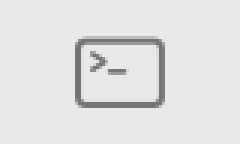

**What works.** One dot per session in desktop order is a genuinely new, glanceable idea; the ring for "the tab you're
looking at" is clever; the icon stays narrow (two rows past 4); per-dot tooltips name each session
(`AppDelegate.swift:368-393`); counts take over beyond 12.

- **MB-1 · P1 · VoiceOver gets nothing.** The dots image is drawn with no `accessibilityDescription` and the status
  button never gets a label or value (`AppDelegate.swift:131`, `:219`; `StatusStyle.swift:41-67`). VoiceOver users
  hear "VibeSwitcher" at best, never "2 sessions need you".
  *Fix:* set `statusItem.button?.setAccessibilityLabel("VibeSwitcher")` and an accessibility value such as "7 sessions:
  1 needs input, 1 working, 1 done", updated with the image. Expose each dot as an accessibility child, or offer the
  list on VO-Space.
- **MB-2 · P2 · Status is colour alone.** Red, orange and green dots at 8 pt are indistinguishable with deuteranopia
  or protanopia, and "Idle" (grey at 55 %) and "Unknown" (grey at 35 % outline) almost vanish on a dark bar:
  1.75:1 for Unknown on dark (`StatusStyle.swift:12-13`; `menubar-dark.png`).
  *Fix:* add shape redundancy for the two states that matter. Needs-input becomes a filled dot with a white "!" or a
  rounded square; working gets a small ring or a gap; idle shrinks to a smaller dot. Honour
  `accessibilityDisplayShouldDifferentiateWithoutColor`.
- **MB-3 · P2 · Left-click jumps; the list needs right-click.** A menu bar extra is expected to open its menu or popover
  on click (HIG, *Menu bar extras*). Here a first-time click on a dot teleports you to a Terminal tab
  (`AppDelegate.swift:332-341`), and the list is behind right-click or ⌃⌥V, which the popover footer explains in
  caption2 tertiary text.
  *Fix:* keep dot-click-to-jump as the power behaviour, but on the first launches open the popover on any click with a
  one-time coach mark ("Tip: click a dot to jump straight to it"). Or invert it: click opens the list, ⌥-click or a
  setting jumps.
- **MB-4 · P3 · The empty-state icon is a generic `terminal` glyph** (`StatusStyle.swift:34`), identical to the glyph
  other menu bar apps use, so the app is hard to find right after install. *Fix:* a template glyph of its own (for
  example three stacked dots in an outline) used empty and in the Dock/About.
- **MB-5 · P3 · The tooltip's second line says "Click to switch · right-click for the list"**
  (`AppDelegate.swift:392`) on every dot, every time. *Fix:* keep that hint for the first few days only.

## Popover (the list)

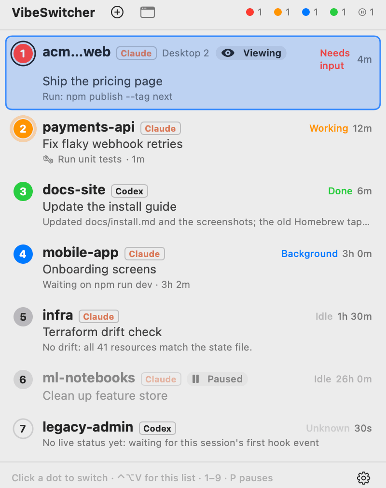 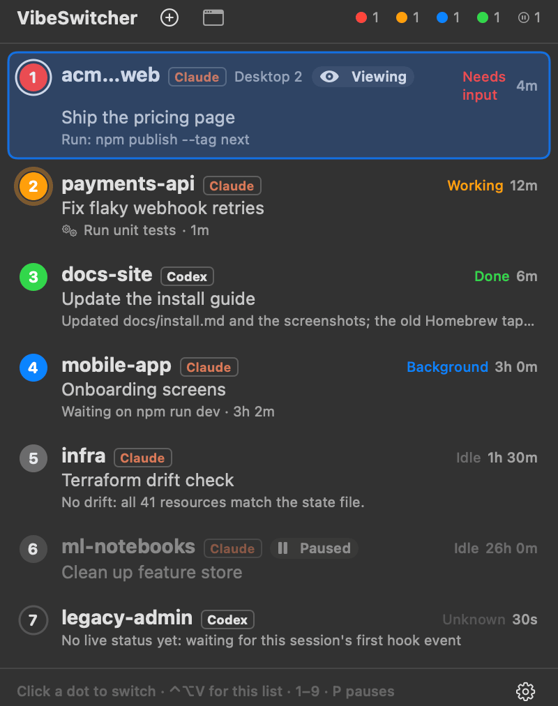
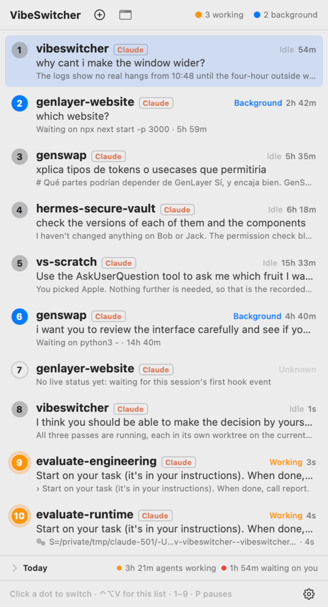 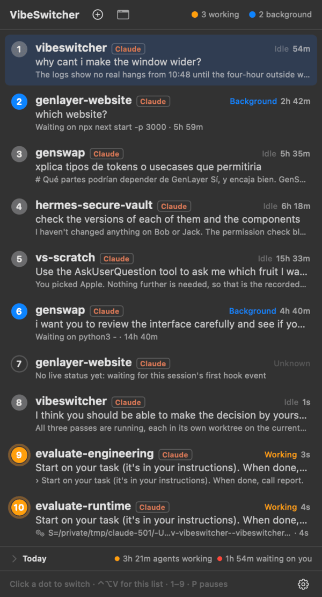

**What works.** Rows are rich and scannable: number badge = dot position, name, task, last message, live tool line
("⚙ Run unit tests · 1m", orange after 10 min). Keyboard is good: ↑↓, ⏎, 1–9, P, Esc (`AppDelegate.swift:706-734`).
The "on this desktop" frame is a nice touch, and the Today summary is honest and useful.

- **PO-1 · P2 · The most important row is the one that breaks.** When a session has a Desktop label and the Viewing
  tag, the project name is middle-truncated to "acm…web" and "Needs input" wraps onto two lines (`popover-dark.png`,
  row 1). Name, agent badge, desktop, viewing tag and status all share one line with no priorities
  (`PopoverView.swift:336-374`).
  *Fix:* give the name `layoutPriority(1)` and never truncate below about 12 characters. Move Desktop and Viewing to
  the second line, or show Viewing only as the ring it already has. `fixedSize()` on the status label.
- **PO-2 · P2 · "Claude" badges on every row are noise** (`PopoverView.swift:468-477`): 10 identical orange outlined
  9 pt labels compete with the status colour (Claude orange sits next to Working orange). *Fix:* show the agent only
  when it isn't the majority agent, or as a 12 pt monochrome glyph like the window's `AgentMark`.
- **PO-3 · P2 · Two meanings, one tint.** The hover/keyboard selection (`accentColor` 15 %) and "on the current desktop"
  (`accentColor` 10 % plus a 1.5 pt accent border) look nearly the same (`PopoverView.swift:405-413`), and hover moves
  the keyboard selection (`:50`), so ⏎ opens whatever the mouse last brushed. *Fix:* desktop membership gets a quiet
  leading bar or a "here" glyph, not the selection's colour. Hover shouldn't steal the keyboard selection until the
  mouse actually moves.
- **PO-4 · P2 · Header counts degrade into unlabeled dots.** With four or more states the words drop and you get
  "● 1 ● 1 ● 1 ● 1 ⏸ 1" (`popover-dark.png`; `PopoverView.swift:105-108`). *Fix:* show only the two that need action
  ("1 needs you · 1 done"), with words, and leave the rest to the list.
- **PO-5 · P2 · Elapsed time formats are inconsistent and noisy**: "3h 0m", "26h 0m", "Idle 54m" ticking every second
  (`PopoverView.swift:366-371`, `426-431`). *Fix:* "3h", "1d 2h"; no timer at all for Idle; tick once a minute.
- **PO-6 · P2 · The ⚙︎ menu is the app's real Settings**: 7 toggles, 2 pickers, login item, Phone Access, Reinstall
  hooks and Quit (`PopoverView.swift:221-250`). See `ST-1`. *Fix:* a short menu (Settings…, Phone Access…, Quit) and
  the rest in Settings.
- **PO-7 · P3 · Footer copy is cryptic and nearly invisible**: "Click a dot to switch · ⌃⌥V for this list · 1–9 ·
  P pauses" in caption2 tertiary, about 1.9:1 (`PopoverView.swift:218`). *Fix:* drop it once the user has used the
  keys. Otherwise, one hint at a time at 11 pt secondary: "Tip: press 1–9 to jump, P to pause".
- **PO-8 · P3 · Number badges past 9** ("10", "11") have no shortcut and crowd the 20 pt circle (`live-popover-*`).
  *Fix:* show a plain dot past 9, or a two-digit badge in a capsule.

## Floating pill

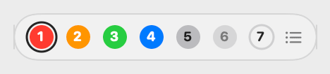 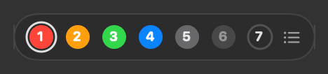

**What works.** Appears only when the menu bar icon is really hidden under the notch (`AppDelegate.swift:397-428`),
remembers its place, follows you across Spaces, and the same numbers as the list.

- **PI-1 · P2 · Numbers are unreadable**: white 9.5 pt bold on systemOrange or systemGreen is 2.0–2.2:1
  (`FloatingPanel.swift:94-97`). *Fix:* dark text (`#1F1F1F`) on orange and green, white on red and blue, 11 pt.
  Or drop the numbers and use the same dots as the menu bar.
- **PI-2 · P3 · Nothing says it can be dragged** (`FloatingPanel.swift:23`). *Fix:* a grip area or a 2 px handle on
  hover, and a right-click menu with "Hide (show it in Settings)".
- **PI-3 · P3 · The list button is an unlabeled `list.bullet` glyph** with tooltip only (`FloatingPanel.swift:108-112`).

## Sidebar mode

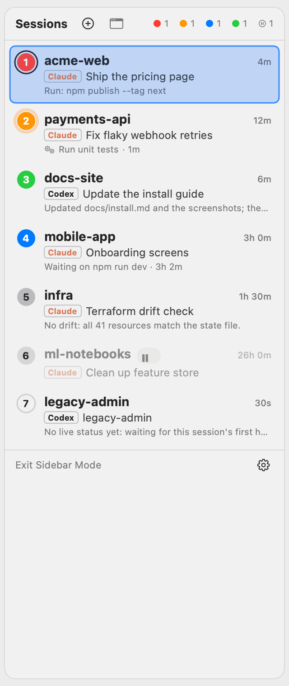 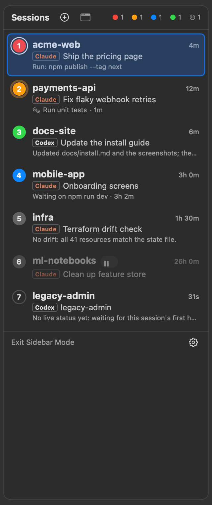

**What works.** Reachable on every desktop, auto-hide with a carefully tuned hot zone, keeps open while a menu is open,
frames the sessions on the new desktop after a Space switch.

- **SB-1 · P2 · Status is colour only.** The compact row drops the status word ("Needs input", "Working"); only the
  badge colour remains (`PopoverView.swift:365`). The paused label becomes an empty grey capsule with a pause glyph
  (`:357`). *Fix:* keep a short word ("Needs you", "Working") on line 1, right-aligned like the popover.
- **SB-2 · P2 · Layout floats.** With few sessions the footer sits halfway down the panel and the rest is empty
  material (`sidebar-light.png`; `PopoverView.swift:74-75` `fixedSize` + `maxHeight: .infinity`). *Fix:* pin the
  footer to the bottom of the panel; let the list take the space.
- **SB-3 · P2 · It slides in on every desktop switch** (`AppDelegate.swift:169`, `Sidebar.swift:114-131`), ignoring
  Reduce Motion (`AX-5`). For people who switch Spaces often this is constant motion at the screen edge. *Fix:* make
  "Show the sidebar briefly after switching desktops" a setting, off with Reduce Motion.
- **SB-4 · P3 · "Exit Sidebar Mode" is the footer's primary affordance** (`PopoverView.swift:214-216`). It's a setting,
  not an action you need every visit. *Fix:* put Today there; keep Exit in the ⚙︎ menu.

## Main window: session list

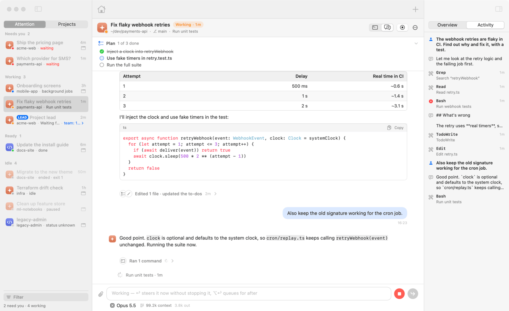
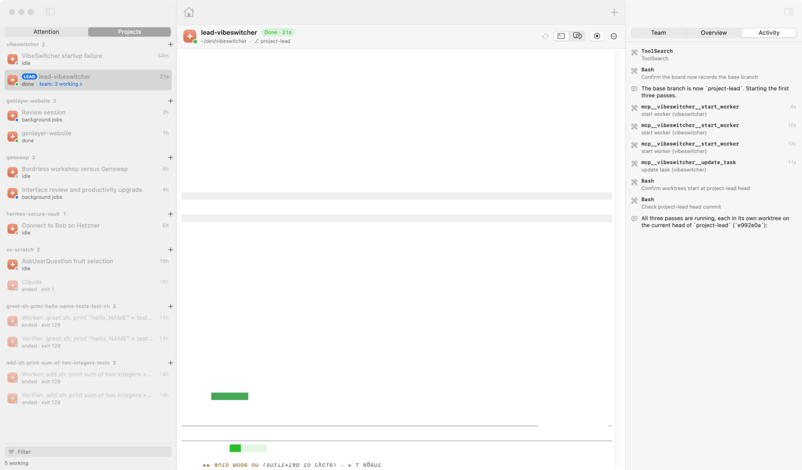

**What works.** Attention grouping (Needs you, Working, Ready, Idle) puts the right thing first; the `AgentMark` with a
status dot is a clean, recognisable mark; leads fold their team; dimming for ended and paused rows; context menu covers
everything; ⌥⌘F, ⌘1–9 and ⌘J are well chosen.

- **WL-1 · P2 · Ended worker and verifier sessions clutter the list for a day** ("Worker: greet.sh: print…", "Verifier:
  …", "ended · exit 129", 14–15 h old) along with throwaway test projects (`live-window-projects-light.png`).
  Retention is a flat day (`SettingsWindow.swift:65`). Exit 129 is 128 + SIGHUP from VibeSwitcher's own cleanup, but it
  reads as a failure ("ended · exit 129", `WindowGroups.swift:44`; orange warning icon, `StartPage.swift:99-101`).
  *Fix:* when a lead removes a task's worktree, drop its worker and verifier rows (they belong to the lead's history).
  Group the remaining ended rows in a collapsed "Ended (n)" section at the bottom. Show signals as words ("closed",
  "stopped") and treat 129/143 from our own teardown as a normal end.
- **WL-2 · P2 · The team line hides its most useful words.** "Waiting f… · team: 1… ›" (`window-chat-light.png`): the
  activity and the team summary share one `lineLimit(1)` line (`SessionListView.swift:127-150`). *Fix:* on a lead row,
  drop the activity (the chat shows it) and give the team summary the whole second line, or use dots ("●●○ 2 working").
- **WL-3 · P2 · Five vocabularies for one state model.** Window list: "waiting", "done", "idle", "status unknown"
  (`WindowGroups.swift:56-67`); groups: "Needs you / Ready" (`:17-21`); header pill and popover: "Needs input / Done /
  Background / Unknown" (`SessionHeaderView.swift:136-138`); phone counts: "need you"; lead tasks: "Working / In review".
  Durations: list "4m", popover "3h 0m", Today "3h 21m". *Fix:* one glossary, used everywhere: **Needs you · Working ·
  Background · Done · Idle · Paused · Ended**, title case in pills and lower case in sentences, one duration formatter.
- **WL-4 · P2 · A worker that hasn't started its task reads "idle"** (lead's report: "team: 2 working · 1 idle" while
  its own worker hadn't begun). `WindowRowView.summary` counts everything that isn't needs-you or working as idle
  (`SessionListView.swift:161-170`); a hosted worker is "starting" only for its first 60 s (`WindowGroups.swift:47-50`,
  `:94`), and the board's own task status (`.running`, `.review`) is never consulted. *Fix:* summarise the team from the
  board, falling back to the session: "planned / briefing / working / in review / done". Show "briefing…" until the
  worker's first prompt arrives.
- **WL-5 · P2 · The same glyph means opposite things.** `macwindow` is "Runs in Terminal" on list rows
  (`SessionListView.swift:146`) and in the mirror (`TerminalPane.swift:241`), but "Open the VibeSwitcher window" in
  the popover header (`PopoverView.swift:99`). *Fix:* use the Terminal app's icon (or `terminal`) for "runs in
  Terminal", and `macwindow` only for the window.
- **WL-6 · P3 · The filter field sits at the bottom of the sidebar** (`SessionListView.swift:58-83`). Mac apps put
  search at the top of the sidebar or in the toolbar (Mail, Notes, Linear). *Fix:* `.searchable` in the sidebar's top
  safe area; keep ⌥⌘F.
- **WL-7 · P3 · Empty state is bare**: grey "No sessions" and a borderless "New Session" menu that doesn't look
  clickable (`window-empty-dark.png`; `SessionListView.swift:38-42`). *Fix:* an icon, one line of explanation, a
  bordered "New Session…" button.

## Main window: terminal and Terminal mirror

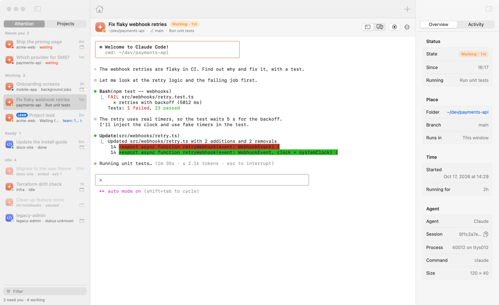 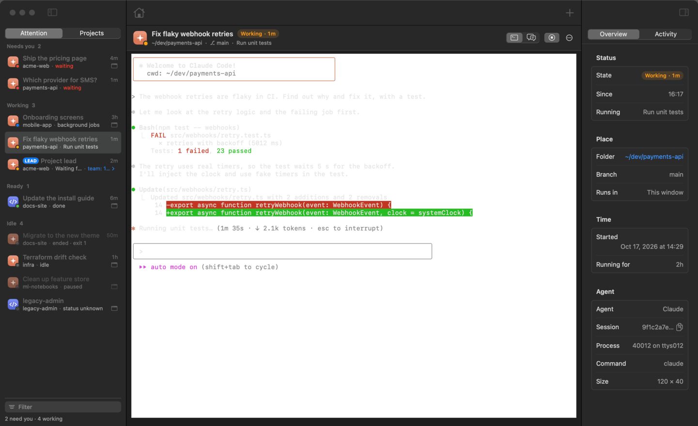
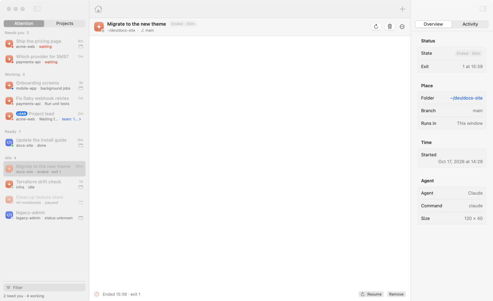 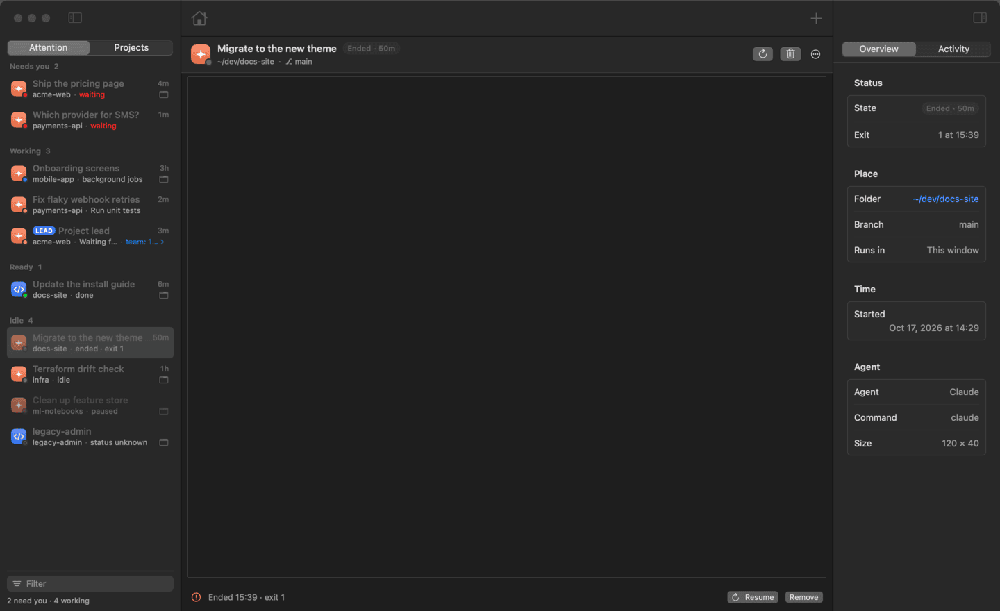
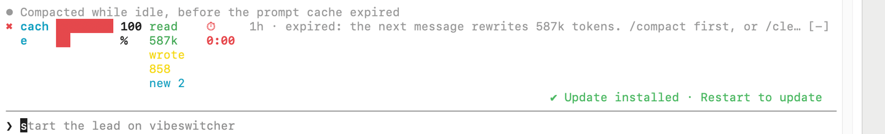

**What works.** Real SwiftTerm terminal with themes that follow the system, margins painted in the terminal's colour,
the last 8 views kept attached so switching is instant, find (⌘F) and font size (⌘±). The ended bar ("Ended 15:39 ·
exit 1 · Resume / Remove") is exactly right.

- **WT-1 · P1 · A Terminal session that needs you is a dead end.** The chat shows "Claude is asking in the terminal"
  with **Show Terminal** (`window-needs-input-light.png`; `ChatView.swift:345-358`). For a session in Terminal.app
  that button reveals the read-only mirror, where nothing can be answered, and the line under it says "Reply there
  (Move to Window is offered between turns)" (`ChatView.swift:425-426`). It takes three steps to reach the answer, and
  the phone can already press 1–3 for that same session. *Fix:* for Terminal sessions, make the primary button
  **Open in Terminal (⌘O)**. Better: render the same answer card as for window sessions and send the keys through the
  path the phone already uses.
- **WT-2 · P2 · Claude Code's status rows render stacked and garbled** (`live-statusline-garbled.png`: "cach / e",
  "100 / %", "read 587k wrote 858 new 2" one word per line, the red bar block offset). The vertical stacking is
  Claude Code's own layout decision: its flex row gives the long right-hand message ("1h · expired: the next message
  rewrites 587k tokens…") the room and wraps the left columns to a few cells. SwiftTerm doesn't do that: its widths
  for ⏱ U+23F1, ✖ U+2716 and ⏺ U+23FA are 1 column, the same as `wcwidth`/`string-width`
  (SwiftTerm 1.19.0 `Utilities.swift:392`, `UnicodeWidthData.swift` east-Asian-wide table), and an emoji-presentation
  sequence like "⏱️" (U+23F1 U+FE0F) is widened to 2 columns when the selector arrives (SwiftTerm
  `Terminal.swift:1500-1515`), as Terminal.app does. I found no cell-width mismatch in SwiftTerm. What VibeSwitcher
  does control is the width: the three-pane layout leaves the terminal at about 110 columns on a 1728 pt window,
  narrower than a typical Terminal window, which pushes Claude into its cramped layout sooner. Not proven: I couldn't
  reproduce the exact bytes, so a resize race (the PTY told a narrow size while the row was drawn) isn't ruled out;
  `TerminalPaneController` only forwards size changes for the session on screen (`TerminalPane.swift:173-176`) and
  catches up on `show` (`:66-69`).
  *Fix:* (a) confirm by running `stty size` in the window session and in Terminal.app at the same pixel width; if the
  rows look the same at the same column count, report the layout upstream. (b) Add a "Focus terminal" toggle (hide
  sidebar and inspector, ⌃⌘F) so the terminal can be wide. (c) Log the cols/rows sent to the host on every resize
  (the hang log already has the view tree) so the next garbled row can be matched to a size.
- **WT-3 · P3 · The mirror's header copy is two different sentences for two states** ("Terminal shares only plain text.
  Move it here for full color." / "Its screen as plain text, as of a moment ago. Answer it in Terminal.",
  `TerminalPane.swift:244-245`). *Fix:* one sentence, state-specific button: "Read-only copy of its Terminal tab ·
  updated every 2 s" + [Open in Terminal] [Move to Window].
- **WT-4 · P3 · Host problems appear as raw text in the header** (`SessionHeaderView.swift:87-106`): a red
  `Text(reason)` with `lineLimit(1)` and no action. *Fix:* a small inline banner with "Reconnect" and "Show log".

## Main window: chat

 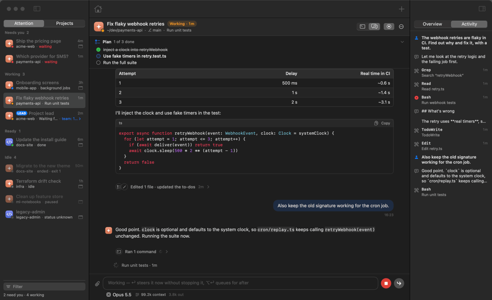
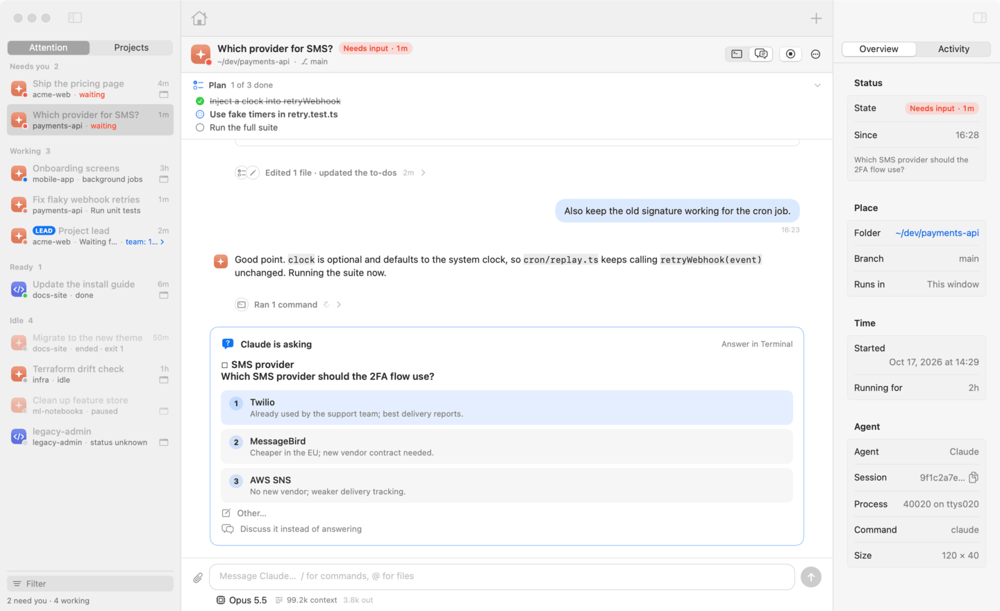 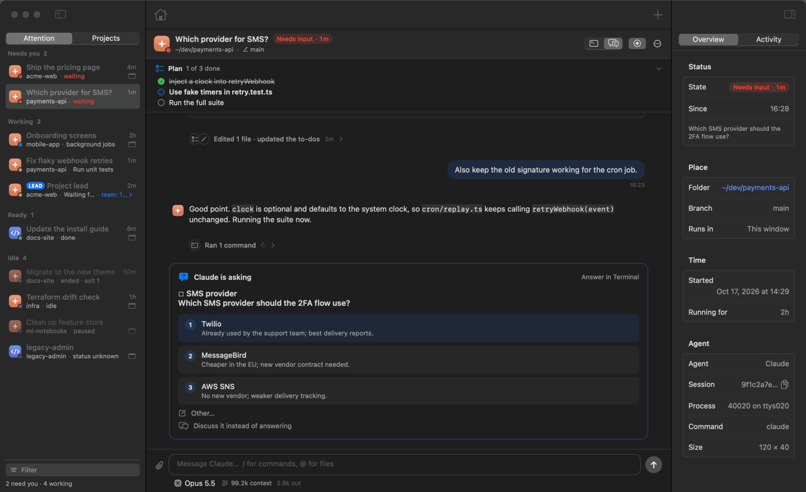
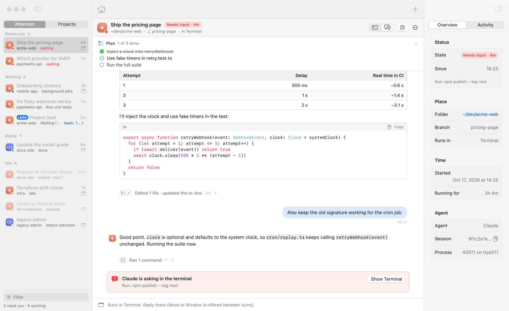 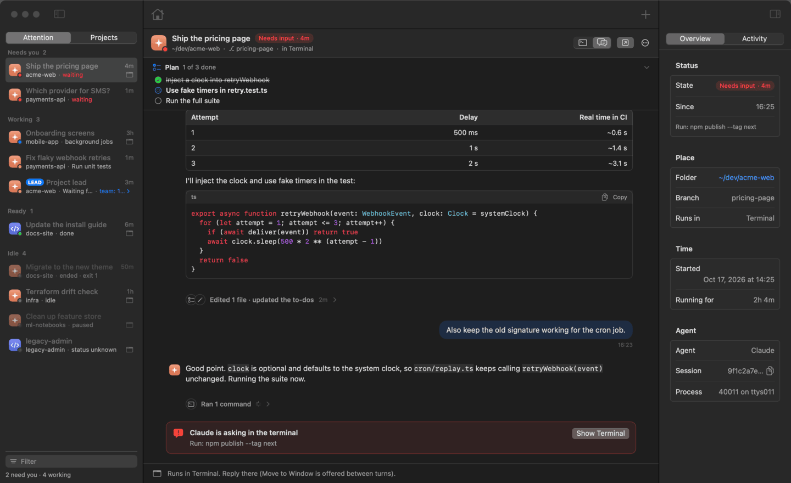

**What works.** This is the app's best surface. Markdown, tables and syntax-coloured code with Copy (and Run) are
handsome in both appearances; tool calls fold into one line ("Edited 1 file · updated the to-dos"); the plan panel;
"New since you looked"; Latest button; ⌘F search; the answer card turns AskUserQuestion into big numbered options with
descriptions, "Other…" and "Discuss it instead"; chips for mode, model and context; ↑ history; / and @ completion.

- **WC-1 · P2 · The answer card's numbers aren't keys.** Options carry 1, 2, 3 badges like the terminal, but pressing 1
  in the window types "1" into the composer; the card has no key handling and its options are `.plain` buttons with no
  focus ring (`ChatView.swift:522-540`). *Fix:* while a card is shown and the composer is empty, 1–9 choose and ⏎
  confirms the highlighted option. Give options a hover and focus state, and make the card the default focus.
- **WC-2 · P2 · Secondary text is too small to read.** "steering… arrives at its next step" 9.5 pt tertiary,
  "sending…/queued" 9.5 pt, delivery warnings 10.5 pt orange, "It keeps working while you think…" 10.5 pt tertiary
  (`ChatView.swift:131`, `145`, `161`, `166`; `LeadViews.swift:135`). Tertiary on light is about 1.9:1. *Fix:* 11 pt
  minimum, `.secondary` for anything the user must read; reserve orange for actionable warnings.
- **WC-3 · P2 · The composer placeholder is a manual.** "Working — ↩ steers it now without stopping it, ⌥↩ queues for
  after" (`ComposerView.swift:63-66`). New users won't know "steer"; experts don't need it on every turn. *Fix:*
  "Message Claude while it works…" with a small "↩ steer · ⌥↩ after this turn" hint shown in the chip row only while
  typing.
- **WC-4 · P2 · Send turns into an unfamiliar orange "↪" while working** (`ComposerView.swift:84-91`) next to a large
  red stop button. Two colours and an unusual glyph for one decision. *Fix:* keep one accent send button and put a
  segmented "Steer / After turn" toggle (or a menu on the button) beside it; stop as a neutral ■ with tooltip
  "Stop (⌘.)".
- **WC-5 · P3 · Raw terminal glyphs leak into the card**: "☐ SMS provider" (`window-answer-dark.png`;
  `ChatView.swift:486-489` falls back to `menu.question`). *Fix:* strip ☐/☒/❯ prefixes in `ScreenMenu`.
- **WC-6 · P3 · "This session has ended." is the whole footer for an ended chat** (`ChatView.swift:58`). *Fix:* the
  same Resume / Remove actions as the ended bar.

## Main window: inspector (Overview, Activity, Team)

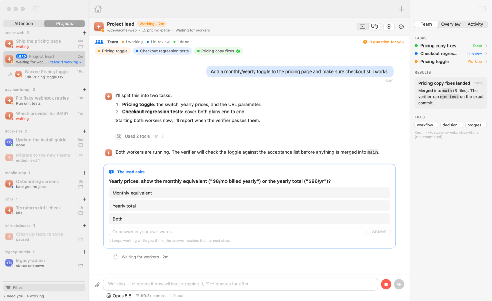 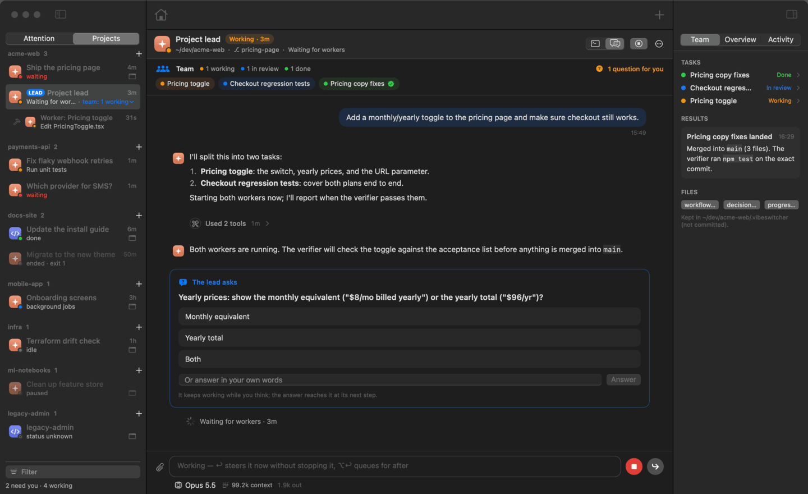

**What works.** A grouped form that matches System Settings; the branch and folder (folder is a link that reveals in
Finder); the Team tab's tasks with contracts, verdicts, results and files is a good model of "what is my team doing".

- **WI-1 · P2 · Activity duplicates the chat, worse.** Next to the chat, it repeats the same transcript with raw
  markdown ("## What's wrong", "**real timers**") and raw tool names ("TodoWrite", `mcp__vibeswitcher__start_worker`)
  (`window-chat-light.png`, `live-window-projects-light.png`; `InspectorView.swift:170-191`). *Fix:* when the chat is
  showing, replace Activity with something the chat doesn't show: files touched (with diff stats), commands run with
  exit codes, cost/tokens over time. Humanise tool names with the same table the chat uses (`ToolStyle`).
- **WI-2 · P2 · Debug data in the primary pane**: "Process 40012 on ttys012", "Size 120 × 40", "Command claude"
  (`InspectorView.swift:99-103`). *Fix:* move under a collapsed "Details" section; lead with things users act on
  (state, waiting since, branch, last commit, context %).
- **WI-3 · P2 · "1 question for you" in the team strip isn't clickable** (`LeadViews.swift:50-54`), and task chips
  without a worker do nothing on click (`:59-73`). *Fix:* the question count scrolls to the card; a chip with no
  worker opens the task in the Team tab.
- **WI-4 · P3 · Team tab files buttons truncate to "workflow…", "decision…", "progres…"** (`window-lead-light.png`;
  `LeadViews.swift:200-209`), and task titles truncate ("Checkout regres…"). *Fix:* a vertical list of files with
  icons; let titles wrap to two lines.
- **WI-5 · P3 · "No session selected" fills the inspector on the start page** (`window-start-light.png`;
  `InspectorView.swift:34-38`). *Fix:* collapse the inspector on the start page, or show Today there.
- **WI-6 · P3 · Long values wrap under their label** ("Started / Oct 17, 2026 at 14:22", `window-terminal-light.png`).
  *Fix:* relative dates ("Today 14:22") or `.formatted(.dateTime.hour().minute())` for today.

## Main window: ⌘K palette

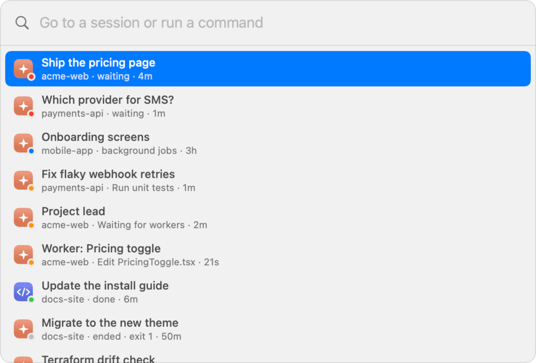 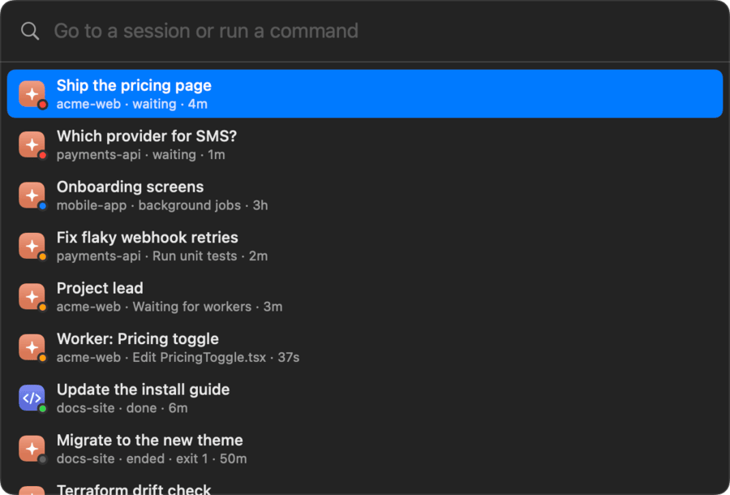

**What works.** Fuzzy search, AgentMark with status dot per session, Esc closes, closes on resign key, presets for
recent projects are included.

- **WK-1 · P2 · No structure.** Sessions (all of them), commands, leads and every "New <preset> in <project>" are one
  flat list (`MainWindowController.swift:547-598`); with 10 sessions the commands start below the 420 pt fold. Raycast
  and Linear group results under headers and rank by recency. *Fix:* sections (Sessions · Actions · New), top 5 per
  section when the query is empty, frequency/recency ranking.
- **WK-2 · P2 · Shortcuts are shown as subtitles** ("⌘J" in grey under "Next Session Needing You",
  `MainWindowController.swift:557-560`), so commands look like sessions and the key isn't where the eye looks for it.
  *Fix:* right-aligned key caps, subtitle only when it adds something.
- **WK-3 · P3 · Mouse hover doesn't move the highlight; rows are tap gestures, not buttons** (`CommandPalette.swift:97-102`).
  *Fix:* hover selects; rows as `Button`s with accessibility labels.
- **WK-4 · P3 · Placeholder "Go to a session or run a command"** is fine, but an empty query could also show "Needs
  you" first with ⌘J hint. Small.

## Main window: start page

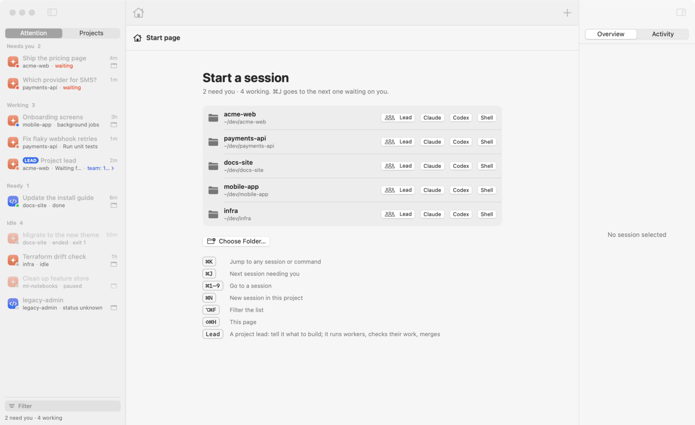 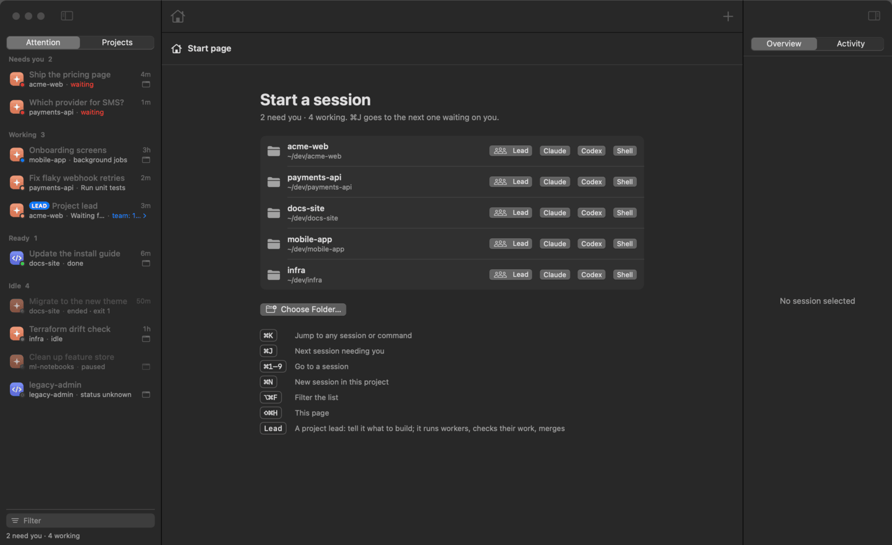
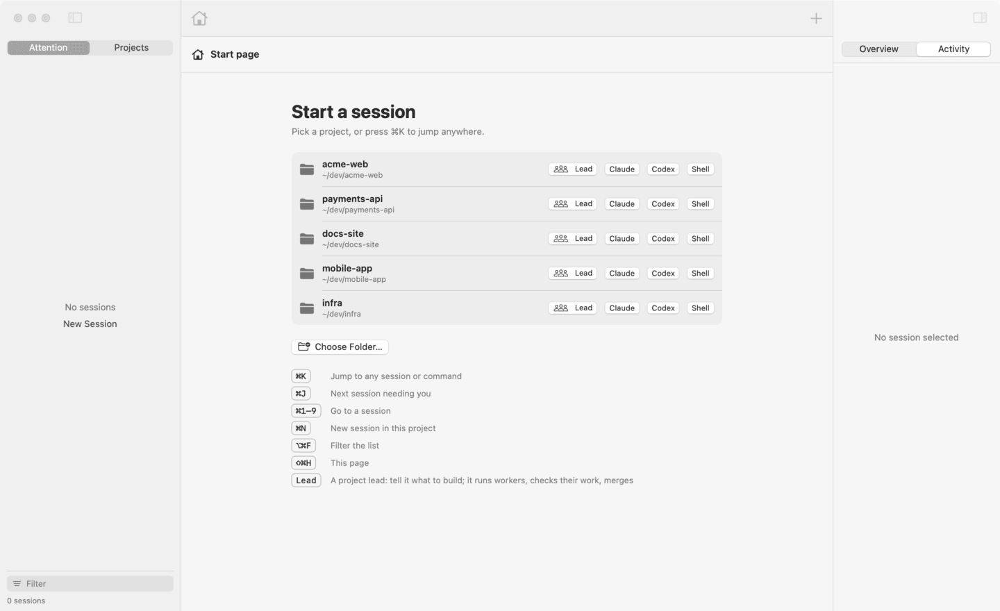 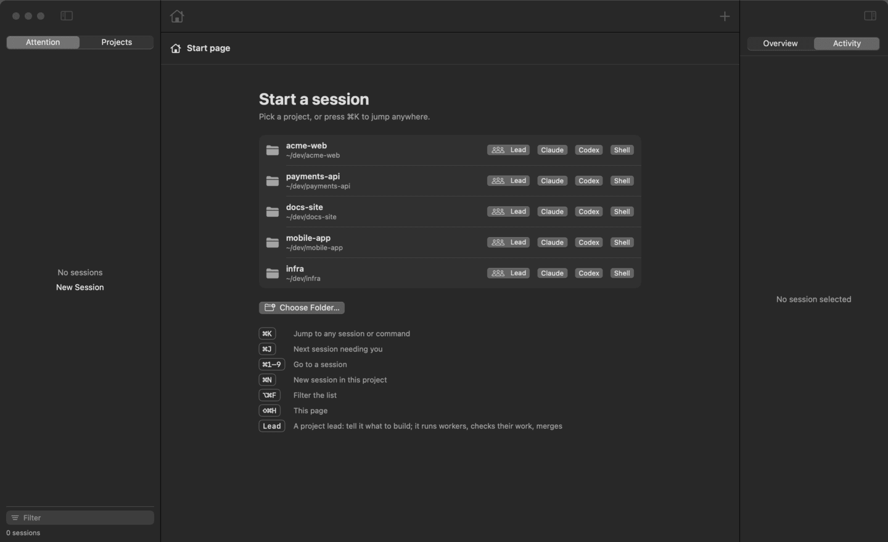

**What works.** Good hierarchy: big title, live summary ("2 need you · 4 working. ⌘J goes to the next one"), recent
projects in a grouped list with presets, a shortcut cheat sheet. Keyboard-centred and calm.

- **WS-1 · P2 · "Lead" comes before the default preset** in every row (`StartPage.swift:55-63`). The most expensive
  action (a lead plus up to three workers) is the first button, and the prominent default is third.
  *Fix:* default preset first (prominent), others next, Lead last behind a `person.3` icon with a clear label "Lead…".
- **WS-2 · P3 · "Lead" isn't a shortcut** but sits in the shortcuts grid as if it were (`StartPage.swift:74`). *Fix:*
  move the explanation to the Lead button's tooltip or a one-line footnote.
- **WS-3 · P3 · Only folder icons**; Things/Arc would use the project's own favicon or git remote avatar. Optional.

## Main window: chrome, menus and keyboard

- **WX-1 · P1 · ⌘W ends the session.** File › End Session… is bound to ⌘W (`MainMenu.swift:36`); Close Window is ⇧⌘W.
  Every Mac user presses ⌘W to close a window. For an idle or done session there is no confirmation
  (`AppDelegate.swift:637-649` only confirms working, needs-input and background), so ⌘W silently kills the agent.
  *Fix:* ⌘W closes the window (HIG); End Session gets ⌥⌘W or ⌘⌫ and always confirms unless the session has exited.
- **WX-2 · P1 · No Undo, Redo or Cut in the menu bar.** The Edit menu has Copy, Paste, Select All and Find only
  (`MainMenu.swift:39-50`). Key equivalents reach text views through the menu, so ⌘Z, ⇧⌘Z and ⌘X do nothing in the
  composer, the filter field, the rename alert and Settings fields, even though the composer enables undo
  (`ComposerView.swift:409`). *Fix:* the standard Edit menu: Undo, Redo, Cut, Copy, Paste, Paste and Match Style,
  Delete, Select All, Find submenu, plus Writing Tools/Emoji & Symbols (AppKit adds those to a menu titled "Edit").
- **WX-3 · P2 · The menu bar is missing standard items**: no Help menu (so no menu search with ⇧⌘/), no Hide Others /
  Show All, no Window › Bring All to Front or the window list (`MainMenu.swift:24-83`). *Fix:* build from the standard
  template; set `NSApp.helpMenu` and `windowsMenu`.
- **WX-4 · P2 · Three modifier families for "1" and "2"**: ⌘1–9 sessions, ⌥⌘1/2 Terminal/Chat, ⌃⌘1/2 grouping
  (`MainMenu.swift:52-56`, `79`). Hard to learn, and ⌃⌘ conflicts with common window managers. *Fix:* keep ⌘1–9 and
  ⌥⌘1/2; make grouping a View menu toggle (⌃⌘G or none).
- **WX-5 · P2 · End Session uses `stop.circle`, which reads as "record"** (`SessionHeaderView.swift:74`), and sits next
  to the view switcher, one slip from a destructive action. *Fix:* put End Session in the ⋯ menu and in File; keep the
  header for reversible actions.
- **WX-6 · P3 · The session header is a second toolbar**: 52 pt below a toolbar that holds only Home and +
  (`MainWindowController.swift:179`, `448-451`). *Fix:* put title, status pill and view switcher in the unified toolbar
  (as Xcode, Linear, Arc do) and win 52 pt for content.
- **WX-7 · P3 · Rename is double-click on the title only** (`SessionHeaderView.swift:19`), not discoverable and not
  keyboard-reachable. *Fix:* also Session › Rename… (⌘R or F2-style ⏎ on a selected row).

## Settings

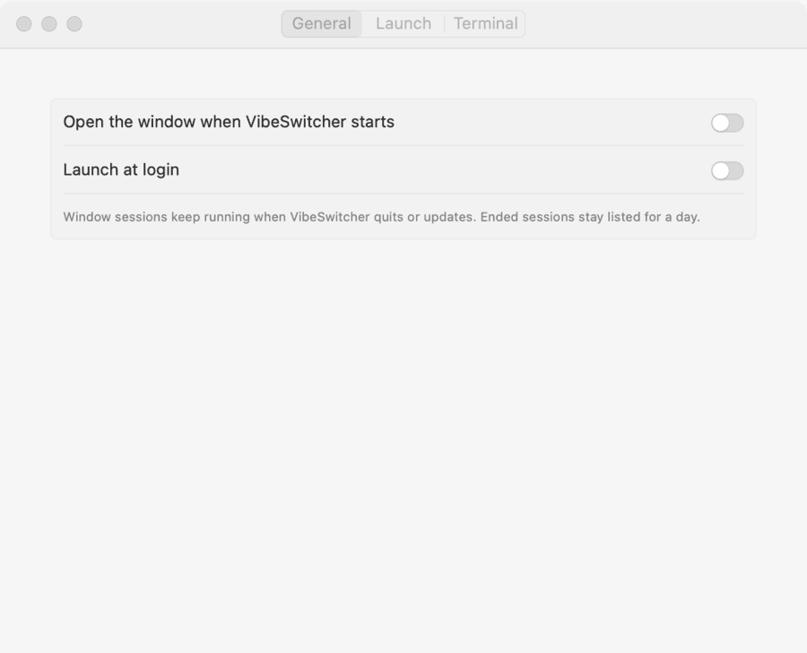 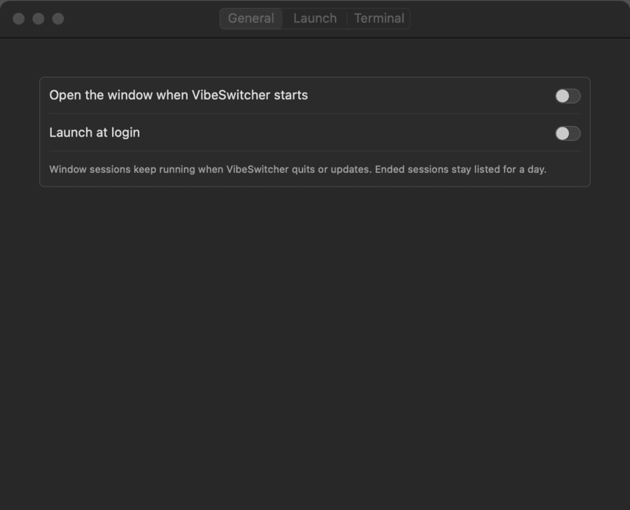
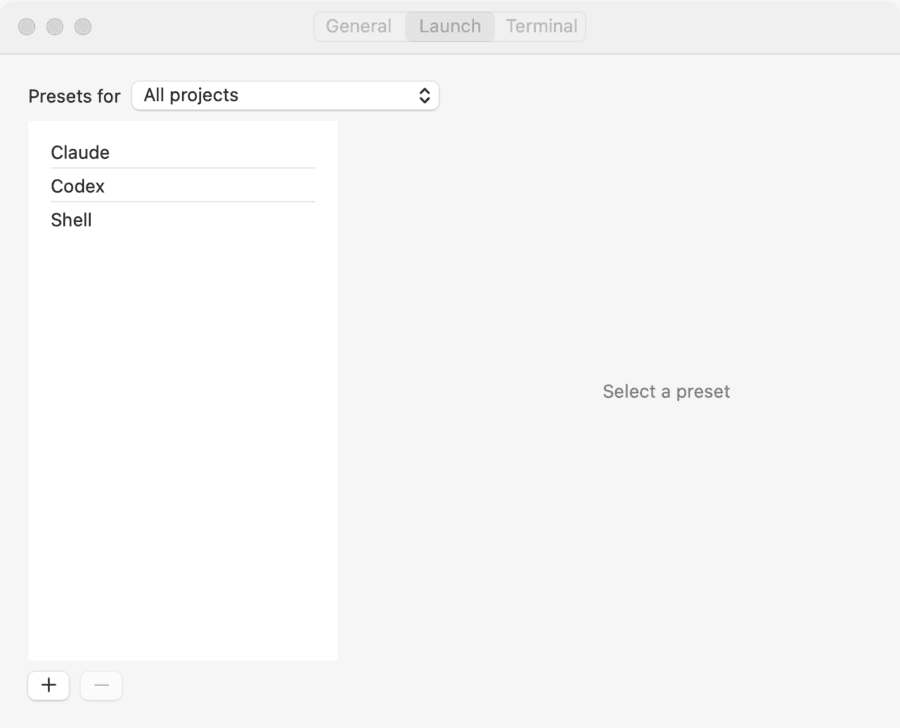 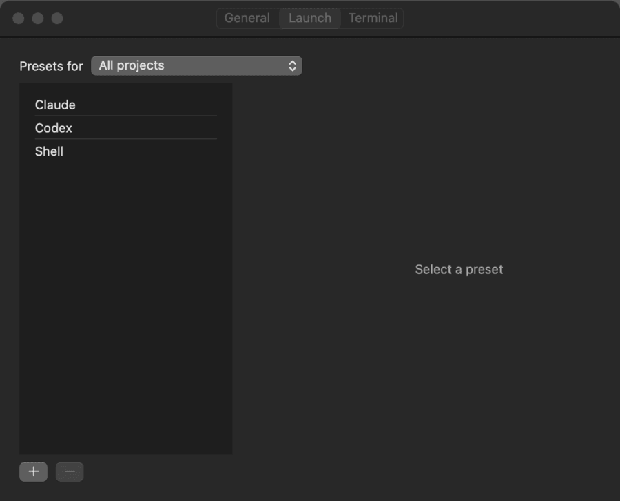
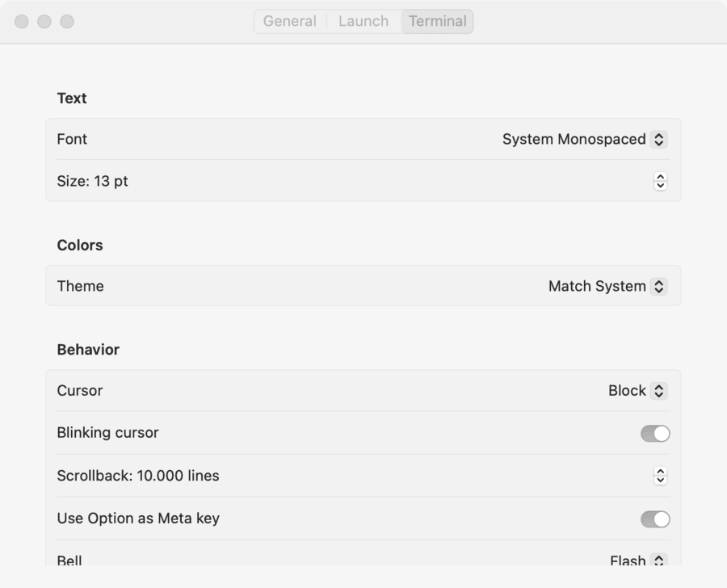 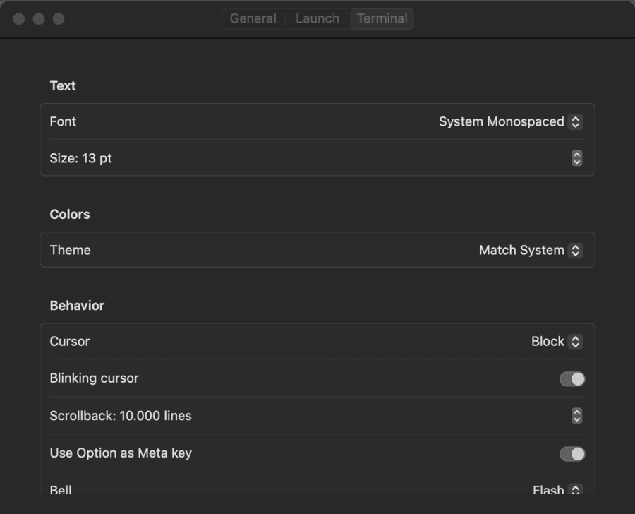

**What works.** Grouped forms, appearance-following terminal themes with a Match System default, per-project presets
with a project default, environment variables.

- **ST-1 · P1 · Settings live in two places, and Settings has the least of them.** General has two toggles
  (`SettingsWindow.swift:61-67`); notifications, sound, reminders, sidebar, auto-hide, order, floating panel and Phone
  Access are only in the popover's ⚙︎ menu (`PopoverView.swift:221-250`). A user who presses ⌘, to turn off
  notifications won't find them. *Fix:* Settings tabs **General** (launch at login, open window, order, floating
  panel), **Notifications** (needs input, finished, sound, reminders, quiet while away), **Sidebar**, **Launch**,
  **Terminal**, **Phone**, **Hooks** (status per agent, Install/Uninstall, what it changes). The ⚙︎ menu keeps
  Settings…, Phone Access… and Quit.
- **ST-2 · P2 · Hooks have no home in Settings.** Status and install are only a popover banner and a "Reinstall hooks"
  menu item. *Fix:* a Hooks pane: per agent installed / not installed, config path, Install, Uninstall, "Show what
  changes".
- **ST-3 · P2 · Bad environment lines vanish silently** (`SettingsWindow.swift:197-205` drops lines without "=" or with
  invalid names). *Fix:* a key/value table with validation, or an inline error under the editor.
- **ST-4 · P3 · Launch opens on an empty "Select a preset"** (`settings-launch-dark.png`;
  `SettingsWindow.swift:120-124`). *Fix:* select the first preset. Label + and − (`:107-108`) for VoiceOver.
- **ST-5 · P3 · Fixed 640×480, non-resizable, content scrolls** (Terminal's last row clipped, `settings-terminal-light.png`;
  `SettingsWindow.swift:16-17`, `53`). The tabs are a segmented TabView, not the toolbar-icon tabs Settings windows use.
  *Fix:* `Settings` scene style (toolbar tabs with icons), height fitting each pane.
- **ST-6 · P3 · Scrollback is a stepper of 1,000 over 1,000–100,000** (`SettingsWindow.swift:249-250`). *Fix:* a picker
  (1k, 10k, 50k, 100k, unlimited) or a text field.

## Phone Access window

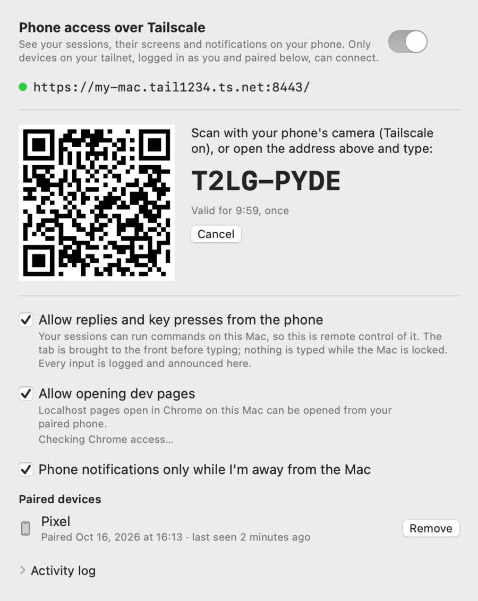 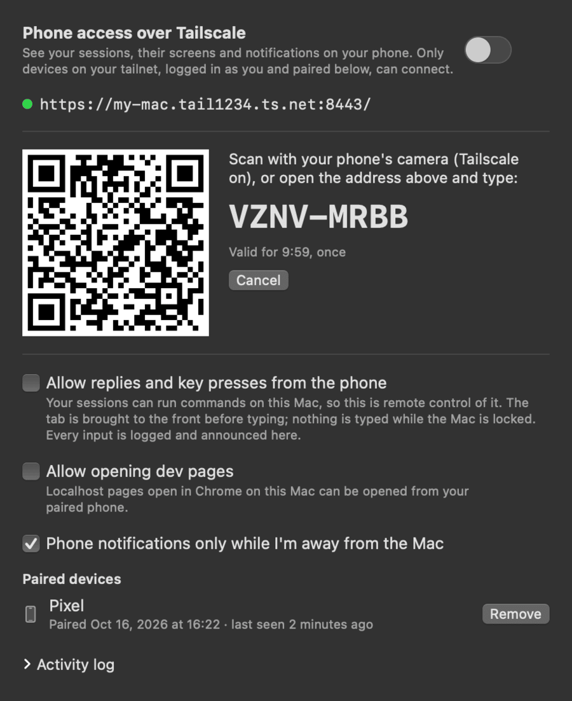

**What works.** Clear security framing; QR plus typed code with a live expiry; explicit second switch for remote
input; device list with last seen; activity log.

- **PA-1 · P3 · Mixed control styles**: a switch for the main toggle, checkboxes for the rest
  (`PhoneAccessView.swift:12-46`). *Fix:* switches throughout (System Settings style), or a grouped `Form`.
- **PA-2 · P3 · "Chrome access: allowed ✓" in green** (`PhoneAccessView.swift:60`) uses colour and a glyph for a
  non-event. *Fix:* secondary text, no colour, when all is well.

## Onboarding and first run

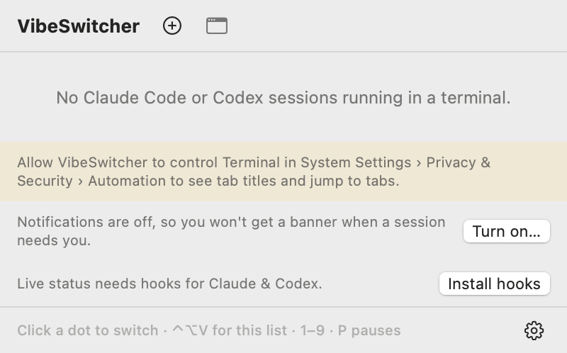 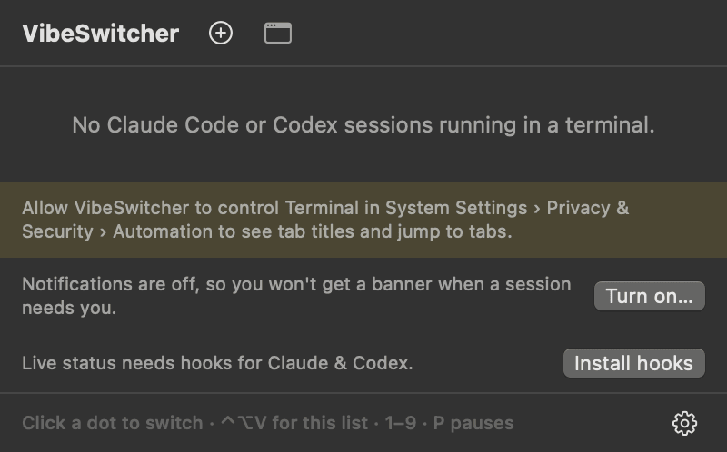
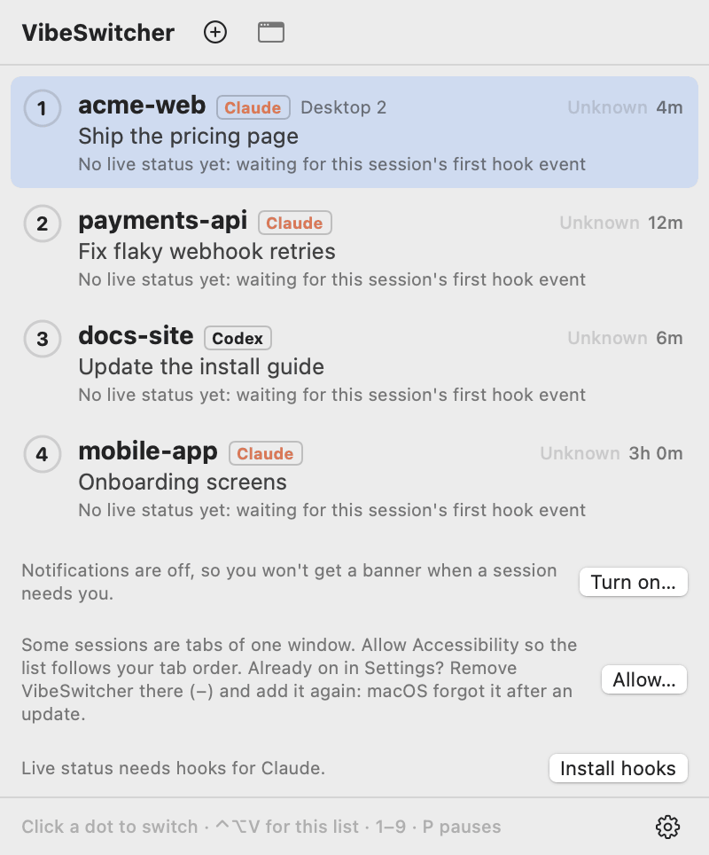 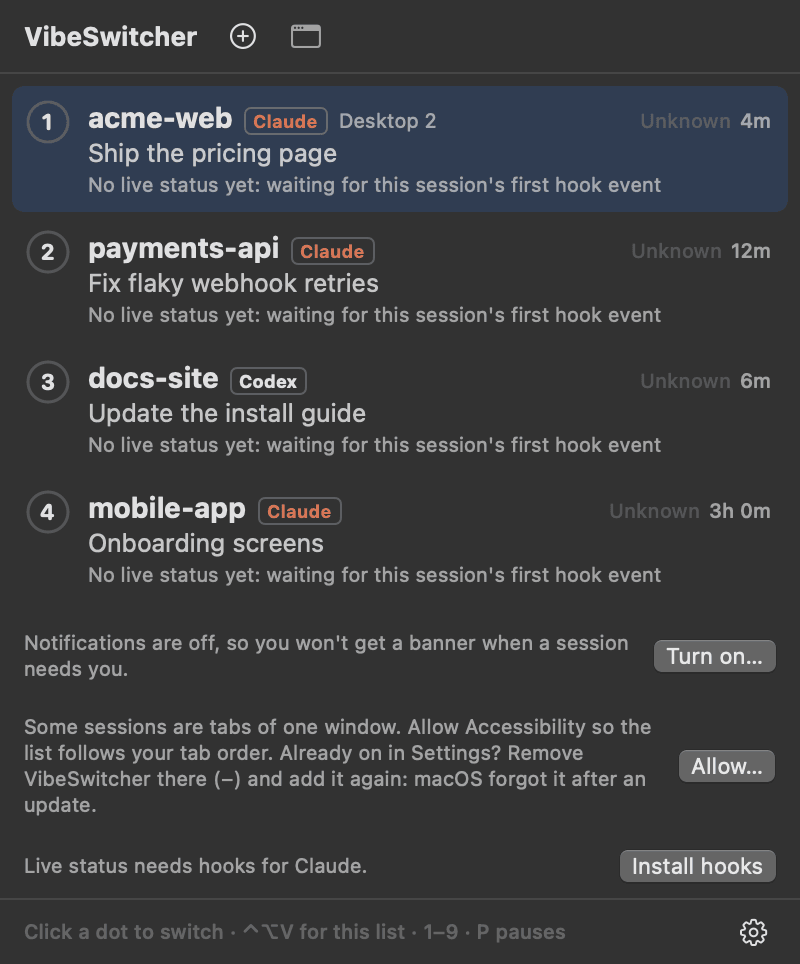

Rendered with the harness: no sessions, hooks missing for both agents, Terminal automation denied, notifications off;
and a second state with sessions found but no hooks (every row Unknown) and the Accessibility banner.

**What works.** Each missing permission has a sentence explaining why; Install hooks is one click; the README explains
everything.

- **ON-1 · P1 · There is no onboarding.** On first launch the app registers itself as a login item without asking
  (`Preferences.swift:74-78`, called at `AppDelegate.swift:110`), fires the notification permission prompt with no
  context (`AppDelegate.swift:111`), and shows a generic terminal glyph in the menu bar. Everything else (hooks, which
  edit `~/.claude/settings.json` and `~/.codex/hooks.json`; Terminal automation; Accessibility) is discovered by opening
  a popover and reading caption text. Best-in-class menu bar apps (Raycast, Bartender, CleanShot) open a short welcome
  window. *Fix:* a 3–4 step welcome window on first launch: (1) what VibeSwitcher does, with the dot legend; (2)
  install hooks, saying exactly which files change and that a backup is kept, with an Install button; (3) permissions
  one at a time with live status (Notifications, Control Terminal, Accessibility) and "Open System Settings"; (4)
  "Launch at login" as an opt-in checkbox and where the icon lives. Re-openable from Help.
- **ON-2 · P2 · Install hooks changes two config files with one click and no preview** (`PopoverView.swift:206`,
  `AppDelegate.swift:813-831`). The result alert is good; the decision isn't informed. *Fix:* a confirmation sheet
  listing the files, the events hooked, the backup path and how to undo.
- **ON-3 · P2 · The Automation banner has no button** (`PopoverView.swift:178-180`), unlike its neighbours. *Fix:*
  "Open Settings…" that opens Privacy & Security › Automation (`x-apple.systempreferences:` URL).
- **ON-4 · P2 · The Accessibility banner is four lines of troubleshooting** ("Already on in Settings? Remove VibeSwitcher
  there (−) and add it again: macOS forgot it after an update.", `PopoverView.swift:192`). *Fix:* "Allow Accessibility
  so tabs follow your order" + [Allow…]; put the reset advice behind "Still not working?".
- **ON-5 · P2 · Without hooks every row is "Unknown" in 1.4:1 grey** and repeats "No live status yet: waiting for this
  session's first hook event" (`firstrun-nohooks-popover-dark.png`). *Fix:* one banner explains it once; rows say "No
  status (hooks not installed)" in secondary text; Codex rows that need a restart say so.
- **ON-6 · P3 · The empty state names the problem but not the next step**: "No Claude Code or Codex sessions running
  in a terminal." (`PopoverView.swift:37`). *Fix:* add [New Session…] and "or start `claude` in Terminal".

## Phone web UI (`Web/`)

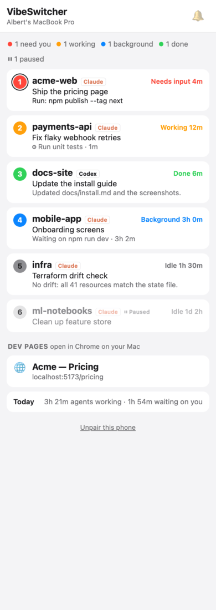 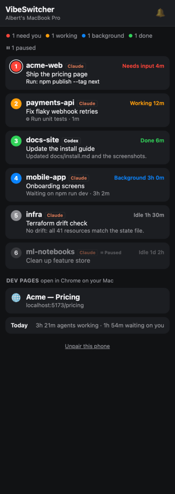
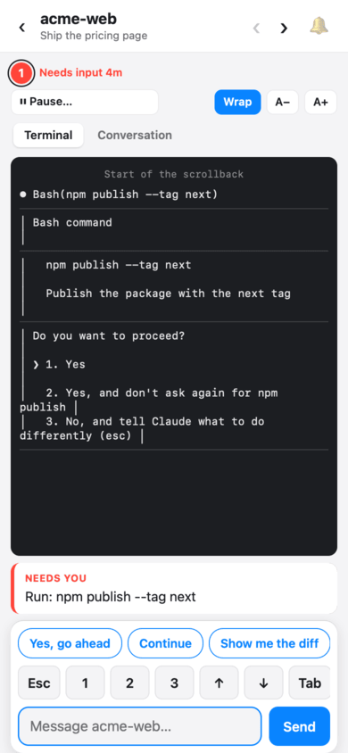 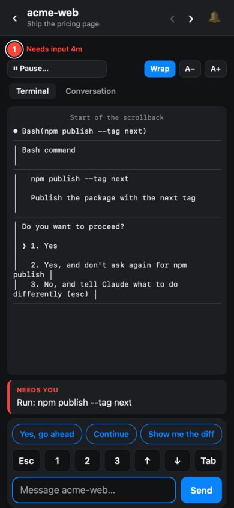
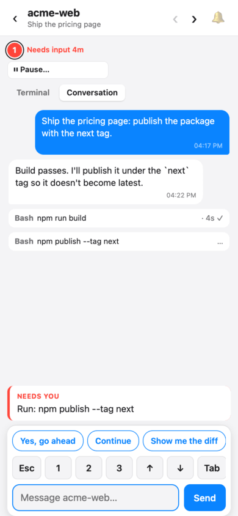 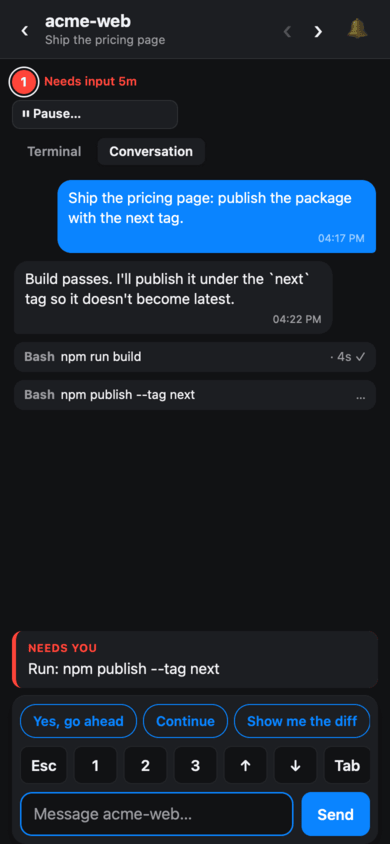
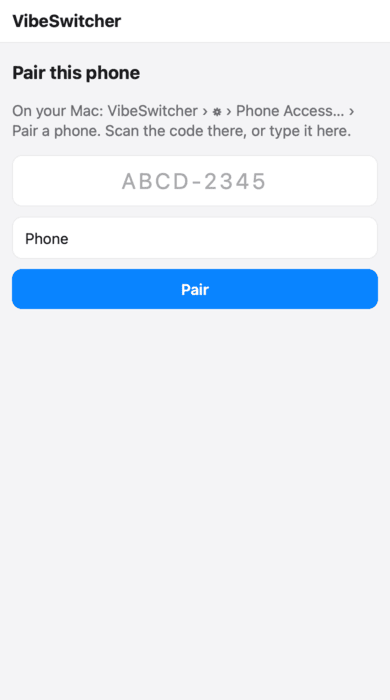  

**What works.** A clean, native-feeling list with the same numbers and colours as the Mac; prev/next between sessions;
Terminal and Conversation tabs; a "Needs you" card with the question; quick replies; key row (Esc, 1–3, ↑↓, Tab, ⏎,
⌃C); a clear offline banner; safe-area handling; text inserted with `textContent` only.

- **PH-1 · P1 · A permission prompt isn't offered as buttons.** The Needs-you card shows only "Run: npm publish --tag
  next" (`app.js:376`); to answer, you read the wrapped terminal box above it, where wrap (on by default, `app.js:307`)
  breaks the box drawing ("publish │"), and press 1, 2 or 3 in the key row. The quick replies right under it ("Yes, go
  ahead") look like answers but, during a menu, only fill the text box (README). The Mac's answer card already parses
  these menus (`ScreenMenu`). *Fix:* send the parsed menu in `/api/state` and render it in the card as full-width
  option buttons (with descriptions), the selected one highlighted; hide quick replies while a menu is up.
- **PH-2 · P2 · Light mode uses the dark-mode status palette.** `#30d158` and `#ff9f0a` text on white cards is 2.0:1
  (`style.css:57-58`, `app.js:5-7`); white numbers on those badges are also about 2:1. *Fix:* light-mode values
  (`#248A3D` green, `#C93400` orange, `#0066CC` blue, `#D70015` red) under `prefers-color-scheme: light`; dark text in
  orange and green badges.
- **PH-3 · P2 · Touch targets are under 44 pt**: header icon buttons (22 px glyph + 4/8 px padding, `style.css:21`),
  chip buttons about 28 px tall (`:86-87`), key row about 36 px (`:108-109`), prev/next arrows. *Fix:* 44×44 minimum hit
  areas (padding or `min-height`), keep the visual size.
- **PH-4 · P2 · VoiceOver isn't told when a session needs you.** The ask card has no `role="alert"`/`aria-live`
  (`index.html:91-94`); status is a coloured badge plus text in a `button` whose name is the whole row. *Fix:*
  `aria-live="assertive"` on the ask card, `aria-label` per row ("1, acme-web, needs input, 4 minutes").
- **PH-5 · P3 · Emoji and text glyphs as icons**: 🔔 dimmed by opacity for "off" (`style.css:22-23`), "‹ ›" for
  navigation, "⏸ Pause…", "⚙". They render differently per platform and the bell's state is opacity only. *Fix:*
  inline SVG icons; a crossed bell for off with a label.
- **PH-6 · P3 · Conversation bubbles show raw markdown** ("`next`", `app.js:620`). *Fix:* a tiny safe renderer for
  code spans, bold and lists, built with DOM nodes (keeps the `textContent` rule).
- **PH-7 · P3 · No visible focus styles and `:active` opacity as the only press feedback** (`style.css:45`, `110`).
  *Fix:* `:focus-visible` outlines; a pressed background.
- **PH-8 · P3 · Tabs are `role="tab"` without `aria-controls`/`tabpanel` or arrow-key support** (`index.html:80-83`).
- **PH-9 · P3 · Replying is silently unavailable for sessions in other terminal apps**: composer and the "Replying is
  off" note are both hidden when `inTerminal` is false (`app.js:379-381`). *Fix:* "Replies work for Terminal and
  window sessions; this one runs in iTerm".

---

## Accessibility

### VoiceOver labels and roles

There is one `accessibilityLabel` in the app (`AgentMark.swift:60`, which names the agent but drops the status dot,
so status is never spoken from the window list). Toolbar items have `accessibilityDescription`
(`MainWindowController.swift:463`, `472`). Everything else relies on SwiftUI's guess from the SF Symbol name plus
`.help`, which VoiceOver reads as help text after a delay, not as the name. Icon-only controls with no label:

| Control | File:line | Read today (roughly) | Should say |
| --- | --- | --- | --- |
| Menu bar status item (dots image) | `AppDelegate.swift:131`, `:219`; `StatusStyle.swift:41-67` | "VibeSwitcher" or nothing | "VibeSwitcher, 7 sessions, 1 needs input…" |
| Popover: open window | `PopoverView.swift:99` | "macwindow" | "Open VibeSwitcher window" |
| Popover: new session menu | `PopoverView.swift:158-160` | "Add" | "New session" |
| Popover: settings menu | `PopoverView.swift:245-247` | "gear" | "Settings and options" |
| Popover/sidebar row status | `PopoverView.swift:435-466` (badge colour) | number only | "Needs input" (sidebar has no word at all) |
| Pill dots | `FloatingPanel.swift:87-104` | "3" | "3, docs-site, done" |
| Pill: show list | `FloatingPanel.swift:108-110` | "list bullet" | "Show all sessions" |
| Header: Terminal / Chat segments | `SessionHeaderView.swift:30-31` | "terminal", "bubble…" | "Terminal", "Chat" |
| Header: more | `SessionHeaderView.swift:38` | "ellipsis circle" | "More actions" |
| Header: open in Terminal | `SessionHeaderView.swift:69` | "arrow up forward app" | "Open in Terminal" |
| Header: end session | `SessionHeaderView.swift:74` | "stop circle" | "End session" |
| Header: resume / remove | `SessionHeaderView.swift:78`, `:81` | "arrow clockwise", "trash" | "Resume", "Remove from list" |
| List: clear filter | `SessionListView.swift:68` | "xmark circle fill" | "Clear filter" |
| List: section ⊕ | `SessionListView.swift:236-237` | "Add" | "New session in <project>" |
| List: runs-in-Terminal glyph | `SessionListView.swift:146` | "macwindow" | "Runs in Terminal" |
| Inspector: copy session id | `InspectorView.swift:94` | "doc on doc" | "Copy session ID" |
| Chat search: previous / next | `ChatView.swift:396-397` | "chevron up/down" | "Previous match", "Next match" |
| Composer: attach | `ComposerView.swift:59` | "paperclip" | "Attach files" |
| Composer: stop | `ComposerView.swift:78-82` | "stop fill" | "Stop the agent" |
| Composer: send / steer | `ComposerView.swift:84-90` | "arrow up" / "arrow turn down right" | "Send" / "Steer" |
| Composer: remove attachment | `ComposerView.swift:379-382` | "xmark circle fill" | "Remove <file>" |
| Tool path: reveal | `ToolViews.swift:223` | "arrow up forward square" | "Reveal in Finder" |
| Settings: add / remove preset | `SettingsWindow.swift:107-108` | "Add", "Remove" | "Add preset", "Remove preset" |

Tap gestures that aren't buttons (not focusable, no role, no keyboard): image thumbnails (`ToolViews.swift:349`,
`ChatView.swift:611`, `LeadViews.swift:192`), palette rows (`CommandPalette.swift:101`), completion rows
(`ComposerView.swift:193`), title double-click to rename (`SessionHeaderView.swift:19`). Answer card options are
buttons but have no number shortcut and no focus ring (`ChatView.swift:522-540`).

- **AX-1 · P1 · Label every icon-only control** in the table above with `.accessibilityLabel` (SwiftUI) or
  `setAccessibilityLabel` (AppKit), and give the status item a label and a live value.
- **AX-2 · P1 · Status must be spoken and not colour-only**: add the state to `AgentMark`'s label ("Claude, needs
  input"), the popover/sidebar rows and the pill; add shape redundancy in the menu bar (`MB-2`).
- **AX-3 · P2 · Turn tap gestures into buttons** with labels and `.accessibilityAddTraits(.isButton)`; make palette
  and completion rows real buttons.

### Text size

macOS has no system-wide Dynamic Type for AppKit apps, but text styles still matter: they follow the sidebar size
setting, accessibility zoom habits and future scaling, and they keep the hierarchy consistent. The app sets **171
fixed `.system(size:)` fonts and 35 text styles**; **38 of the fixed sizes are 9–10.5 pt** (badges, timestamps, hints,
steering notes). Only the chat (⌘+/−, 10–22 pt, `MarkdownView.swift:5-15`) and the terminal scale.

- **AX-4 · P2 · Use text styles and an 11 pt floor.** Map sizes to `.body` (13), `.callout` (12), `.subheadline` (11),
  `.caption` (10) and stop below 11 for anything meant to be read; apply the chat's ⌘+/− factor to the list,
  inspector and popover too (one "Text size" in Settings).

### Contrast of status colours

Computed with WCAG 2 relative luminance against the backgrounds the app draws on (popover ≈ `#ECECEC` light, `#323232`
dark):

| Pair | Ratio | Where |
| --- | ---: | --- |
| White on systemOrange / systemGreen (light) | 2.20 / 2.22 | Number badges (`PopoverView.swift:450-452`), pill, web badges |
| White on systemOrange / systemGreen (dark) | 2.06 / 2.02 | same, dark |
| White on systemRed / systemBlue (light) | 3.55 / 4.02 | badges |
| systemOrange / systemGreen label on light popover | 1.86 / 1.88 | "Working", "Done" (`PopoverView.swift:365`), lead strip "1 question for you" (2.0) |
| systemRed / systemBlue label on light popover | 3.00 / 3.40 | "Needs input", "Background" |
| "Idle" grey 55 % / "Unknown" grey 35 % on light | 1.68 / 1.37 | `StatusStyle.swift:12-13` |
| "Idle" / "Unknown" on dark | 2.38 / 1.75 | same |
| Tertiary label on light / dark | ≈1.9 / ≈2.2 | footer hints, durations, steering notes |
| Web `#30d158` / `#ff9f0a` on white | 2.02 / 2.06 | `style.css:57-58` |
| Web muted `#6e6e73` on `#f4f4f6` | 4.62 | passes |

- **AX-6 · P2 · Fix the status palette for text.** Keep the bright system colours for dots, but use darker variants
  for text on light backgrounds (orange `#C93400`, green `#248A3D`, ≥4.5:1) and dark glyphs inside orange/green badges.
  Draw Idle and Unknown at full opacity with `.secondaryLabelColor` instead of alpha. Respect Increase Contrast
  (`accessibilityDisplayShouldIncreaseContrast`) by switching to the high-contrast variants and solid backgrounds in
  the popover and sidebar (`.regularMaterial` today, `PopoverView.swift:89`).

### Reduced motion

No code reads Reduce Motion (`grep accessibilityReduceMotion|ShouldReduceMotion` finds nothing; Reduce Transparency
and Increase Contrast aren't read either). Motion in the app:

- Sidebar slide in/out on hover and on every desktop switch (`Sidebar.swift:285-322`, `AppDelegate.swift:169`).
- Inspector collapse animation (`MainWindowController.swift:499`).
- Animated chat scrolling to the bottom, to search matches and on "Latest" (`ChatView.swift:190`, `214`, `216`).
- Tool group expansion (`ToolViews.swift:20`) and the visual bell flash (`TerminalPane.swift:331-334`).
- Elapsed counters re-rendering every second in the popover and chat (`PopoverView.swift:367`, `386`;
  `ChatView.swift:331`), which also makes VoiceOver re-announce rows.

- **AX-5 · P2 · Honour Reduce Motion**: read `NSWorkspace.shared.accessibilityDisplayShouldReduceMotion` (AppKit) and
  `@Environment(\.accessibilityReduceMotion)` (SwiftUI); cross-fade or show instantly instead of sliding; no sidebar
  flash on Space switches; jump instead of animated scrolls; tick elapsed times once a minute.

---

## Appendix: screenshot index

| Surface | Light | Dark | Method |
| --- | --- | --- | --- |
| Menu bar icon | `menubar-light.png`, `firstrun-menubar-light.png` | `menubar-dark.png`, `firstrun-menubar-dark.png` | render (3× upscale) |
| Popover (mock) | `popover-light.png` | `popover-dark.png` | render |
| Popover (live data) | `live-popover-light.png` | `live-popover-dark.png` | `--snapshot` |
| Floating pill | `pill-light.png` | `pill-dark.png` | render |
| Sidebar | `sidebar-light.png` | `sidebar-dark.png` | render |
| Window: chat (Activity inspector) | `window-chat-light.png` | `window-chat-dark.png` | render |
| Window: terminal (Overview inspector) | `window-terminal-light.png` | `window-terminal-dark.png` | render |
| Window: answer card | `window-answer-light.png` | `window-answer-dark.png` | render |
| Window: lead, team strip, Team tab, Projects grouping | `window-lead-light.png` | `window-lead-dark.png` | render |
| Window: Terminal session needing input | `window-needs-input-light.png` | `window-needs-input-dark.png` | render |
| Window: ended session | `window-ended-light.png` | `window-ended-dark.png` | render |
| Window: start page | `window-start-light.png` | `window-start-dark.png` | render |
| Window: no sessions | `window-empty-light.png` | `window-empty-dark.png` | render |
| Window: live, Projects grouping | `live-window-projects-light.png` | (system is light) | `--capture-window` (terminal text not drawn) |
| Window: Claude status line (user's screenshot, cropped) | `live-statusline-garbled.png` | | user screenshot |
| ⌘K palette | `palette-light.png` | `palette-dark.png` | render |
| Settings: General / Launch / Terminal | `settings-*-light.png` | `settings-*-dark.png` | render |
| Phone Access window | `phone-access-light.png` | `phone-access-dark.png` | `--snapshot` / render |
| First run: nothing set up | `firstrun-popover-light.png` | `firstrun-popover-dark.png` | render |
| First run: sessions, no hooks | `firstrun-nohooks-popover-light.png` | `firstrun-nohooks-popover-dark.png` | render |
| Phone: list / session / conversation / pair | `web-*-light.png` | `web-*-dark.png` | WKWebView, mock API |
| Phone: offline banner | `web-offline-light.png` | | WKWebView, mock API |

## Top 15 to fix first

Ranked by how many users hit it and how badly.

1. **WX-1 · P1** ⌘W ends the session (no confirmation when idle). Make ⌘W close the window; move End Session.
2. **WX-2 · P1** No Undo, Redo or Cut in the menu bar: ⌘Z/⇧⌘Z/⌘X do nothing in the composer. Add the standard Edit menu.
3. **ON-1 · P1** No onboarding; silent login item; context-free permission prompts. Add a short welcome window.
4. **ST-1 · P1** Settings split between ⌘, and the ⚙︎ menu. Move notifications, sidebar, order, pill, phone and hooks into Settings.
5. **WT-1 · P1** A Terminal session needing you dead-ends at a read-only mirror. Make the action "Open in Terminal", or answer it like the phone does.
6. **PH-1 · P1** The phone shows permission menus as a broken terminal box plus number keys. Send the parsed menu and render buttons.
7. **MB-1 / AX-1 · P1** No VoiceOver label for the menu bar icon and 20+ unlabeled icon buttons. Label them.
8. **AX-2 / MB-2 / SB-1 · P1** Status by colour alone in the menu bar, sidebar and pill. Add words, labels and shape redundancy.
9. **WL-3 · P2** Five vocabularies for one state model. One glossary and one duration format everywhere.
10. **AX-6 / PH-2 / PI-1 · P2** Status text and badge numbers at about 2:1. Darker text variants, dark glyphs in orange/green badges.
11. **WL-1 · P2** Ended workers, verifiers and test projects clutter the list; exit 129 looks like a failure. Prune with the lead's cleanup, collapse "Ended", reword signals.
12. **WT-2 · P2** Claude's status rows garbled in the window: confirm the column count against Terminal.app, log resizes, offer a wide-terminal focus mode.
13. **WI-1 · P2** Activity repeats the chat with raw markdown and raw tool names. Show files, commands and cost instead.
14. **WC-1 · P2** Answer card numbers aren't keys. 1–9 to choose, ⏎ to confirm, focus ring on options.
15. **AX-5 · P2** No Reduce Motion handling (sidebar slides on every Space switch). Respect it everywhere.
