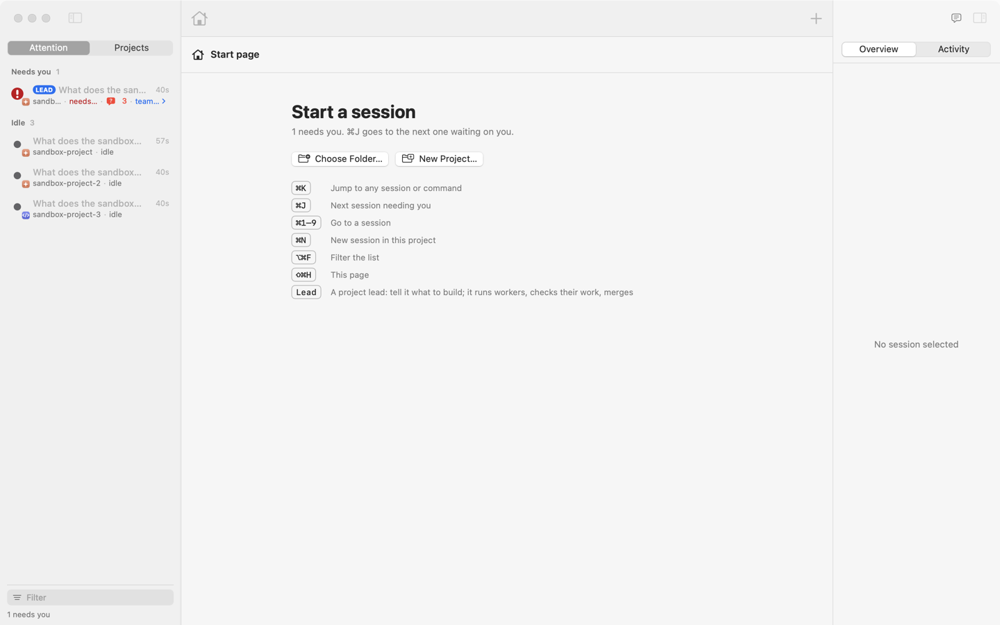

# Everyday use

The menu bar, the main window, the chat, notifications and the command line.

## Statuses

| Status | Mark | Meaning |
| --- | --- | --- |
| Needs you | red, with "!" | Blocked on you: a permission prompt, a question, a plan to approve. |
| Working | orange arc | Thinking or running tools. |
| Background | blue half ring | The turn ended, but work it started still runs (the row says what, and for how long). |
| Done | green check | Finished a turn you haven't looked at yet. |
| Idle | grey dot | Finished and already seen. |
| Unknown | empty ring | No hooks and no readable title yet. |
| Paused | grey, two bars | You paused it: no alerts until you resume it. |

How the status is worked out is in [Architecture](architecture.md#how-status-is-detected).

## The menu bar

One dot per session. They're ordered by desktop (Desktop 1 first, as Mission Control orders them), then windows in
reading order and tabs in tab order; Settings › General switches to oldest first. Up to 4 dots fit in one row, then two
rows of smaller dots, 12 at most.

- Click a dot to jump to that session's Terminal tab (or its place in the window). Hover it to see which one it is.
- Right-click, or press ⌃⌥V anywhere, to open the list; pick a row with a click, 1–9 or ↑↓ ⏎.
- ⌘-click opens the main window.
- At the bottom of the list, **Today** shows how long agents were working today and how long sessions waited on you.
  Waiting counts only while you're at the Mac, and a finished turn counts for its first 30 minutes at most.

On a notched MacBook, macOS hides status icons that don't fit. If VibeSwitcher's is hidden, a floating pill with the
same dots appears; Settings › General sets it to Always or Never.

**Sidebar mode** (Settings › General, or the list's ⚙︎ menu) puts the list on the right edge of the screen, on every
desktop. It slides in when the mouse touches the middle of that edge and slides away when it leaves.

## The main window



- **The list** (left) groups sessions by what needs you or by project (⌃⌘1, ⌃⌘2); ⌥⌘F filters it. A lead's workers
  and verifiers fold under the lead.
- **The middle** shows the session's terminal (⌥⌘1) or its chat (⌥⌘2). For a session running in Terminal it shows a
  read-only mirror with **Open in Terminal** (⌘O).
- **The inspector** (right, ⌥⌘0) has Overview (status, folder, times, session id), Activity (prompts, replies and
  tools from the transcript) and, for a lead, Team.

Shortcuts: ⌘K jumps to any session or command; ⌘J goes to the next session waiting on you; ⌘1–9 to a session; ⇧⌘H to
the start page; ⇧⌘↩ gives the terminal the whole window. ⌘W closes the window and never ends a session. **End
Session…** (⇧⌘⌫) always asks first.

### Starting sessions

- **⌘N** starts a session in the selected session's project; **⌥⌘N** opens a plain shell there.
- With nothing selected, or from the start page's **Choose Folder…**, you pick a folder. In a git repository that
  starts the folder's project lead (or shows the one already running). A folder that isn't a repository offers to make
  one. Pick a preset first to start that preset instead.
- **New Project…** asks for a name, a location (the projects folder from Settings › General, `~/dev` by default) and
  an optional first goal. It makes the folder with a git repository, a README.md, a .gitignore and a first commit, and
  can start a session or the project lead in it.
- Launch presets (Settings › Launch) set the command, flags, environment and whether it runs in the window or in
  Terminal.

New sessions run in the window by default, in the session host, which keeps them running when VibeSwitcher quits,
crashes or updates. Sessions you run in Terminal are listed too and open there; **Move to Window** brings one into the
window between turns.

### Pause and rename

Right-click a row › **Pause**: until you resume it, for 1 hour, until tomorrow morning, or for a week. A paused
session stays in its place, greyed out, sends no notifications, and its waiting doesn't count in Today. Pausing can
also minimise its Terminal window to the Dock (Settings › General). Pauses survive restarts. **Rename…** gives a
session your own name.

## The chat

⌥⌘2 shows any Claude or Codex session as a conversation, built from its transcript and followed live.

- Replies are rendered markdown, with code highlighted and a Copy button. The tool calls between two messages fold
  into one line ("Ran 3 commands · edited 2 files") that opens to each command, its output and the diffs.
- Questions, permission prompts and plan approvals show as cards. Answer with a click, ⌘1–⌘3, or ↑↓ ⏎ when the
  message box is empty.
- ⌘F searches the chat; ⇧⌘E exports it as markdown.
- In a window session the composer types into the session: ↩ sends, ⇧↩ adds a line, ↑ recalls earlier prompts,
  `/` completes commands and `@` files. Pasted or dropped images and files are attached.
- While the agent works, ↩ **steers** it: the message reaches it at its next step without stopping it. ⌥↩ queues the
  message for the end of the turn instead; ■ (⌘.) stops the turn.
- A shell code block in a reply has a **Run** button, which types it into the session as a `!` command. Anything more
  than one plain line is shown in full and asks first; a multi-line block runs as one private script file. A block
  with hidden characters or a heredoc gets no Run button.

Claude Code may show `Ran 1 stop hook` / `Stop hook feedback: [VibeSwitcher · messages, v2] …` when a message arrives
as a turn ends. That is the message being delivered, not an error ([docs/eval/stop-hook-shapes](../eval/stop-hook-shapes/README.md)).

## Notifications

- A banner when a session needs you (with a sound) or finishes. It says what's asked: the question, the exact command
  waiting for approval ("Run: npm publish"), or the plan's title. A finished session shows the start of its last
  message. Click it to go to the session.
- One reminder if a session has waited on you for 10 minutes, or a working session has shown no progress for 15
  minutes (`Sources/VibeCore/Attention.swift`). Reminders wait while you're away from the Mac (screen locked, or no
  input for 5 minutes).
- The session you're looking at (its Terminal tab in front, or selected in the window) raises no banner or reminder.
- Workers and verifiers never notify you. A lead notifies you for its questions, for an all-done card and for a merge
  held up because its branch moved.
- Credentials in commands and messages (tokens, passwords, API keys, bearer headers, private keys, webhook URLs) are
  masked before they're stored or shown.

Choose which you get in Settings › General.

## Briefings

**Brief me** (the speech-bubble button, or ⇧⌘B) tells you in about 30 seconds what happened across every project
VibeSwitcher leads: what landed, what's stuck, what waits on you. It covers what's new since your last briefing, or the
last 3 hours if that's longer. It's written by Claude (`claude -p` with Haiku and no tools) from each lead's progress
log and board, redacted first, in 70–90 words, in the language set in Settings › General › Briefing. Without Claude,
a plain English summary of the same notes is shown.

It's read aloud by ElevenLabs when you've saved an ElevenLabs API key in Settings, else by the Mac's own voice. The text
goes to ElevenLabs only when you press Brief me, Play or Test voice. The key is kept only in your login keychain.

## The command line

`VibeSwitcher` here is `/Applications/VibeSwitcher.app/Contents/MacOS/VibeSwitcher`.

```sh
VibeSwitcher --lead ~/dev/app --goal "add a login page"   # start (or message) the project lead of that repository
VibeSwitcher --new claude ~/dev/app        # start a preset (a name, or claude/codex/shell); --terminal: in Terminal
VibeSwitcher --window [palette|home]       # open the window (with the palette, or on the start page)
VibeSwitcher --window select:TEXT          # … and select the first session matching TEXT
VibeSwitcher --window move:ttys012         # move that Terminal session into the window (between turns)
VibeSwitcher --open ttys012                # open a session, as clicking its row does
VibeSwitcher --focus ttys012               # select a Terminal tab directly
VibeSwitcher --toggle                      # open or close the list (bind it in Raycast and the like)
VibeSwitcher --settings [TAB]              # open Settings
VibeSwitcher --install-hooks | --uninstall-hooks
VibeSwitcher --dump                        # detected sessions and raw hook state
```

A goal sent with `--lead` reaches the lead marked as not vouched for, since any process can send one.
