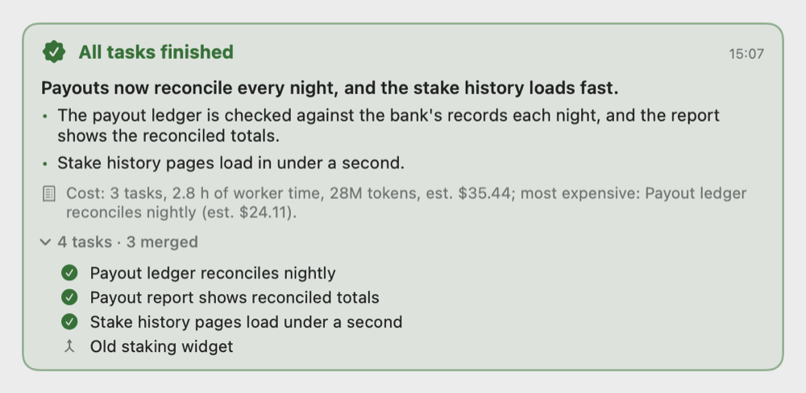

# The project lead

A project lead is one Claude Code session per git repository that you talk to about the project. It plans the work,
runs a small team of Claude sessions to do it, checks what they did and merges what passes. You decide what to build;
it handles the rest and asks you only what's yours to decide.

## Starting a lead

- In the window: the start page's **Choose Folder…**, ⌘N with nothing selected, ⌘K, or the ⊕ menu's Project Lead.
  Picking a folder in a git repository starts its lead, or shows the one already running. A folder that isn't a
  repository offers to make one; a repository with no commits offers to make a first commit.
- **New Project…** makes a new repository and can start its lead with a first goal.
- From a shell: `VibeSwitcher --lead FOLDER [--goal "…"]` starts the lead of the repository holding FOLDER, or sends
  the running lead the goal.

A new lead first reads its status, the project's `workflow.md` notes, `decisions.md` and the end of `progress.md`.
With a goal, it plans tasks, starts workers and tells you its plan; without one, it greets you in a line.

The lead's branch (its base) is the one checked out when it first starts in the repository; `base_branch:` in
`workflow.md` changes it. Workers start from it and their work is merged into it. The lead never pushes.

## How a lead plans: the task contract

The lead turns what you ask for into tasks on its board. Each task has a contract:

- **goal**: what should be true when it's done;
- **acceptance**: the checks, focused tests or things to look at that show it works;
- **boundaries**: the files and areas the worker may change;
- **context**: what the worker needs to know.

A task can also have a review level (below), an `after` list (tasks that must be done first), its own time budget
(`budget_min`) and `auto_advance: false` to keep it out of automatic moves. The lead changes a task with
`update_task`, and its states are planned, running, blocked, failed, kept, folded, abandoned and merged. A task made by
mistake that never ran can be removed.

## Workers

The lead starts each task's **worker**: a Claude session in its own git worktree,
`.vibeswitcher/worktrees/<task>`, on the branch `agent/<task>`. At most `max_workers` (3 by default) run at once in a
project. The worker gets the contract and the user's working policy, runs `init_command` (if set) first, and:

- owns the change through completion, making the routine calls itself and listing them in its report;
- asks the lead (`ask_lead`) only about direction, scope or anything risky;
- notes milestones with `progress` (shown on its task's line in the Team tab);
- runs the tests its change affects; the merge runs the full suite;
- reports `done` with evidence for each acceptance check, `blocked`, or `over_budget`.

**Time budget.** A task's budget is `task_budget_min` (120 minutes by default; 0 means none) unless it sets its own.
Only the worker's working time counts: not waiting on a prompt, the lead, you or a test slot, and not audits. When it's
reached, the worker is told to commit what works and report `over_budget` with what works, what's missing and a
proposal. Nothing is stopped; the lead extends the budget, re-plans or abandons the task.

Workers can't push, move refs, rebase other branches, or check out the lead's branch: Claude Code's permission rules
deny it. A worker brings its branch up to date by merging the base in.

## Review levels and audits

Each task has a review level:

- **none** (the default): the merge takes the worker's done report on the branch's head, and the merge's own test run
  is the check.
- **audit**: a read-only **verifier** checks the work against the contract with real commands and tries to break it.
  Only work it passes merges. The lead picks this for security, irreversible operations or complex changes.

Some tasks are audited whatever their level says:

- a branch that touches `sensitive_paths` (by default `.claude/`, `.mcp.json`, `CLAUDE.md`, `CLAUDE.local.md`,
  `AGENTS.md`, `.github/`, `.env`, `.env.*`, `*.entitlements`, `*.pem`);
- a review-none task whose diff is over `risk_lines` (400) lines.

The Team tab shows such a task as **Needs audit**, with why.

**Findings.** A verdict comes with findings, each at a file and line with its evidence, and a severity:

- **Important** blocks the merge until it's fixed or dismissed;
- **Nit** never blocks and never becomes a task by itself;
- **Pre-existing** never fails the task.

The lead resolves each Important finding: the worker fixes it and a re-audit checks only those findings; or
`dismiss_finding` closes it with a reason; or it becomes a task of its own.

**The round cap.** After 2 audit rounds that failed or left Important findings open, the task's status says
"reconsider the approach". The lead doesn't send it back for a third round. It re-plans it, asks you, or **re-rolls**
it: the worker stops, its branch is kept as `archive/<task>-<n>`, and a fresh worker starts from the base with a
summary of the findings and answers so far.

**Several finders.** With `audit_finders: 2` or `3`, an audit runs that many verifiers, each with its own focus
(contract and acceptance; bugs and regressions; security or the tests). The audit builds and tests the commit once and
hands every finder the logs. Findings most finders raised stay open; the rest show as **unconfirmed** and never block.
New Nits past `audit_nit_cap` (5) are left out and counted. Each finder counts against the Mac-wide session limit.

A verifier ends itself 20 seconds after it submits its verdict. The app ends every worker and verifier session of a
task that merged, was folded, abandoned or cleaned up.

## The merge gate

`merge` takes exactly the commit the verifier passed (or, for review none, the commit the worker reported done on),
then:

1. rebases it onto the lead's branch in a worktree no agent works in (squashed into one commit if the worker merged
   the base in);
2. runs `init_command`, then `test_command`, then `regression_command` if set, each within `test_timeout_min` (45
   minutes);
3. fast-forwards the lead's branch to exactly what was tested. Never a merge commit, never a force.

It refuses while an Important finding is open, while the task is **kept** (held back with a reason, such as "don't
merge until I've looked"), when the lead's branch was moved by something other than its own merges, or when the
`workflow.md` guard rails differ from what the lead last set.

**Flaky tests.** When tests fail, the failing tests run once more (up to 20 named tests, else the whole command), at
most once per merge, and never after a build error or a `regression_command` failure. If they pass, the merge goes
ahead and each is recorded as a flake, with its evidence in a file. A test that flakes 3 times within 7 days becomes a
task to fix it, once.

**Merge policy** (`merge_policy:` in `workflow.md`), chosen once per project:

- `auto`: work merges once its review passes; the lead then posts what changed, how it was checked and how to revert it.
- `ask_sensitive`: a commit touching `sensitive_paths` waits for you.
- `ask_all`: every merge waits.

Until you choose, the lead asks you once and merges are handled as `ask_sensitive`. A merge that waits needs your
answer "Approve <commit>", which approves that exact commit only. A timer never counts as an approval.

Other endings: **folded** (another task carries its work), **abandoned** (dropped, with a reason), **failed** (tried and
didn't pass). Folded and abandoned tasks don't count as failed.

## auto_advance

With `auto_advance: true` (the default), finished work moves on without waiting for the lead's next turn. The lead's
tool server:

- merges a review-none task reported done (unless the risk check raises it to audit);
- starts an audit task's audit, and merges a clean verdict;
- sends the worker a verdict's open Important findings, once per verdict, never past the round cap;
- retries once a verifier that ended without a verdict;
- sends the worker a failed merge's output;
- cleans up what merged;
- starts a planned task once every task in its `after` list is done, within `max_workers`, the Mac-wide limits and the
  battery hold.

Each step goes through the lead's own tools and checks, lands in the progress log and reaches the lead in one report.
It never moves a task the lead holds: kept, blocked, failed, folded or abandoned. `configure(auto_advance: false)` turns
it off for the project; a task's own `auto_advance: false` opts it out.

## Mac-wide limits

These are set once for the Mac, not per project, in Settings › Project lead, and kept in
`~/.vibeswitcher/mac-limits.json`:

- **Team sessions** (`mac_max_sessions`): the most workers and verifiers of all projects together, 10 by default.
- **Load** (`load_threshold`): the 1-minute load average above which leads start nothing; empty means twice the cores.

The session host counts the live workers and verifiers of every project (the **census**), so every lead sees the same
total. `start_worker` and `audit` refuse at either limit, and the lead gets one message once there's room again. A
project's `workflow.md` lines for these two are ignored.

**Heavy work.** Full test suites, release builds, merges and audits' test runs take a slot from `vs-heavy`, shared by
every project on the Mac. There are `heavy_slots` of them: `VIBESWITCHER_HEAVY_SLOTS`, else the Mac's cores ÷ 4 (3 on a
12-core Mac). A run that finds every slot held waits, naming who holds each.

## The battery hold

On battery, below a set charge, lead work pauses: `start_worker`, `audit`, `merge` and `revert` refuse, and work
already running finishes. The default is 50 %; Settings › Project lead sets it from 10 to 90 %, or never. The lead is
told when the hold starts and ends.

## Questions to you

The lead asks with `ask_user`. Questions show as cards in its chat, in the Team tab and on your phone; answering one
doesn't stop the lead. For a reversible choice, it can propose an answer with a timer ("Going with SQLite in 8 min",
10 minutes by default): pick another option, or **Hold** to stop the timer. When it runs out, the lead goes ahead with
its proposal and records it as its decision. There's never a timer on a blocking question, deleting or discarding
work, a merge of a sensitive path, or anything outward-facing (publishing, pushing, deploying, sending).

You can message the lead any time; your message reaches it at its next step.

## The Team tab, the all-done card, receipts and revert

The inspector's **Team** tab is meant to be glanced at: the lead's open questions, its recent decisions, then each task
in one line with its state and how long it has been in it ("Working 12m", "Rework 1 · 22m", "Needs audit 2m"). Under a
task at work, a dim line says what its agent is doing. Click a task for its checkpoints, report, audit and links to its
sessions. Below are the scorecard, answered questions and the lead's files.

When the board goes from open work to none, with at least one merge since the last one, the lead's chat shows an
**all-done card**: a headline and bullets saying what landed, the batch's tasks, and its cost.

Each merged, folded or abandoned task keeps a **receipt**: working and wall time, tokens and estimated cost for worker
and verifier, audit rounds, re-rolls, merge reruns, tests, your questions and how long they waited, and the rollback
point. Numbers only, no transcript text.

**revert** undoes a merge with one new commit: it runs the tests and fast-forwards, like a merge. Nothing is reset or
rewritten. It refuses if the tests fail or later commits conflict.

## The board and its archive

The board is `.vibeswitcher/board.json` in the repository (git-ignored). Merged, folded, abandoned or reverted tasks
with no worktree left, finished more than 24 hours ago, move to `.vibeswitcher/board-archive.jsonl`, one line each.
Failed tasks stay. Only the lead's tool server moves them: when it starts, and at most once an hour after merges.

## The witness

VibeSwitcher watches the team and tells the lead when a worker waits for input, stops without reporting, or dies, and
when one has stalled:

- it reads as working but its transcript hasn't grown for 15 minutes;
- it's been between turns for 10 minutes without reporting or asking (45 minutes while it waits on a background task
  of its own);
- its transcript ends at a mid-turn compaction for 5 minutes;
- a message has waited in its inbox for 5 minutes.

Reports wake a lead that's between turns: VibeSwitcher types one short prompt into its empty box ("2 new reports …
Call status."), never into your draft or over a dialog. A finished task's session that sits idle for over an hour is
named once an hour as stranded.

## The records

The lead's reasoning lives in the repository, in `records_dir` (`docs/lead` by default): `decisions.md`,
`progress.md`, `incidents.md` and `decisions-archive.md`. The lead can't commit, so its tool server commits these files
to the lead's branch, after each merge and at most every 5 minutes, as "Lead: decisions and progress". Your staged and
unstaged changes are left alone. `archive_decisions` moves old entries to `decisions-archive.md` unchanged. Workers may
not edit that folder.

`workflow.md` (in `.vibeswitcher/`, git-ignored) holds the limits and commands below. The lead changes it with its
`configure` tool, which keeps your comments. The guard rails (the test and setup commands, `merge_policy`,
`sensitive_paths`, `records_dir`, `max_workers`, `heavy_slots`, `audit_finders`, `audit_nit_cap`, `auto_advance`)
count only as the lead last set them: when the file says anything else, `merge` and `start_worker` refuse until the
lead sets them again.

## Your working policy

Every lead, worker and verifier gets your working policy in its prompt. It's one text for all projects, kept in
`~/.vibeswitcher/policy.md` and edited in Settings › Project lead. The default is five rules: one agent owns each
change, affected tests while editing and the full suite once before merging, parallel work with builds and tests
serialized, only material bugs fixed, stop when it works. Running leads are told once when you change it.

## Defaults and where they come from

Each value as the code sets it today. Paths are under `Sources/VibeCore/` unless they say otherwise.

| Setting or rule | Default | Source |
| --- | --- | --- |
| `max_workers` | 3 | `LeadWorkflow.swift:5` |
| `task_budget_min` | 120 min (0: no budget) | `LeadBudget.swift:10` |
| `test_timeout_min` | 45 min | `Worktrees.swift:1052` |
| `audit_finders` | 1 (at most 3) | `LeadWorkflow.swift:38`, `:137` |
| `audit_nit_cap` | 5 | `LeadWorkflow.swift:40` |
| `risk_lines` | 400 | `LeadRisk.swift:23` |
| `auto_advance` | true | `LeadWorkflow.swift:52` |
| `merge_policy` | unset: handled as `ask_sensitive` | `LeadWorkflow.swift:41-42` |
| `sensitive_paths` | the list above | `LeadWorkflow.swift:189` |
| `records_dir` | `docs/lead` | `LeadWorkflow.swift:134` |
| `disk_warning_gb`, `disk_floor_gb` | 10 GB, 3 GB | `LeadWorkflow.swift:23-24` |
| `watch_app_logs` | false | `LeadWorkflow.swift:60` |
| Audit round cap | 2 rounds | `LeadBoard.swift:300` |
| Flake limit | 3 flakes of one test in 7 days | `LeadBoard.swift:1065-1066` |
| Merge reruns | once, up to 20 named tests | `MergeRerun.swift` |
| Question timer (`decide_in`) | 10 min | `LeadBoard.swift:770` |
| Board archive age | 24 h; at most hourly | `LeadBoardArchive.swift:43`, `:45` |
| `mac_max_sessions` | 10 | `MacLoad.swift:112` |
| `load_threshold` | 2 × cores | `MacLoad.swift:119-133` |
| `heavy_slots` | `VIBESWITCHER_HEAVY_SLOTS`, else cores ÷ 4 | `TestLock.swift:85-89` |
| `vs-heavy` timeout | 60 min | `Resources/bin/vs-heavy` |
| Battery hold | below 50 % on battery | `PowerSource.swift:74` |
| Stall: silent, idle, compacted | 15, 10, 5 min | `LeadStall.swift:44-46` |
| Verifier ends after its verdict | 20 s | `Sources/VibeHost/HostServer.swift:83` |
| Records commit | after each merge, at most every 5 min | `LeadRecords.swift:65` |

The rules the lead itself follows (when to audit, when to ask) are in its prompt (`LeadWorkflow.swift`) and in
[docs/process/lead-rules.md](../process/lead-rules.md).
